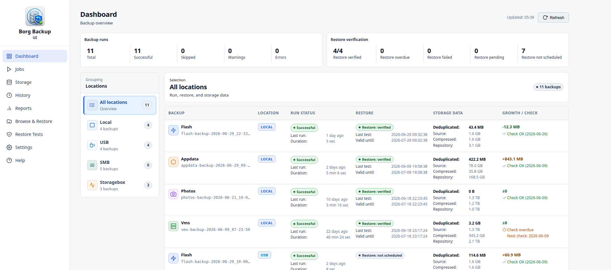
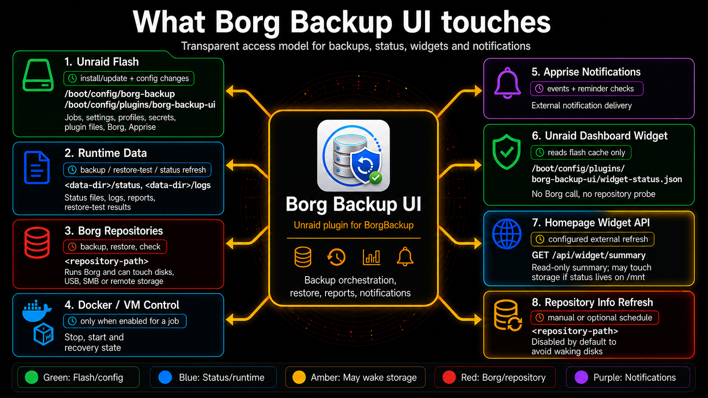
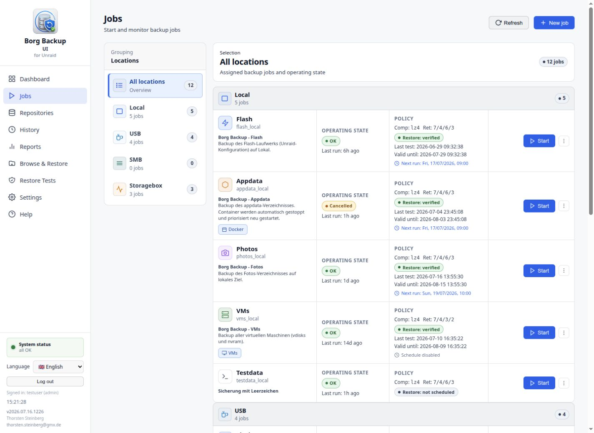
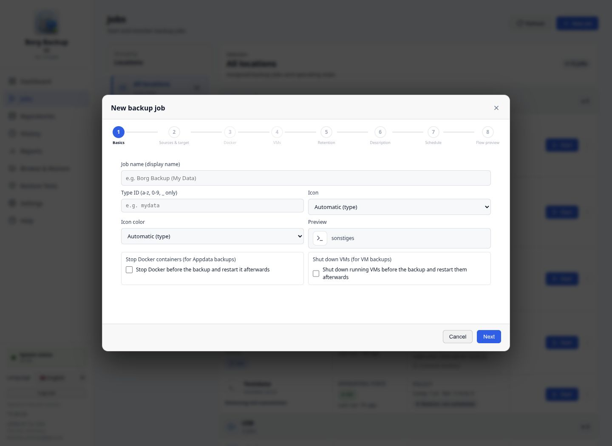
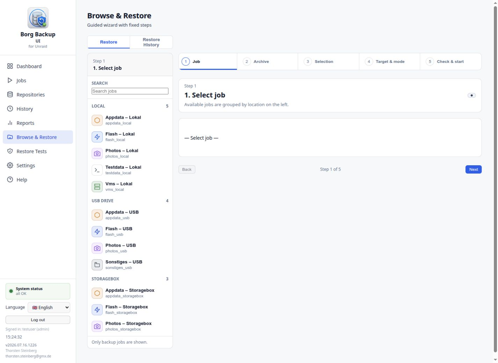
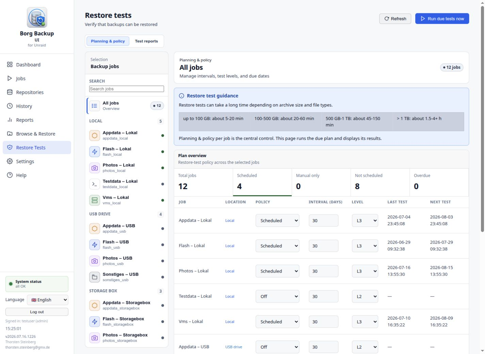

# Borg Backup UI

An Unraid plugin that turns BorgBackup into a guided backup and restore
workflow: configure jobs and repositories, browse archives, verify restores,
review reports, automate optional Pre/Post tasks, and monitor results from one
web interface. The UI and user manuals are available in English and German.

Borg Backup UI is built for Unraid users who want the reliability of BorgBackup
without maintaining custom shell scripts for everyday operation. BorgBackup
remains the backup engine; this project adds the Unraid-focused control layer
around jobs, storage targets, schedules, restore workflows, checks, and support
diagnostics.

[Community Apps listing](https://ca.unraid.net/apps/borg-backup-ui-17vu3jm06a2wie) |
[English manual](https://github.com/borgforge/borg-backup-ui/blob/main/docs/user-manual/en/user-manual.md) |
[Deutsches Handbuch](https://github.com/borgforge/borg-backup-ui/blob/main/docs/user-manual/de/user-manual.md) |
[Unraid support thread](https://forums.unraid.net/topic/198728-plugin-borg-backup-ui-web-ui-for-borg-backup-on-unraid/) |
[Issues](https://github.com/borgforge/borg-backup-ui/issues)

## Documentation

Follow the [German/English tutorial, tasks, reference and concepts](docs/user-manual/README.md).
For an outage, use [Notfallwiederherstellung](docs/user-manual/de/user-manual.md#16-notfallwiederherstellung)
or [Disaster Recovery](docs/user-manual/en/user-manual.md#16-disaster-recovery).
The same manuals are available offline under **Help > User Manual**.

## Feature demo

A walkthrough of reusable Pre/Post scripts, the job wizard, Docker/VM
handling, exclusions, retention, multi-file restores, scheduled restore tests,
and the Prometheus/Grafana integration.

*7:11 minutes | English narration | Recorded with release 2026.10.09.1435.*

[Watch on YouTube](https://www.youtube.com/watch?v=ewaQ4SC4haQ) ·
[Pre/Post scripts](https://www.youtube.com/watch?v=ewaQ4SC4haQ&t=33s) ·
[Restore files and folders](https://www.youtube.com/watch?v=ewaQ4SC4haQ&t=257s) ·
[Grafana](https://www.youtube.com/watch?v=ewaQ4SC4haQ&t=391s)

The demo uses generated data in an isolated environment. Grafana shows synthetic
metrics; Docker/VM behavior is explained through the job configuration.

## Install

1. Open **Apps** in the Unraid web interface.
2. Install **Python 3 for Unraid** if it is not already installed.
3. Search for **Borg Backup UI** and open its Community Apps listing.
4. Install the plugin.
5. Open **Settings > Borg Backup UI**, start the service, and complete the
   initial setup.

If the Apps tab is unavailable, follow the official
[Community Applications instructions](https://docs.unraid.net/unraid-os/manual/applications/).

## Overview

- Guided job wizard for common Unraid backup workflows.
- Reusable Pre/Post scripts managed in Settings and assigned per job.
- Storage profiles for local paths, USB devices, SMB shares, SSH targets, and
  Hetzner Storage Box style repositories.
- Docker/VM handling with restart after archive creation, before maintenance.
- Dashboard overview for backup runs, restore proof, storage data, and checks.
- Multi-file and folder restores with configurable safe restore target roots.
- Scheduled restore tests with separate evidence validity and structured reports.
- Optional Prometheus metrics and a supplied Grafana dashboard.
- Notifications through Apprise profiles, Unraid notifications, and email.
- Import/export, support bundle, system health, and auditable migrations.

## Feature Overview

### Backup Jobs

- Create and edit jobs through a guided multi-step wizard.
- Choose backup type, source paths, repository target, compression, retention,
  schedule, optional scripts, and runtime behavior.
- Exclude paths, skip folders containing marker files, or import Borg pattern
  files. Keep archives by retention tiers, age, latest count, or keep all.
- Stop all Docker containers, selected containers, or all except selected
  containers before a backup.
- Optionally back up Docker containers one after another: each container is
  only stopped while its own folders are archived, with one archive per
  container and separate retention per archive series.
- Stop selected VMs when a VM backup requires consistent runtime state.
- Restart workloads stopped by the job after successful or warning-only archive
  creation, before pruning, compaction, and final repository statistics.
- Configure Docker restart priority and delays for service dependencies.
- Schedule jobs in the wizard and optionally show added, modified, and errored
  files in the live log.
- Review a flow preview before saving the job.

### Pre/Post Scripts

- Manage reusable Bash scripts under **Settings > Scripts**, with descriptions,
  timeouts, syntax validation, duplication, and `.sh` import/export.
- Assign scripts in the wizard's **Pre/Post scripts** step. Pre runs before
  backup preparation; Post runs after maintenance and cleanup according to the
  selected condition, optionally including failure, skip, or cancellation.
- Use job context and results for custom automation, such as publishing a status
  for external tools. Normal backup checks work without custom scripts.
- Review script outcomes in the job log and history. A failed Pre script stops
  the backup from starting; a failed Post script marks the job failed while
  retaining an archive already created.

### Storage and Repositories

- Manage storage targets and profiles for local, USB, SMB, SSH, and Storagebox
  style repositories.
- Run connection and repository checks from the UI.
- View repository size, compression, deduplication, and check state.
- Keep location grouping consistent across Dashboard, Jobs, History, Reports,
  Restore Tests, and Browse & Restore.

### Restore and Verification

- Browse Borg archives and select multiple files and folders in one restore.
- Review destination paths, conflicts, and available space before starting.
- Restrict restore targets to administrator-approved safe roots.
- Prevent unsafe backup and restore write operations from using the same
  repository at the same time.
- Track active restore runs and completed restore history.
- Schedule recurring restore tests or run them manually; configure how long a
  successful test remains valid independently of the next scheduled run.
- Choose L1-L3 checks and inspect archive metadata, dry-run extraction, and
  sample extraction results according to the selected level. L3 records SHA-256
  hashes of extracted sample data; it does not compare against independent
  expected hashes or prove full application recovery.

### Monitoring and Notifications

- Dashboard overview for backup runs, restore verification, and growth/check
  state.
- Backup history and reports for operational review.
- Enable the optional read-only Prometheus exporter under **Settings >
  Integrations > Prometheus & Grafana**, then import the supplied Grafana
  dashboard into your separate monitoring installation.
- Monitor job results, restore evidence, repository storage efficiency, and
  collector health. See the [Prometheus/Grafana setup guide](docs/integrations/prometheus.md).
- Notification events for successful, warning, failed, skipped, and overdue
  backup runs.
- Restore test notifications for success, failure, and overdue tests.
- Notification channels are configured through Apprise profiles and can include
  providers such as ntfy, email-capable services, and other Apprise-supported
  targets.

### Operations and Safety

- System health and migration status inside Settings.
- Structured migration state and JSONL audit logs.
- Support bundle creation for troubleshooting.
- Import/export flows for jobs, profiles, and secrets.
- Plugin packaging for Unraid with bundled BorgBackup runtime.
- Admin access recovery from the Unraid control page through a short-lived,
  one-time recovery link.
- English/German UI, light/dark themes, and bundled offline help.

## Requirements

- Unraid with a running array.
- Python 3.10 or newer.
- Recommended on Unraid: `Python 3 for Unraid` from Community Applications.
- Reachable storage targets for the selected backup locations.

BorgBackup is bundled with the plugin package. No pip-based runtime dependency
installation is required for normal operation.

## First Run

1. Create the first administrator account.
2. Confirm the main data directory in the setup wizard.
3. Create or select a storage target and repository.
4. Create the first backup job with the guided wizard.
5. Run the first backup manually and review Dashboard, History, and Reports.
6. Restore a small sample into a separate test folder and verify the result.
7. Configure restore tests and notifications for ongoing verification.

For custom automation, create scripts under **Settings > Scripts** before
assigning them to a job. For external monitoring, follow the
[Prometheus/Grafana setup guide](docs/integrations/prometheus.md).

For first tests, start with a small test folder or non-critical share. Do not
begin with irreplaceable data until backup and restore behavior has been
verified on your system.

## Screenshots

Screenshots use demo data. The Grafana example uses synthetic metrics.

### Dashboard

Backup status, restore verification, repository health, and recent activity in
one overview.

### Access Model

Transparent overview of what Borg Backup UI touches, when background activity
can happen, and which operations may wake storage or access repositories.

### Jobs

Grouped backup jobs with operational status, next run information, restore
verification state, and manual start controls.

### Job Wizard

A step-by-step workflow for sources, repositories, exclusions, Docker/VM
handling, retention, scheduling, Pre/Post scripts, and flow preview. The image
shows the script assignment step.

### Script Management

Create and validate reusable Bash scripts before assigning them to jobs.
Validation checks syntax without executing the script.

### Browse and Restore

Browse archives, select multiple files and folders, precheck the restore target,
and restore into administrator-approved paths.

### Restore Tests

Set recurring test times and evidence validity, then review results and reports.

### Grafana

Monitor backup status, restore evidence, and storage efficiency with the supplied
dashboard. Prometheus and Grafana run separately from the plugin.

## Data and Secrets

The plugin stores configuration below the Unraid flash configuration area and
keeps runtime data below the configured data directory. Repository passphrases
and profile secrets are stored in dedicated secret files and are excluded from
normal logs, public artifacts, and support bundle output.

Backups are only useful when restores are proven. Borg Backup UI therefore
treats restore tests and restore history as first-class operating data.

## Support

Use the
[Unraid support thread](https://forums.unraid.net/topic/198728-plugin-borg-backup-ui-web-ui-for-borg-backup-on-unraid/)
for setup questions and community discussion. Use
[GitHub Issues](https://github.com/borgforge/borg-backup-ui/issues) for bugs,
feature requests, and design discussions. When reporting runtime problems,
include the generated support bundle where possible and remove private
infrastructure details before sharing logs publicly.

## ❤️ Support the Project

Borg Backup UI is free and open source.

If Borg Backup UI makes your backups easier and you'd like to support its
continued development and maintenance, you can support BorgForge on Ko-fi.

Donations are completely optional. Bug reports, feedback, feature suggestions,
and contributions are just as appreciated!

## License

- Project: MIT, see [LICENSE](LICENSE)
- Bundled BorgBackup: BSD-3-Clause, see
  [runtime/licenses/borg/LICENSE](runtime/licenses/borg/LICENSE)
- Bundled Apprise notification runtime: BSD-2-Clause and permissive Python
  dependency licenses, see
  [runtime/licenses/THIRD-PARTY-NOTICES.md](runtime/licenses/THIRD-PARTY-NOTICES.md)
