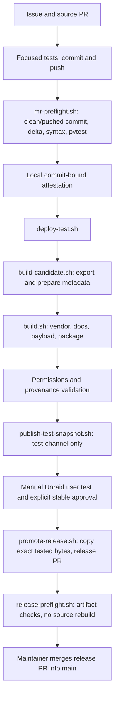

# CI/CD audit and implementation (#671)

Audit date: 2026-10-31. Baseline: `bfc1c90` (stable 2026.10.30.1734).
The scope is build tooling, read-only CI and local release previews. No release,
tag, channel reference, repository setting or production data is changed.

## A. Current architecture

There are no Actions workflows/runs, Git tags, GitHub Releases or environments
in the repository at the audit baseline (GitHub API inspected). `main` has an
active ruleset: pull requests, resolved conversations, no deletion/force push;
no required CI checks yet. `test-channel` is an intentionally replaceable
snapshot with one manifest and one package. Other `codex/*` branches are work
branches, not channels. README already links a Community Apps listing; this is
repository evidence, not a newly verified CA installation or new promotion.

- `release_workflow.py` owns source digests, release-note fragments, provenance,
  package ownership/modes, installer generation and stable validation.
- `build.sh` installs hash-locked binary wheels into an exported `runtime/vendor`,
  verifies all Apprise providers offline, packs a deterministic vendor bundle,
  copies API/UI/runtime, and calls `package_documentation.py` for offline manuals.
  No documentation generator is run; Markdown/assets are copied/link-rewritten.
- The baseline builder runs native `makepkg` when available, otherwise GNU tar,
  then decompresses and recompresses the complete package to normalize permissions.
- `borg-backup-ui.plg` identifies the same legacy plugin for both channels.
  Stable uses raw `main` manifest/package URLs; testing uses `test-channel`.
  Unraid follows the installed manifest's `pluginURL`. Version schema is
  `YYYY.MM.DD.HHMM`; default scripts use host time, operators may supply a value.
- The manifest installer verifies package MD5, uses `upgradepkg`, checks installed
  payload version/registration, expands the SHA256-checked Apprise bundle only
  when changed, and invokes the rc integration. The service stages the bundled
  Borg binary, waits for Python/array readiness and launches the application.
- Python >=3.10 is externally supplied; private Python delivery is issue #548.
  Borg 1.4.5 x86_64/glibc231 is tracked with SHA256SUMS. Apprise has a hash lock;
  the frontend has vendored static assets rather than an npm production build.
- Stable promotion verifies source/notes digests, consumes only tested fragments,
  preserves package bytes, and retains five packages/three manifest note sections.
  No GitHub Release assets/tags currently participate in installation.
- Confidential fixes use `security_workflow.py` and the private advisory workflow;
  public guards and private candidate validation must remain intact.
- Rollback is not automatic. A previous package requires a deliberate corrected
  release/update plan; migration snapshots restore data, not an installed plugin.

## B. Performance evidence and prioritized findings

Measurements use repository-local output and the existing Python 3.12 Linux
host. Results are single samples unless stated otherwise, not statistical claims.
There are no Actions job, queue, download or historical step timings to compare.
Existing local preflights for PR #670 took 395.44 and 720.47 seconds (same 1,992
passed/9 skipped counts; different source commits). Earlier #666 took 485.42s
for 1,980 passed/9 skipped. This demonstrates variability, not a causal trend.

Baseline package reconstruction: 67.60s; 74,948,680 bytes. Full Git export:
470,128,640 bytes / 0.74s; source digest: 1.08s. The five retained packages range
74,917,472–74,972,172 bytes: no recent growth trend is established. Their payload
includes 53,030,902 bytes of offline manual assets, 29,585,612 bytes of Borg,
2,360,749 bytes of vendor bundle and 5,393,195 bytes of other application files.
No `.git`, test trees, logs or temporary build directories were found in the
inspected current stable package.

1. **Measured structural redundancy:** two full XZ compressions per package.
   Normalize archive entries while writing once on the non-Slackware builder;
   retain the native makepkg path for its generated installation hooks.
2. **Confirmed repeated downloads:** `pip --no-cache-dir` explicitly disables
   reuse. Cache downloaded wheels/HTTP responses, continue hash verification
   and offline provider tests; never trust cached installed runtime directories.
3. **Confirmed excess staging:** full `git archive` exports the five old release
   packages and development material. Export only build inputs. No manual assets
   are removed: they serve the offline help and need a separate product decision.
4. **Missing instrumentation:** measure stages and failures with structured
   timings. CPU/load/network explanations for slow preflights remain hypotheses.
5. **Already avoided:** stable does not rebuild or rerun pytest; preserve this.
   Avoid CI on both source-branch pushes and PR events for the same change.
6. Source digest invokes Git per file; at 1.08s this is lower priority than
   compression, dependencies and the full test suite. No speculative rewrite.

## C. Target architecture

Keep one shared application and the existing repository layout. Run read-only
CI on PRs and relevant main pushes; independent quality/security work can run
alongside the full test suite. Keep stateful tests serial until their global
fixtures/environment changes are proven safe for process sharding.

Classify the actual delta before running source tests: a pure stable release
uses artifact checks only, on both its PR and main push. It must preserve the
deployable source digest, change only permitted release files, consume exactly
the tested note fragments and pass manifest/package/provenance checks. PRs also
compare bytes to a fetched test snapshot. A branch name cannot bypass tests;
mixed source/release changes fail. A later test-feed rotation does not invalidate
an already committed main release. Checkout uses depth 2 for this classification
and fetches the exact base SHA only when missing, not all historical packages.

Manual candidate and stable-preview workflows produce review artifacts only.
They have no publish credentials, tag pushes or channel writes. A stable preview
consumes the exact test snapshot and verifies its source digest against main;
it never builds a replacement. Publication activation requires a later reviewed
change and maintainer-controlled approval/credentials. No public PR code is ever
run with a write token. See the multi-generation architecture document for the
explicit platform/channel contract and inactive Unraid 8 target.

## D. Implemented changes

| Component | Result |
| --- | --- |
| `.github/workflows/ci.yml`, `checks.yml` | Delta-aware PR/main/dispatch CI; source changes run reusable quality and full-suite jobs independently. Pure releases run artifact checks without rebuilding/retesting source. Python/JS/PHP/shell syntax, focused Ruff error rules, Borg SHA256, API/UI/Borg tests. No source-branch push trigger duplicating each PR run. |
| `security.yml` | Read-only dependency audit on every PR/main push, weekly and manual dispatch; hash-locked audit tooling, no package execution for lock analysis, JSON report even on failure. |
| `testing-release.yml` | Manual platform/version selection, fail-fast target validation, shared checks then one candidate build. Upload only review artifacts and metrics, never a channel update. |
| `stable-release.yml` | Manual main-only preview; verify test snapshot, exact source/notes and checksums, copy tested package without building. No release, tag or PR mutation. |
| `plugin/ci_pipeline.py`, `build_targets.py` | Explicit legacy channel metadata, strict timestamp/path validation, safe new local output directory, public/private guard, candidate bundle/checksums. Unraid 8 is an explicit error for both channels. |
| `build-candidate.sh` | Export only required build inputs; source-commit epoch, local pip download cache, staged provenance and timings. Existing deploy and private-security entrypoints reuse this builder. |
| `release_workflow.py`, `build.sh` | Portable package compresses once with sorted, normalized entries. Native makepkg hooks remain. Hash-verified wheel caching and no discarded bytecode compilation; new package SHA256 verification in installer and preview/stable validation. |
| `build_metrics.py`, `ci_checks.py` | JSONL wall/CPU/peak-child-RSS/exit-code metrics; no environment/arguments logged. Fail explicitly if Node/browser/Borg test dependencies are missing. |
| Locks and tests | Hash-locked Python CI/security dependencies, exact Playwright npm lock; channel/corruption/notes tests, real installer download/cache-function tests with synthetic local data, archive reproducibility/mode tests and workflow privilege checks. |

All external Actions are pinned to verified full commit SHAs; checkout does not
persist credentials. Jobs have timeouts, workflow concurrency cancels obsolete
PR runs, manual candidates serialize by platform/version, and stable previews
serialize by platform. Global permissions are only `contents: read`. Fork PRs
have no publishing secrets; no `pull_request_target`/privileged `workflow_run`
handoff executes their source. GitHub's normal first-time-contributor approval
may still apply.

Caches hold pip downloads and npm content, never installed application payloads
or secrets. Candidate pip keys include Linux/architecture/Python 3.12 and the
runtime lock hash; setup-python/node keys use their dependency locks. Each
install revalidates hashes/integrity. Browser binaries are installed explicitly
rather than cached: OS dependencies remain required, and restore cost is not
assumed to be lower than download cost. Packages are already XZ compressed, so
artifact upload uses compression level 0. Retention is 14 days; these expiring
Actions artifacts cannot replace persistent Unraid update feeds.

The preview bundle includes manifest, package, `candidate.json` (source, target,
channel, checksum and `published: false`) and `SHA256SUMS`. It is not a signed
attestation and does not authorize production publication. Existing committed
stable manifests/packages, CA metadata, `APP_VERSION`, runtime behavior and
legacy feed names have not been changed. The prospective installer change is
SHA256 in addition to compatible MD5, carried only in newly generated previews.

Build tooling uses Python 3.12/Linux x86_64 in CI; application minimum Python
remains unchanged. Install local test tooling from `.github/requirements-ci.lock`
in an isolated environment. Native `makepkg` and real Unraid need separate
validation; no claim of identical bytes across toolchains is made.

## E. Performance comparison

Controlled comparison uses the same extracted stable payload and local host.
One baseline run and two optimized runs are available; OS caching/load was not
controlled, so the range is evidence of reduced work, not a guaranteed speedup.

| Metric | Before | After |
| --- | --- | --- |
| Hosted CI and runner queue time | Not available (no historical workflows/runs) | Pending first hosted run |
| Full local source preflight | Older #670: 395.44 / 720.47s, different commits | Final branch result reported with PR validation; not a controlled timing comparison |
| Same-payload package compression | 67.60s, two compressions | 50.03s / 34.05s, one compression |
| Source export | 470,128,640 bytes / 0.74s | 88,381,440 bytes / 0.27s at baseline commit |
| Same-payload package size | 74,948,680 bytes | 76,485,416 bytes (+2.05%) |
| Redundant compression passes | 1 extra full pass | 0 on portable builder; native path unchanged |
| Retained old packages exported | 5 | 0 |
| End-to-end public testing release | No comparable historical timing | Not executed: publication expressly prohibited |
| End-to-end stable release | No comparable historical timing | Not executed: publication expressly prohibited; no rebuild by design |

Both optimized package runs produced SHA256
`308a1516bf29bdb171fa93a50bcc5ff009bc40484a6a19bb909a96e0eff5d096`, including
after changing input mtimes. All regular-file payload digests and modes match
the baseline. Deterministic ordering/metadata changes the compressed stream and
in this sample costs 1,536,736 bytes; do not misrepresent it as a size reduction.
The export reduces processed staging bytes by 81.2%. Historical network transfer
counts and comparable peak memory are unavailable; the baseline measured child
RSS only while the optimized compressor runs in Python itself. New metrics
measure each compressor as a child process for future consistent comparisons.

Two complete local candidate previews used implementation commit `ba7b6fd`,
version `2026.10.31.1600`, Python 3.12 and pip 26.2.2. The second build is an
intentional reproducibility/cache experiment, not a second release. Subsequent
changes only refine CI validation/reporting, outside the deployable source
digest. The final source preflight validates the final pushed commit separately.

| Preview step | Empty pip cache | Reused pip cache |
| --- | --- | --- |
| Source export | 0.341s | 0.354s |
| Metadata/notes preparation | 0.045s | 0.051s |
| Locked dependency install | 9.505s | 2.132s |
| Offline all-provider check | 1.298s | 1.017s |
| Documentation copy | 0.053s | 0.071s |
| Vendor bundle | 3.206s | 3.390s |
| Package compression | 35.123s | 35.693s |
| Build aggregate (includes its child steps) | 50.667s | 43.110s |
| Shared provenance validation | 3.864s | 3.606s |
| Complete preview, including hashes and artifact copy | 59.876s | 52.223s |

Both complete previews are 76,482,876 bytes with SHA256
`7e46883be21082d812ce7b63689ff5787ad1620180b5cad7864ede3850a840c3`;
their manifests also compare byte-for-byte. Both source digests are
`87033573153cb5451a8b66b8b48bc0c869f7839570c7d1b6cbd2c5e1a1599fbd`.
Cold pip logs show 11 downloads; warm logs show 11 cached wheels. The cache
occupies 4,241,323 bytes. Actual HTTP byte counts/queue time were not measured.
Peak child RSS was 117,232 / 117,096 KiB. The provider check exercised all 141
Apprise providers, metadata and synthetic HTTP/SMTP success/rejection/timeout
paths offline. Do not sum aggregate and child step durations.

### Validation boundary

Local validation includes successful Python/JS/PHP/shell syntax, Ruff checks,
Borg binary SHA256 and execution, actionlint 1.7.12, npm lock installation,
target/channel/checksum tests, old stable MD5-only manifest compatibility and
the two complete reproducible builds above. The two intentional invalid hook
examples from #550 are checked for expected syntax failure, not treated as
production syntax defects. A real main-only stable-preview guard and both
Unraid 8 target guards were exercised and refused output as intended.

Final full pytest/preflight results are recorded on the implementation PR for
the final commit. A first hosted Actions run is needed to validate runner setup,
cache restoration, artifact retention/permissions and job scheduling. Real
Unraid fresh install, stable-to-testing update, testing-to-stable update, reboot,
same-version repair, uninstall preserving data, and a synthetic backup/restore
remain manual system tests. No such installation has been simulated as passed.
Both legacy channel snapshots remain untouched by this audit; local previews
are not published install URLs or a stable approval.

## F. Risks

Archive metadata changes need extraction/ownership and reproducibility tests;
makepkg remains a separate builder, not claimed byte-identical to Python.
Unraid installation, reboot, plugin-manager updates and actual SDK behavior
require target-system validation. Local tests cannot establish those results.

The dependency audit is **not green**: pip-audit reported eight entries in three
locked packages, six distinct advisories after duplicate IDs. `certifi`
2026.7.22, `oauthlib` 3.3.1 and `urllib3` 2.7.0 require review. Fixed versions
reported are respectively 2026.10.18 (review subsequent root-store correction),
4.0.0 and 2.8.0. See [follow-up #672](https://github.com/borgforge/borg-backup-ui/issues/672)
and primary advisories for [certifi](https://github.com/advisories/GHSA-6q48-6c7w-9gw2),
[OAuthlib](https://github.com/advisories/GHSA-xpv3-w29h-x7cv) and
[urllib3](https://github.com/advisories/GHSA-vxq7-64xx-v4gw). A dependency finding
alone does not prove exploitability of this application's notification-client
paths. No advisory is suppressed and no untested major runtime upgrade is hidden
in the tooling change; the security workflow will visibly fail until addressed.

Integrity checks are not signatures: a writer who can replace code and digest
can replace both. Branch review, protected publication, bot separation and a
future signed provenance policy remain necessary. The binary checksum does not
scan Borg's embedded native dependencies; vendored browser assets also need a
separate upstream inventory/advisory process. Do not claim pip-audit covers them.

The baseline ruleset does not yet require CI, and no tag protection/environment
exists. No repository settings were changed. Before publication activation,
require successful checks for the exact reviewed commit, dependency findings
resolved, explicit maintainer test approval and a protected stable environment.
Keep bot credentials only in the publishing job/process, never in PR checks.
Current CI previews deliberately lack them. Any future GitHub Release should
attach the already tested bytes/checksums/provenance, not rebuild or silently
switch legacy download URLs to release assets.

## G. Open decisions

Maintainer activation of publishing and protected environments; required status
checks after successful hosted CI; independently versioned Unraid 8 plugin
identity/feed after SDK review; explicit migration approval. No settings are
modified by this task.

Before publication activation, define a single version allocator/timezone and
reject reuse of a released version for different bytes/source. Current manual
timestamp arguments are format-checked, not a global version reservation.
Local previews deliberately permit the same version for reproducibility
experiments; that is not permission to overwrite a release. GitHub Release
assets/tags and signed attestations remain proposed additions, not active
installation dependencies.

## H. Recommendations

1. Validate hosted runs first, then make stable job names required in the main
   ruleset. `CI result` is the aggregate for both source and artifact routes;
   do not require a conditionally absent nested test job for release-only PRs.
   Require the dependency audit separately after resolving #672, before any
   publishing activation.
2. Keep manual publication and byte-identical promotion until a separate reviewed
   publishing workflow can enforce bot identity, exact-source checks and stable
   environment approval. Never trigger a stable release from an ordinary push.
3. After sufficient timings, consider test sharding only for isolated groups and
   content-addressed common assets/vendor bundles with complete keys. Avoid
   caching a package under a branch name or claiming different commits match.
4. Define tag rules and GitHub Release asset names by platform if releases are
   adopted. Retain existing update feeds; test installation/channel transitions
   explicitly. A security hotfix is a newly tested version, not an unreviewed
   rewrite of stable history.
5. Follow the [multi-generation plan](multi-generation-plugin-architecture.md)
   when official SDK contracts exist; shared core tests once, selected platform
   packaging only, separate feed identities and explicit migration approval.

### References

- [Existing release workflow](../maintainer/release-workflow.md)
- [Private security workflow](../maintainer/security-release-workflow.md)
- [GitHub workflow syntax](https://docs.github.com/en/actions/reference/workflows-and-actions/workflow-syntax)
- [GitHub Actions security guidance](https://docs.github.com/en/actions/reference/security/secure-use)
- [pip secure installs](https://pip.pypa.io/en/stable/topics/secure-installs/)
- [Playwright CI guidance](https://playwright.dev/docs/ci)
- [Artifact upload options](https://github.com/actions/upload-artifact/blob/main/README.md)
