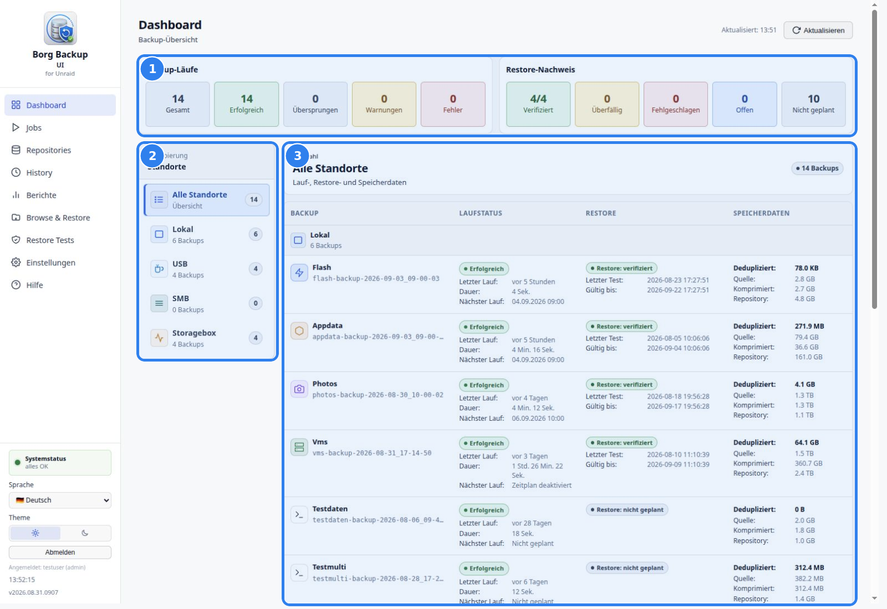
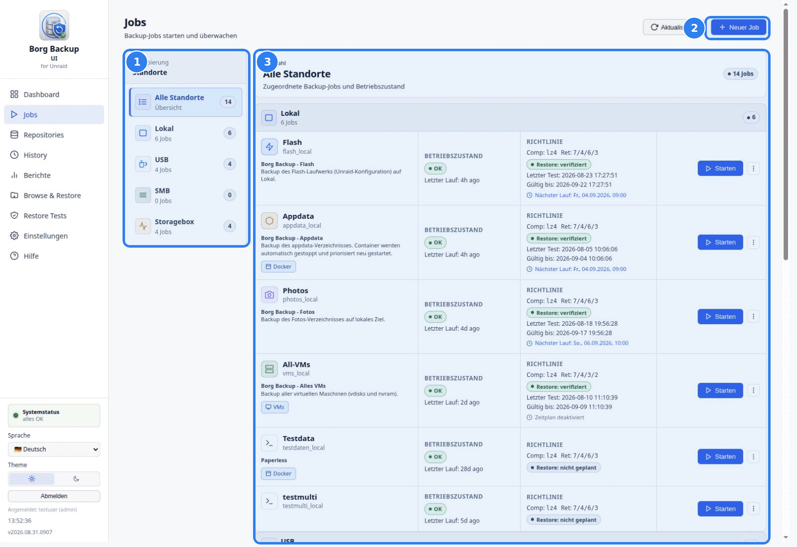
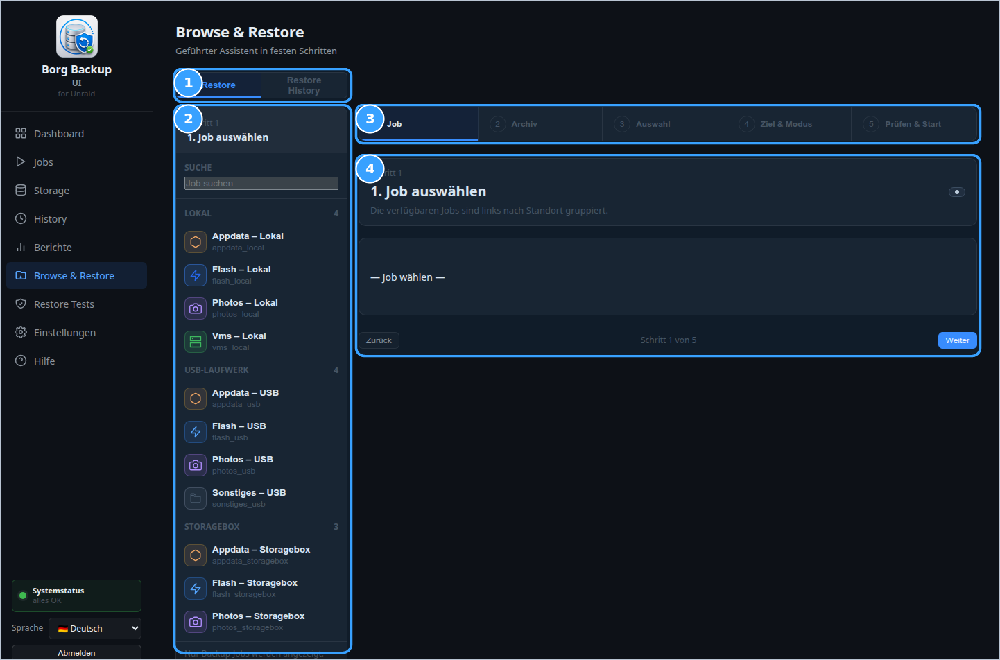
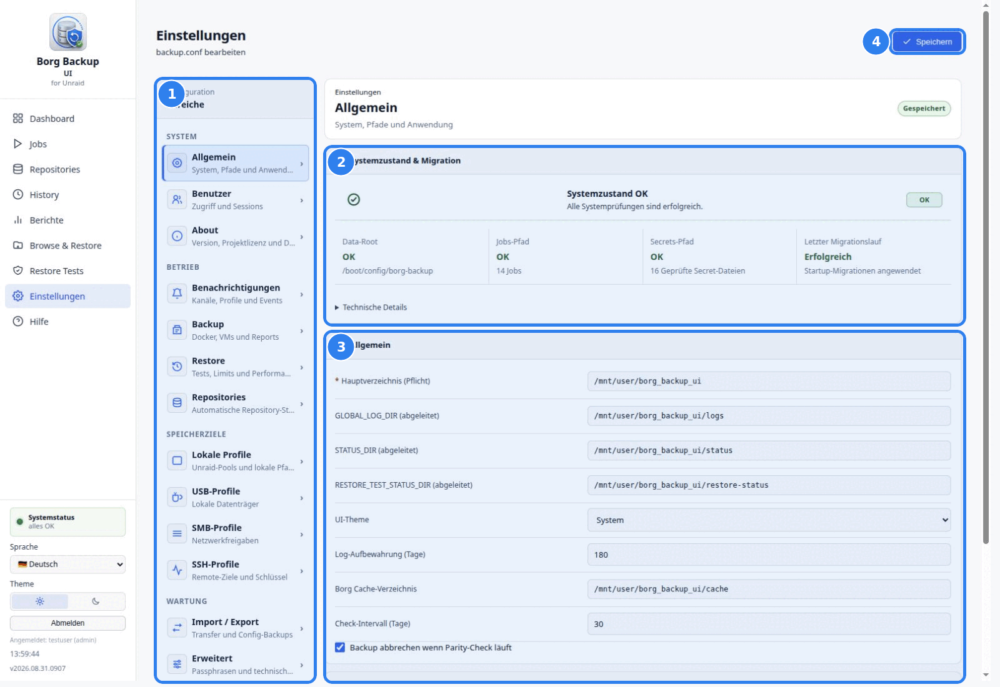

# Borg-Backup-UI Benutzerhandbuch

Dokumentationsprüfung: 11.10.2026. Verhaltensbasis: Stable `2026.10.11.1525`, Borg `1.4.5`.
Sprache: Deutsch  
Zielgruppe: Einsteiger, fortgeschrittene Anwender und Administratoren eines Unraid-Systems

Wählen Sie den Einstieg nach Ihrer Aufgabe. Die nummerierten Kapitel bleiben als Menüreferenz erhalten. Die neuen Hilfe-Darstellungen werden mit dem Dokumentations-Testkandidaten ausgeliefert; sie ändern keine Backup-Funktion. Die Bilder wurden am 11.10.2026 mit der aktuellen Anwendung und synthetischen Daten neu aufgenommen. Die Plugin-Demo läuft isoliert mit echtem Borg; Grafana zeigt separat erzeugte Beispielmetriken. Die Aufnahmen ersetzen keinen Test auf echter Unraid-Hardware.

[Bildstand und Demo-Grenzen](../assets/README.md).

> **Hinweis:** Dieses Handbuch beschreibt die Anwendung selbst. Es ersetzt keine allgemeine BorgBackup-Dokumentation und keine Unraid-Systemdokumentation. Wenn eine Funktion in der Oberfläche nicht sichtbar ist, ist sie für die aktuell angemeldete Rolle oder die aktuelle Konfiguration möglicherweise nicht verfügbar.

## Ihr Weg durch das Handbuch

| Zugang | Beginnen Sie hier |
| --- | --- |
| Einstieg | [Installation](#13-installation-und-erstkonfiguration), danach der [Schnellstart](#schnellstart-erstes-backup-und-geprüfter-restore) |
| Aufgaben | [Sichern, prüfen, wiederherstellen und benachrichtigen](#11-typische-aufgaben); bei Ausfall [Notfallwiederherstellung](#16-notfallwiederherstellung) |
| Referenz | [Jobs](#3-jobs), [Repositories](#4-repositories), [Restore](#7-browse--restore), [Einstellungen](#9-einstellungen), [Aktions- und Einstellungsreferenz](#17-aktions--und-einstellungsreferenz) |
| Konzepte | [Begriffe](#11-grundbegriffe), [Ablauf, Datenmengen und Aussagegrenzen](#18-konzepte-und-ablauf) |

## Schnellstart: Erstes Backup und geprüfter Restore

**Ziel:** Eine bekannte Testdatei sichern und ihren wiederhergestellten Inhalt
vergleichen. Dafür benötigen Sie ein eingerichtetes Unraid-System und die Rolle
**admin**; spätere manuelle Läufe und Restores sind auch als **operator** möglich.
Planen Sie etwa 20 Minuten zuzüglich Installation und Datenübertragung ein.
Verwenden Sie ausschließlich neue Testverzeichnisse. Das Beispiel ist eine
Funktionsprobe auf einem Host, keine unabhängige Ausfallsicherung.

1. Schließen Sie die [Erstkonfiguration](#13-installation-und-erstkonfiguration)
   ab. Öffnen Sie im Unraid-Terminal eine Shell. Legen Sie in einem vorhandenen
   Share `/mnt/user/demo` drei bisher nicht vorhandene Ordner an:
   `source`, `repositories` und `restore`. Wählen Sie andere neue Namen, falls
   dort bereits Daten liegen. Schreiben Sie in `source/probe.txt` den Text
   `Borg Backup UI restore check`. Das können Sie auch über die Dateiverwaltung
   tun. Nur die Testquelle soll gesichert werden, niemals der gesamte Share mit
   Repository und Restore-Ziel.
2. Öffnen Sie **Einstellungen > Lokale Profile**. Legen Sie das Speicherziel
   `Demo-Lokal` mit Basispfad `/mnt/user/demo/repositories` an. Speichern Sie und
   prüfen Sie die Erreichbarkeit und Schreibbarkeit. Bei Fehlern zuerst Mount,
   Pfad und freien Platz prüfen; noch keinen Job anlegen.
3. Öffnen Sie **Repositories > Repository hinzufügen**. Wählen Sie `Demo-Lokal`,
   **Neues Repository erstellen**, den Anzeigenamen `Demo-Repository` und das
   relative Repository-Verzeichnis `demo-repo`. Wählen Sie `repokey-blake2`,
   vergeben Sie eine neue Passphrase und bewahren Sie sie getrennt auf. Prüfen
   Sie die angezeigte vollständige Zieladresse. Nach dem Erstellen laden Sie
   die Repository-Informationen und exportieren den Borg-Key über die Verwaltung.
   Sichern Sie den Export außerhalb dieses Servers. [Schlüssel und Recovery](#16-notfallwiederherstellung).
4. Öffnen Sie **Jobs > Neuer Job**. Setzen Sie **Job-Name** auf `Demo-Backup` und
   **Archivpräfix** auf `demo-backup`. Behalten Sie die automatisch erzeugte
   **Job-ID**. Lassen Sie Docker-/VM-Steuerung für diese Textdatei ausgeschaltet.
5. In **Quellen & Ziel** wählen Sie ausschließlich `/mnt/user/demo/source`,
   `Demo-Lokal`, `Demo-Repository` und Kompression `lz4`. Lassen Sie
   **Ausschlüsse** leer. Docker und VMs werden übersprungen. Wählen Sie unter
   **Retention** für diese kleine Probe **Alle behalten**, tragen Sie eine
   Beschreibung ein und lassen Sie den Zeitplan zunächst ausgeschaltet.
   Unter **Pre-/Post-Skripte** wählen Sie keine Skripte. Prüfen Sie in der
   **Flow-Vorschau** Quelle und Ziel, dann speichern Sie.
6. Starten Sie `Demo-Backup` unter **Jobs** manuell und bestätigen Sie den Dialog.
   Warten Sie den Abschluss ab. In **History** müssen Ergebnis, Archivname und
   Originalgröße plausibel sein. Öffnen Sie unter **Repositories > Archive** das
   neue Archiv und suchen Sie `probe.txt`. Ein erfolgreicher Status allein sagt
   nicht, dass die richtigen Daten ausgewählt wurden.
7. Öffnen Sie **Browse & Restore**. Wählen Sie `Demo-Backup` und genau dieses
   Archiv. Navigieren Sie zum gespeicherten Pfad und markieren Sie nur
   `probe.txt`. Wählen Sie als Ziel `/mnt/user/demo/restore` und
   **Nicht überschreiben**. Prüfen Sie in der Zusammenfassung den endgültigen
   Dateipfad. Sie können zuerst einen **Testlauf (keine Änderungen)** ausführen;
   dieser erzeugt keine Vergleichsdatei. Schalten Sie die Option danach aus und
   starten Sie den echten Restore.
8. Prüfen Sie den Abschluss und **Restore History**. Öffnen Sie die tatsächlich
   wiederhergestellte Datei. Vergleichen Sie im Unraid-Terminal mit `cmp` (bei
   abweichendem Ziel den in der Zusammenfassung angezeigten Pfad verwenden):

   ```bash
   cmp /mnt/user/demo/source/probe.txt /mnt/user/demo/restore/probe.txt
   ```

   Keine Ausgabe und Exit-Code `0` bedeuten gleiche Inhalte. Eine fehlende Datei,
   ein Unterschied oder ein übersprungenes vorhandenes Ziel ist kein bestandener
   Test. Prüfen Sie dann Archiv, Auswahl, Zielpfad, Konfliktstrategie und Log.
   Bei Anwendungsdaten gehören zusätzlich ein Starttest und fachliche Kontrollen
   in einer isolierten Anwendungsinstanz dazu.
9. Erst nach erfolgreichem Vergleich aktivieren Sie den Backup-Zeitplan. Ein
   Beispiel ist täglich 03:00 Uhr in der Unraid-Serverzeitzone. Planen Sie
   Restore Tests getrennt, z. B. sonntags 06:00 Uhr mit acht Tagen
   Nachweisgültigkeit. Die [Testgrenzen](#83-testlevel) bleiben dabei bestehen.
   Richten Sie [Benachrichtigungen](#115-benachrichtigungen-einrichten) ein,
   speichern Sie die Einstellungen und senden Sie eine Testnachricht.
10. Für echte Daten wählen Sie eine geeignete Aufbewahrung und mindestens eine
    unabhängige Kopie. Sichern Sie Konfiguration, Schlüssel und Zugangsdaten nach
    dem [Notfallleitfaden](#16-notfallwiederherstellung). Lassen Sie die Testdaten
    bestehen, bis Sie den Vergleich nachvollzogen haben.

## Inhaltsverzeichnis

1. [Grundlagen](#1-grundlagen)
2. [Dashboard](#2-dashboard)
3. [Jobs](#3-jobs)
4. [Repositories](#4-repositories)
5. [History](#5-history)
6. [Berichte](#6-berichte)
7. [Browse & Restore](#7-browse--restore)
8. [Restore Tests](#8-restore-tests)
9. [Einstellungen](#9-einstellungen)
10. [Hilfe](#10-hilfe)
11. [Typische Aufgaben](#11-typische-aufgaben)
12. [Status, Warnungen und Best Practices](#12-status-warnungen-und-best-practices)
13. [Fehlerbehebung](#13-fehlerbehebung)
14. [FAQ](#14-faq)
15. [Empfohlene Betriebspraxis](#15-empfohlene-betriebspraxis)
16. [Notfallwiederherstellung](#16-notfallwiederherstellung)
17. [Aktions- und Einstellungsreferenz](#17-aktions--und-einstellungsreferenz)
18. [Konzepte und Ablauf](#18-konzepte-und-ablauf)

## 1. Grundlagen

Borg-Backup-UI ist eine Weboberfläche für BorgBackup auf Unraid. Die Anwendung verwaltet Backup-Jobs, Speicherziele, Zeitpläne, Restore-Funktionen, Restore-Tests, Berichte, Benachrichtigungen und Systemdiagnosen.

### 1.1 Grundbegriffe

- **Job:** Eine Backup-Definition mit zu sichernden Ordnern oder Dateien, Ziel, jobbezogenen Borg-Optionen, Retention und optionalem Zeitplan.
- **Repository:** Das BorgBackup-Ziel, in dem Archive gespeichert werden.
- **Archiv:** Ein einzelner BorgBackup-Snapshot innerhalb eines Repositorys.
- **Standort:** Eine Zielgruppe wie `Lokal`, `USB`, `SMB` oder `Storagebox`.
- **Profil:** Wiederverwendbare Zielkonfiguration, z. B. USB-, SMB- oder SSH-Profil.
- **Restore:** Wiederherstellung von Dateien oder Verzeichnissen aus einem Archiv.
- **Restore Test:** Automatisierte Prüfung, ob eine Wiederherstellung technisch möglich ist.
- **Systemstatus:** Zusammenfassung aus Konfiguration, Migration, Jobs, Secrets, Runtime-Recovery und Wartungshinweisen.

### 1.2 Anmeldung, Sprache und Rolle

Nach der Anmeldung zeigt die linke Seitenleiste das Hauptmenü, den Systemstatus, die Sprachauswahl, die Abmeldung, den angemeldeten Benutzer und die installierte Version.

Beim ersten Aufruf folgt die Oberfläche einer unterstützten deutschen oder englischen Browsersprache; bei anderen oder unbekannten Sprachen wird Englisch verwendet. Danach kann die Sprache unten links zwischen Deutsch und Englisch umgeschaltet werden und bleibt für diesen Browser gespeichert. Die Änderung betrifft die Weboberfläche, nicht die technischen Logdateien. Logs, maschinenlesbare Werte und technische Fehlercodes können weiterhin englische Begriffe enthalten.

Die Anwendung kennt die Rollen `admin`, `operator` und `viewer`:

- **admin:** Vollzugriff auf Benutzer, Einstellungen, Speicherziele, Repositorys und Jobs.
- **operator:** Darf betriebliche Aktionen wie Backup-, Restore- und Wartungsläufe ausführen, jedoch keine administrativen Einstellungen verwalten.
- **viewer:** Lesender Zugriff; schreibende Aktionen werden deaktiviert oder abgelehnt.

> **Warnung:** Bewahren Sie Passwörter, Borg-Passphrasen, SSH-Keys und Export-Passwörter sicher auf. Borg-Backup-UI maskiert Secrets in Diagnoseausgaben, trotzdem sollten Support-Pakete vor einer Weitergabe geprüft werden.

### 1.3 Installation und Erstkonfiguration

Allgemeine Unraid-Schritte erläutern die offiziellen Anleitungen zu [Community Apps](https://docs.unraid.net/unraid-os/manual/applications/) und [Plugins](https://docs.unraid.net/unraid-os/using-unraid-to/customize-your-experience/plugins/).

Borg Backup UI wird über **Unraid Community Apps** installiert. Voraussetzungen sind **Unraid 6.12.5 oder neuer** sowie **Python 3.10 oder neuer**. Installieren Sie das separate Plugin **Python 3 for Unraid** zuerst über Community Apps. BorgBackup selbst ist im Borg-Backup-UI-Paket enthalten; eine zusätzliche Borg- oder pip-Installation ist nicht erforderlich.

1. Öffnen Sie in Unraid **Apps**.
2. Installieren Sie **Python 3 for Unraid**, falls es noch nicht vorhanden ist.
3. Suchen Sie nach **Borg Backup UI** und installieren Sie das Plugin.
4. Öffnen Sie **Einstellungen > Borg Backup UI**, starten Sie den Dienst und rufen Sie die Weboberfläche auf.
5. Legen Sie das erste Administratorkonto mit einem Passwort von mindestens zwölf Zeichen an.
6. Wählen und bestätigen Sie ein konkretes Hauptverzeichnis für Logs, Status- und Restore-Daten.
7. Beginnen Sie mit nicht kritischen Testdaten, führen Sie den ersten Lauf manuell aus und prüfen Sie eine Wiederherstellung in ein separates Testziel.

> **Warnung:** Ein geschriebenes Backup ist noch kein Wiederherstellungsnachweis. Verlassen Sie sich erst auf die Einrichtung, nachdem ein manueller Restore und ein Restore-Test erfolgreich waren.

Das Hauptverzeichnis darf unter einem Unraid-Share, Pool, Array-Datenträger, Unassigned-Devices- oder Remote-Mount liegen. Beim Start wartet Borg Backup UI auf den tatsächlich dahinterliegenden Mount, bevor Migrationen, Scheduler oder Status-Worker darauf schreiben. Ist noch kein Hauptverzeichnis eingerichtet oder der Mount nicht verfügbar, bleiben nur die für Einrichtung und Diagnose notwendigen Funktionen aktiv; die Anwendung erzeugt keine vermeintlichen Laufzeitverzeichnisse auf dem Root-Dateisystem.

Start, Stopp und Autostart des Dienstes werden durch das Plugin verwaltet. Ergänzen Sie dafür keinen eigenen Aufruf in `/boot/config/go`.

## 2. Dashboard



**Abbildung 1 - Dashboard:** (1) Gesamtstatus für Backup-Läufe und Restore-Nachweise, (2) Standortfilter, (3) Detailtabelle der gefilterten Jobs.

Das Dashboard ist die zentrale Übersicht über Backup-Zustand, Restore-Nachweise, Speicherentwicklung und Repository-Prüfungen.

### 2.1 Zweck der Seite

Das Dashboard beantwortet die wichtigsten Betriebsfragen:

- Welche Jobs existieren?
- Welche Backups waren erfolgreich, übersprungen, mit Warnung oder fehlerhaft?
- Wann läuft ein geplanter Job das nächste Mal?
- Welche Restore-Tests sind verifiziert, überfällig, fehlgeschlagen oder nicht geplant?
- Welche Speicher- und Repository-Daten sind zuletzt bekannt?
- Welche Jobs benötigen Aufmerksamkeit?

### 2.2 Bereiche und Anzeigen

Die Seite besteht aus:

- **Backup-Läufe:** Der erste Kreis zählt jeweils das letzte Ergebnis pro Job. Erfolgreiche, übersprungene, abgebrochene, unbekannte und fehlerhafte Läufe sowie Warnungen bleiben unterscheidbar. Überfällige Backups stehen zusätzlich unter dem Kreis; sie ändern das letzte Laufergebnis nicht.
- **Restore-Nachweis:** Der zweite Kreis zeigt verifizierte Nachweise im Verhältnis zu Jobs mit Restore-Testplan. Überfällige, fehlgeschlagene und offene Nachweise stehen daneben. Jobs ohne Testplan oder mit unbekanntem Restore-Status werden separat genannt.
- **Handlungsbedarf:** Zeigt Fehlertexte, Warnungen, Gründe für übersprungene Läufe und überfällige Backups oder Restore-Nachweise. **Ansehen** öffnet die Details des betroffenen Jobs.
- **Standort-Sidebar:** Filtert die Tabelle nach `Alle Standorte`, `Lokal`, `USB`, `SMB` und `Storagebox`. Standorte ohne Jobs werden ausgeblendet. Unter **Alle Standorte** bleiben die Jobs nach Standort gruppiert; die bisherigen Standort-Icons bleiben erhalten.
- **Auswahlkarte:** Zeigt den aktuell gewählten Standort und die Anzahl der Backups.
- **Job-Tabelle:** Zeigt Job mit Icon und letztem Archivnamen, Laufstatus, nächsten geplanten Lauf, Restore-Status und Repository-Größe. **Details** klappt weitere Daten auf. Geöffnete Details bleiben beim Aktualisieren, Standort- und Sprachwechsel erhalten.
- **Aktualisieren:** Lädt Dashboard-Daten neu.

### 2.3 Wichtige Spalten

- **Backup:** Name, konfiguriertes Icon samt Farbe und letzter Archivname. Den vollständigen Archivnamen finden Sie auch in den Details.
- **Laufstatus:** Ergebnis, relativer Zeitpunkt und Dauer des letzten Laufs sowie vorhandene Fehler- oder Warntexte.
- **Nächster Lauf:** Nächster geplanter Lauf einschließlich Gruppenzeitplänen; ein überfälliges Backup wird zusätzlich markiert.
- **Restore:** Aktueller Nachweisstatus und Gültigkeit, sofern vorhanden.
- **Repository:** Zuletzt bekannte Repository-Größe und Schalter **Details**.
- **Aufgeklappte Details:** Deduplizierte Größe, Quelle, komprimierte Größe, Repository-Größe, Wachstum, Borg-Check im letzten Lauf und gespeicherter Repository-Check sowie Restore-Daten und Archivname. Es wird kein zusätzlicher Checkplan angelegt; die Anzeige verwendet vorhandene Laufdaten. Fehlende Daten bleiben unbekannt.

### 2.4 Typische Aktionen

1. Öffnen Sie **Dashboard**.
2. Prüfen Sie oben die Zusammenfassungen.
3. Wählen Sie links einen Standort, wenn Sie nur lokale, USB-, SMB- oder Storagebox-Jobs sehen möchten.
4. Lesen Sie pro Job den Laufstatus und Restore-Status.
5. Öffnen Sie **Details** für Speicherwerte, Borg-Checks, Restore-Daten und den vollständigen Archivnamen.
6. Klicken Sie auf **Aktualisieren**, wenn Sie unmittelbar nach einem Lauf neue Daten erwarten.

### 2.5 Hinweise und Best Practices

> **Tipp:** Nutzen Sie das Dashboard als täglichen Kontrollpunkt. Wenn alle Backup- und Restore-Zähler plausibel sind, können Detailseiten gezielt nur bei Auffälligkeiten geöffnet werden.

> **Hinweis:** Das Dashboard zeigt die zuletzt bekannten Statusdaten. Wenn ein Repository nicht erreichbar ist oder ein Statusfile fehlt, kann die Tabelle veraltete oder unvollständige Werte anzeigen. Prüfen Sie in diesem Fall **History**, **Repositories** und die Logs.

### 2.6 Unraid-Dashboard-Widget

Das Plugin ergänzt das normale Unraid-Dashboard um ein eigenes, ausschließlich lesendes Widget. Es zeigt unter anderem Backup-Zähler, laufende Jobs, den letzten und die nächsten Backups, den Restore-Nachweis sowie die Zahl erreichbarer Repositorys.

Das Widget liest eine vorberechnete Statusdatei auf dem Flash-Laufwerk. Sein Aktualisieren startet weder Borg noch einen Repository-Check und soll keine Array-Datenträger nur für die Anzeige aufwecken. Der Cache wird nach Backup- und Restore-Test-Ereignissen erneuert. **Data updated** zeigt den Datenstand, **Last fetched** den letzten erfolgreichen Abruf durch das Widget. Der Refresh-Button liest nur die vorhandene Statusdatei erneut. Ein älterer Datenstand zwischen zwei Ereignissen ist daher normal und allein kein Verbindungsfehler. Zeitabstände und Heute/Morgen-Angaben werden im Browser aktualisiert; Uhrzeiten entsprechen der Browser-Zeitzone. Ein bereits vergangener, im Cache gespeicherter Termin wird als **Scheduled … (past)** gekennzeichnet, bis ein neues Ereignis den Zeitplan aktualisiert. Ältere Cache-Dateien ohne absolute Zeitstempel zeigen bis zum nächsten Ereignis einen Hinweis statt veralteter relativer Zeiten.

Übersprungene Läufe erscheinen separat als **Skipped**. Ist ein Job zusätzlich überfällig, erscheint weiterhin eine Warnung. Fehler beim Abrufen oder ungültige Cache-Daten werden sichtbar gemeldet; die letzte verfügbare Anzeige bleibt erhalten. Ein Zustand wie **Initial** oder **Unbekannt** ist kein aktueller Backup-Nachweis; prüfen Sie dann Dashboard, History und Systemzustand in Borg Backup UI.

> **Hinweis:** Dieses native Unraid-Widget ist von der optionalen **Homepage**-Integration unter **Einstellungen > Allgemein** zu unterscheiden. Homepage verwendet einen eigenen, eingeschränkten Token.

## 3. Jobs



**Abbildung 2 - Jobs:** (1) Filter nach Speicherziel, (2) Einstieg in den Job-Wizard, (3) Jobkarten mit Zustand, Richtlinie und Startaktion.

Die Seite **Jobs** verwaltet Backup-Jobs. Hier werden Jobs angezeigt, gestartet, bearbeitet, geplant und gelöscht.

### 3.1 Zweck der Seite

Jobs definieren, welche Daten wohin gesichert werden. Ein Job enthält:

- Anzeigename, dauerhafte Job-ID und Archivpräfix
- Standort und Repository
- Zu sichernde Ordner oder Dateien
- Docker- und VM-Steuerung
- Borg-Optionen wie Kompression und Retention
- Zeitplan
- Beschreibung und Icon

### 3.2 Bereiche und Funktionen

- **Standort-Sidebar:** Gruppiert Jobs nach Speicherziel.
- **Job-Liste:** Zeigt Name, Beschreibung, Betriebszustand, Richtlinie und nächste Ausführung.
- **Starten:** Startet einen Job manuell.
- **Weitere Aktionen:** Öffnet je nach Job Aktionen wie Bearbeiten, Zeitplan, Logs oder Löschen.
- **Neuer Job:** Öffnet den Job-Wizard.
- **Aktualisieren:** Lädt Jobliste und Status neu.
- **Live-Log:** Während eines laufenden Jobs kann die Ausgabe im Browser verfolgt werden.
- **Job abbrechen:** Fordert einen kontrollierten Abbruch des laufenden Jobs an.

### 3.3 Job manuell starten

1. Öffnen Sie **Jobs**.
2. Suchen Sie den gewünschten Job über die Standortgruppe oder die Suche.
3. Klicken Sie auf **Starten**.
4. Bestätigen Sie den Startdialog.
5. Beobachten Sie das Live-Log.
6. Prüfen Sie anschließend **History** und ggf. **Repositories**.

> **Warnung:** Wenn der Job Docker-Container oder VMs stoppen soll, werden nur die im Job konfigurierten Ziele gesteuert. Prüfen Sie diese Auswahl vor produktiven Läufen.

### 3.4 Laufenden Job abbrechen

1. Klicken Sie beim laufenden Job auf **Job abbrechen**.
2. Bestätigen Sie den kontrollierten Abbruch.
3. Beobachten Sie Status und Live-Log, bis die Wiederherstellung der Laufzeitumgebung abgeschlossen ist.

Ein aktiver Borg-Schritt wird mit einem Interrupt beendet. Wird der Abbruch während des Stoppens von Docker-Containern oder VMs angefordert, beendet die Anwendung zunächst den bereits begonnenen Stoppvorgang vollständig. Danach werden die zuvor laufenden Container beziehungsweise VMs automatisch wieder gestartet. Während dieser Wiederherstellung ist kein weiterer Abbruch möglich. Schlägt der Neustart eines Containers oder einer VM fehl, endet der Lauf als Fehler und **Systemzustand & Migration** zeigt den offenen Runtime-Recovery-Hinweis.

> **Hinweis:** Ein kontrolliert abgebrochener Lauf wird als **Abgebrochen** gespeichert. Die Anwendung startet nach einem Abbruch nicht automatisch `borg check`, entfernt keine Borg-Locks und repariert kein Repository. Prüfen Sie bei auffälligen Borg-Meldungen das Log und verwenden Sie die Repository-Wartung gezielt.

Die Verbindungsanzeige des Live-Logs beschreibt die Browser-Verbindung zum Log-Stream, nicht unmittelbar das Ergebnis des Backup-Prozesses. Bei einem kurzen Übertragungsfehler versucht die Oberfläche erneut zu verbinden. Bewerten Sie den Lauf anhand seines abschließenden Status und des gespeicherten Logs.

### 3.5 Job-Wizard

Der Job-Wizard führt in festen Schritten durch die Erstellung oder Bearbeitung eines Jobs.

#### Schritt 1: Grunddaten


Hier werden Jobname, Archivpräfix, Icon, Icon-Farbe und erste Laufzeitoptionen gesetzt. Die automatisch vergebene **Job-ID** bleibt unverändert.

Wichtige Felder:

- **Job-Name:** Sichtbarer Name in UI, Berichten und Benachrichtigungen.
- **Archivpräfix:** Namensanfang zukünftiger Archive; erlaubt sind Buchstaben, Ziffern, Punkt, Unterstrich und Bindestrich.
- **Job-ID:** Dauerhafte UUID; verbindet Job, Zeitplan und Verlauf unabhängig vom Anzeigenamen.
- **Icon / Icon-Farbe:** Darstellung in Dashboard, Jobs, Restore und Reports.
- **Docker vor dem Backup stoppen:** Aktiviert Docker-Steuerung.
- **VMs vor dem Backup herunterfahren:** Aktiviert VM-Steuerung.

Der **Job-Name** ist ein Anzeigename. Die **Job-ID** ist eine davon unabhängige, unveränderliche UUID. Das **Archivpräfix** bestimmt das Muster `<aktueller-präfix>-*`. Umbenennen des Jobs ändert seine Identität nicht. Ändern des Präfixes gilt nur für neue Archive; frühere Präfixe bleiben in der Archivmuster-Historie und im Informations-Popover sichtbar. Bestehende Archive werden weder umbenannt noch verschoben. Browse & Restore kann aktuelle und frühere Muster gemeinsam anzeigen; Prune berücksichtigt nur das aktuelle Präfix. Nach einem Repositorywechsel bleiben alte Archive im bisherigen Repository.

#### Schritt 2: Quellen & Ziel


Die kompakte Ansicht zeigt links **Backup-Quellen** und rechts das **Backup-Ziel**. Links wählen Sie in getrennten Reitern Ordner und Datenbankprofile aus. Beide Reiter zeigen die Anzahl ausgewählter Einträge; lange Listen scrollen innerhalb des Bereichs. Ausschlüsse werden im nächsten Schritt festgelegt. Rechts werden Speichertyp, konkretes Speicherziel, ein vorhandenes Repository und die Job-Kompression gewählt. Die Repository-Liste zeigt ausschließlich Repositorys, die zum ausgewählten Speicherziel gehören. Repository-Pfade werden im Job nicht mehr frei eingegeben.

Typische Ordner, die gesichert werden:

- `/boot/`
- `/mnt/user/appdata/`
- `/mnt/user/domains/`
- `/mnt/user/photos/`

> **Hinweis:** Die ausgewählten Ordner oder Dateien müssen auf dem Unraid-System existieren und für den Backup-Prozess lesbar sein. Technisch werden sie als Quellpfade des Jobs gespeichert.

Eine vollständig eingegebene, gültige Quelle kann mit **Enter** übernommen werden, auch wenn die Autovervollständigung weitere Unterordner anzeigt. Share-Wurzeln wie `/mnt/user/appdata` sind erlaubt, sofern sie existieren. Ist die gewählte Quelle selbst ein Symlink oder liegt ein Teil ihres Pfads hinter einem Symlink, löst Borg Backup UI sie erst zur Laufzeit zum tatsächlichen Ziel auf und passt zugehörige Ausschlüsse entsprechend an. Im Job bleibt der vom Benutzer gewählte, verständliche Pfad gespeichert; die Auflösung wird im Laufprotokoll vermerkt.

Beim Bearbeiten eines Jobs kann ein anderes vorhandenes Repository gewählt werden. Diese Änderung gilt nur für zukünftige Backups. Bestehende Archive werden nicht verschoben und sind danach über diesen Job in **Browse & Restore** nicht mehr erreichbar; der Wizard verlangt dafür eine ausdrückliche Bestätigung.

#### Schritt 3: Ausschlüsse


Der eigene Schritt **Ausschlüsse** zeigt Ausschlusspfade, Markerdateien und die Ausschlussdatei immer sichtbar an. Alle zehn Wizard-Schritte behalten dieselbe Fenstergröße; Docker und VMs werden bei ausgeschalteter Steuerung übersprungen. Auf kleinen Bildschirmen oder bei langen Listen bleibt Scrollen möglich.

Ausschlüsse sind konkrete Dateien oder Verzeichnisse unterhalb eines ausgewählten Backup-Ordners. Sie werden nicht in das Borg-Archiv aufgenommen. Bei vielen Einträgen scrollen nur die Pfadlisten innerhalb ihres Bereichs.

Die erweiterten Regeln ergänzen die Ausschlusspfade und verändern keine Quelldateien oder vorhandenen Archive.

- **Markerdateien:** Ein Dateiname pro Zeile, Groß-/Kleinschreibung beachten. Wird z. B. `.nobackup` eingetragen und im Ordner `/mnt/user/data/cache` eine Datei dieses Namens angelegt, überspringt Borg diesen Ordner vollständig, einschließlich Unterordnern und Marker. Der Dateiinhalt ist unwichtig. Es werden höchstens 32 verschiedene Namen akzeptiert; keine Pfade.
- **Ausschlussdatei:** Eine UTF-8-Textdatei ohne BOM hochladen, maximal 64 KiB. Borg-Muster bleiben unverändert, etwa `fm:*.tmp`; Leerzeilen und mit `#` beginnende Kommentarzeilen werden ignoriert. Eine eigene Kopie wird beim Job gespeichert. Änderungen an der ursprünglichen Datei wirken erst nach erneutem Hochladen und Speichern. Herunterladen, Ersetzen und Entfernen sind möglich.

Der Lauf verwendet eine private temporäre Kopie der hochgeladenen Datei. Wird die Job-Konfiguration währenddessen bearbeitet, verändert dies den laufenden Backup-Filter nicht. Eine fehlende oder beschädigte verwaltete Datei blockiert den Lauf, bevor das Backup startet. Der Systemzustand meldet den Fehler. Prüfen Sie nach Änderungen mit einem Testjob den tatsächlichen Archivinhalt.

Neue Job-Exporte enthalten die verwaltete Ausschlussdatei. Bei erweiterten Regeln wird das Exportformat `bbui-job-bundle-v4` verwendet, damit ältere Versionen diese Einstellungen nicht stillschweigend ignorieren. Exporte im bisherigen UUID-Jobformat v3 bleiben importierbar. Bei einer manuellen Konfigurationssicherung das gesamte `config/jobs`-Verzeichnis einschließlich `exclusions` sichern. Die hochgeladenen Dateiinhalte werden nicht in Support-Pakete aufgenommen.

#### Docker- und VM-Schritte

Wenn Docker- oder VM-Steuerung aktiviert ist, zeigt der Wizard eigene Schritte für die Auswahl.

Optionen:

- **Alle laufenden Container**, **nur ausgewählte Container** oder **alle außer den ausgewählten Containern**
- **Alle laufenden VMs** oder **nur ausgewählte VMs**

Bei `/mnt/user/appdata` empfiehlt die Anwendung, alle Docker-Container zu stoppen. Bei `/mnt/user/domains` empfiehlt sie, alle VMs herunterzufahren. Wenn nur einzelne Dienste gestoppt werden, muss der Hinweis bewusst bestätigt werden.

Ist Docker- beziehungsweise VM-Steuerung deaktiviert, werden die zugehörigen Auswahlschritte übersprungen. Bei geschützten Appdata- oder Domains-Quellen erscheint die erforderliche Risikobestätigung spätestens in der Abschlussprüfung, damit ein bewusstes Backup ohne Stoppen der Dienste möglich bleibt.

> **Warnung:** Appdata- und VM-Backups können Warnungen oder inkonsistente Daten erzeugen, wenn während des Backups Dateien geändert werden. Stoppen Sie bei vollständigen Appdata- oder Domains-Backups möglichst alle betroffenen Dienste.

Das planmäßige Herunterfahren einer VM wird als Information gemeldet. Ein fehlgeschlagener Shutdown oder Neustart sowie ein ausdrücklich erlaubtes hartes Ausschalten erzeugen eine Warnung beziehungsweise einen Fehler. Es werden nur die vom Job gestoppten Container und VMs wieder gestartet, die vor diesem Lauf tatsächlich aktiv waren.

Nach Abschluss der Archiverstellung (`borg create`) werden die vom Job gestoppten Container und VMs sofort wieder gestartet, auch bei Borg-Warnungen. Erst danach laufen Aufbewahrung (`prune`), Speicherbereinigung (`compact`) und eine fällige Repository-Prüfung (`check`). Diese Wartung verlängert die Ausfallzeit der Dienste nicht. Bei Fehlern oder Abbruch der Archiverstellung erfolgt der Neustart weiterhin beim Aufräumen. Schlägt ein Neustart fehl, wird der Neustart auch für die andere Dienstgruppe versucht; der Lauf endet als Fehler und die Wartung wird nicht gestartet.

#### Container nacheinander sichern

Mit **Container nacheinander stoppen und sichern** im Docker-Schritt werden die Container nicht mehr gemeinsam für das ganze Backup gestoppt. Stattdessen gilt für jede Containergruppe: stoppen, eigene Ordner archivieren, sofort wieder starten. Danach folgt die nächste Gruppe. Jeder Container ist damit nur so lange gestoppt, wie die Sicherung seiner eigenen Ordner dauert. Ohne diese Option bleibt das bisherige Verhalten unverändert.

- **Ordner je Container:** Beim Lauf liest die Anwendung die beschreibbaren Bind-Mounts (Volume-Zuordnungen) der laufenden Container im gewählten Umfang. Berücksichtigt werden nur Pfade innerhalb der Backup-Quellen, zum Beispiel `/mnt/user/appdata/nextcloud`. Unraid-Ansichten wie `/mnt/cache/appdata/...` oder `/mnt/disk1/appdata/...` werden der Freigabe `/mnt/user/appdata/...` zugeordnet. Schreibgeschützte Zuordnungen und Docker-Volumes werden ignoriert. Liegt eine Backup-Quelle innerhalb einer Zuordnung, gehört die ganze Quelle zu diesem Container. Ausgeschlossene oder fehlende Ordner werden übersprungen und im Lauf-Log genannt.
- **Archive:** Jede Gruppe erhält ein eigenes Archiv `<präfix>@<container>-<datum>`, zum Beispiel `appdata@nextcloud-2026-10-24_03-00-12`. Alle übrigen Pfade der Quellen und Datenbank-Dumps werden danach ohne gestoppte Container im normalen Archiv `<präfix>-<datum>` gesichert; die Container-Ordner sind dort ausgeschlossen. Bleibt nichts übrig, entfällt dieses Archiv. Ausgewählte VMs werden nur für dieses normale Archiv heruntergefahren.
- **Gemeinsame Ordner:** Überschneiden sich die Ordner mehrerer Container (gleicher oder verschachtelter Pfad), werden diese Container zusammen gestoppt und in einem Archiv `<präfix>@<container1>+<container2>-<datum>` gesichert. Ein Container mit einer weiten Zuordnung, etwa ein Dateimanager mit `/mnt/user`, überschneidet sich mit allen Ordnern; dann werden alle betroffenen Container gemeinsam gestoppt. Nehmen Sie solche Container mit **Alle außer ausgewählte Container** aus dem Umfang, wenn sie während des Backups nicht in die Quellen schreiben.
- **Ohne Ordner in den Quellen:** Container ohne beschreibbaren Pfad in den Backup-Quellen werden nicht gestoppt.
- **Fehler und Abbruch:** Die gerade gestoppte Gruppe wird immer wieder gestartet, bevor der Lauf endet. Nach einem Abbruch, einem Fehler von `borg create` oder einem fehlgeschlagenen Neustart wird keine weitere Gruppe gestoppt; normales Archiv und Wartung entfallen dann. Können die Volume-Zuordnungen nicht gelesen werden, endet der Lauf mit einem Fehler, bevor ein Container gestoppt wird.
- **Abhängigkeiten:** Container werden einzeln gestoppt. Eine Anwendung kann daher kurz ohne ihre Datenbank laufen, zum Beispiel Nextcloud während der Sicherung von MariaDB. Die Archive eines Laufs bilden keinen gemeinsamen Zeitpunkt. Für eng gekoppelte Dienste eignen sich der normale Modus oder die Datenbank-Sicherungen.
- **Aufbewahrung:** Jede Archivserie `<präfix>@<container>-*` wird mit der Aufbewahrung des Jobs separat bereinigt. Ein gemeinsames Prune würde je Zeitraum nur ein Archiv über alle Container behalten. Der manuelle Prune auf der Repository-Seite betrifft nur `<aktueller-präfix>-*`. Wird die Option später ausgeschaltet, bleiben vorhandene Container-Archive erhalten, werden aber nicht mehr automatisch bereinigt.
- **Wiederherstellung:** Bei **Archive dieses Jobs** zeigt Browse & Restore für Jobs mit dieser Option zusätzlich das Muster `<präfix>@*`. Nach dem Ausschalten der Option finden Sie ältere Container-Archive über **Alle Archive im Repository** oder einen **Eigenen Filter** wie `appdata@nextcloud-*`.

Die Flow-Vorschau des Wizards zeigt die aktuell ermittelten Gruppen. Beim Lauf werden sie anhand der dann laufenden Container neu bestimmt; das Lauf-Log nennt jede Gruppe mit Pfaden und Archivnamen. Im Ablaufstreifen der Job-Karte erscheint dafür der Schritt **Docker nacheinander** mit dem Fortschritt der Gruppen.

Jeder Job hat eine eigene Karte mit Rahmen und Abstand. In **Alle Standorte** erscheinen separate Standortüberschriften nur für Standorte mit Jobs. Leere Standorte bleiben in der linken Auswahl mit 0 sichtbar; bei einem ausgewählten Standort entfällt die doppelte Abschnittsüberschrift.

Der Gesamtstatus steht direkt unter **Betriebszustand**.

Der Ablaufstreifen nutzt die gesamte Kartenbreite. Er zeigt die im Lauf konfigurierten Schritte in Ausführungsreihenfolge: gegebenenfalls Pre-Skript, Datenbank-Sicherungen, Docker/VMs stoppen, `borg create`, Docker/VMs starten, `borg prune`, `borg compact`, `borg check` und Post-Skript. Bei nacheinander gesicherten Containern ersetzt **Docker nacheinander** das Stoppen und Starten von Docker; `borg create` steht dann für das normale Archiv. Bei „Alle Archive behalten“ fehlt `prune`. Eine eingeplante, noch nicht fällige Prüfung bleibt dagegen mit „Nicht fällig“ sichtbar. Namen und gemessene Laufzeiten sind immer sichtbar; alle Schritte bleiben in einer Zeile. Reicht der Platz nicht aus, lässt sich der Ablaufstreifen horizontal scrollen, auch per Tastatur nach Auswahl mit Tab.

Haken im Kreis, Kreuz im Kreis, Warndreieck, Stopp-Symbol, Minus, leerer Kreis und animierter Ring unterscheiden Erfolg, Fehler, Warnung, Abbruch, übersprungene, ausstehende und laufende Schritte auch ohne Farberkennung. Bei reduzierter Bewegung bleibt der Ring statisch. Bei Fortschrittsaktualisierungen läuft die Animation ohne Neustart weiter. Nicht ausgeführte Schritte erhalten keine erfundene Laufzeit und keinen Erfolgshaken. Dienstwiederherstellung nach Fehlern oder Abbrüchen wird ebenfalls erfasst.

**Details anzeigen** öffnet eine kompakte Zeile je Schritt mit kleinem Statussymbol, Ergebnis und Laufzeit. Erfolgreiche Schritte zeigen ihre verfügbaren Ergebnisse ohne wiederholtes „Erfolgreich“ oder Exit-Code 0; Fehler und Warnungen behalten Status und Exit-Code. Dienstzähler benennen die Aktion als „gestoppt“ bzw. „gestartet“. Behaltene/gelöschte Archive und Skriptnamen werden nur aus gemeldeten Ergebnissen übernommen. Rohes Skript-Output und Dateipfade erscheinen nicht hier. Der Bereich bleibt beim Aktualisieren geöffnet und ist per Tastatur bedienbar.

Bei `borg create` bedeutet **Dateien verarbeitet** nicht „neue oder geänderte Dateien“: unveränderte Dateien zählen mit. **Originaldaten** bezeichnet die unkomprimierte Datenmenge des Archivs, **Neu gespeichert (dedupliziert)** die laut Borg zusätzlich gespeicherte, deduplizierte und komprimierte Datenmenge. Diese Werte sind weder die Gesamtgröße des Repositorys noch eine Messung seiner Dateisystembelegung. Bei `borg compact` zeigt **Ca. … freigegeben** die von Borg gemeldete Schätzung des freigegebenen Repository-Speicherplatzes. Fehlende Werte bleiben unbekannt; 0 wird nur bei einer tatsächlichen Nullmeldung angezeigt. Ältere Laufergebnisse erhalten keine rückwirkend geschätzten Werte.

Der aktuelle Schritt ist sofort im Betriebszustand erkennbar. Zusätzliche Borg-Fortschrittsdetails erscheinen erst nach mindestens 60 Sekunden Laufzeit des jeweiligen Befehls. Beim Befehlswechsel beginnt diese Wartezeit neu. Beim Erstellen werden verfügbare Datei- und Datenmengen ohne Gesamtprozentzahl oder Restzeitschätzung angezeigt. Dateianzahl, Originaldaten und neu gespeicherte Daten stehen jeweils in einer eigenen Zeile. `prune`, `compact` und `check` zeigen von Borg gemeldeten Fortschritt für den aktuellen Arbeitsschritt, nicht für den gesamten Backup-Lauf. Für `prune` und `compact` erscheinen Fortschrittsdetails nur bei tatsächlich empfangenen Fortschrittsereignissen. „Letzte Borg-Rückmeldung“ bezeichnet den letzten Fortschrittsbericht; eine längere Pause bedeutet allein keinen Fehler.

Nach dem Lauf bleiben Schritte, Ergebnisse und Laufzeiten im vorhandenen Laufergebnis gespeichert. Die Gesamtdauer enthält auch Vorbereitung, Dienstwiederherstellung und Skripte. Unter der Karte steht das **letzte erfolgreiche Backup** mit Datum/Uhrzeit, Zeitabstand und Dauer, auch bei eingeklappten Details. Fehler, Warnungen, Abbrüche und übersprungene spätere Läufe ersetzen diese Erfolgsangabe nicht. Die Zusammenfassung wird in neue Statusberichte übernommen und bleibt so bei normaler Historienbereinigung erhalten. Fehlt ein früherer Erfolgsbericht, erscheint keine geschätzte Angabe. Ältere Berichte zeigen nur die darin vorhandenen Borg-Schritte; zusätzliche Schritte werden nicht rückwirkend erfunden.

Das Live-Log öffnet sich beim Jobstart nicht automatisch. **Live-Log anzeigen** öffnet es während des Laufs auf Klick; ein bereits geöffnetes Log bleibt beim Abschluss sichtbar. **Log anzeigen** öffnet nach Abschluss das gespeicherte Log, soweit vorhanden. Im Live-Log erscheint keine zusätzliche Fortschrittsanzeige; wechselnde Fortschrittswerte werden weder gespeichert noch heruntergeladen. Die Prüfung schreibt eine abschließende Ergebniszeile sowie gegebenenfalls Warnungen und Fehler. Abschlussstatistiken und optional aktivierte Dateiaktivität bleiben erhalten. Leere INFO-Zeilen und interne Cache-Fortschrittsmeldungen werden ausgeblendet; die Archivliste von `prune`, Warnungen und Fehler bleiben erhalten.

#### VM-Shutdown-Fehler und optionales zwangsweises Ausschalten

Im Wizard-Schritt **VMs** ist **VMs nach Ablauf des Shutdown-Zeitlimits zwangsweise ausschalten** standardmäßig aus. Die Freigabe wird pro Job gespeichert und in der Abschlussprüfung angezeigt. Bei bestehenden Jobs bleibt sie aus, bis Sie sie ausdrücklich aktivieren und den Job speichern. Sie gilt nur für VMs im gewählten Umfang dieses Jobs, die vor der Vorbereitung aktiv waren.

- **Ohne zwangsweises Ausschalten:** Der Job fordert ein normales Herunterfahren an und wartet die unter **Einstellungen** konfigurierte Zeit **VM Shutdown Timeout (s)**. Bleibt eine betroffene VM aktiv, wird die Archiverstellung abgebrochen. Log, Verlauf und Fehlermeldung benennen die VM-Vorbereitung als Ursache sowie betroffene VM-Namen und Zeitlimit.
- **Mit zwangsweisem Ausschalten:** Zunächst wird ebenfalls ein normales Herunterfahren angefordert und dasselbe Zeitlimit abgewartet. Danach werden noch aktive betroffene VMs hart ausgeschaltet (`virsh destroy`). Dabei werden weder VM-Definitionen noch virtuelle Festplatten gelöscht. Das Backup beginnt erst, wenn alle betroffenen VMs nachweislich inaktiv sind. Schlägt das harte Ausschalten fehl oder lässt sich der VM-Zustand nicht ermitteln, wird das Backup weiterhin abgebrochen. Pausierte VMs müssen vor dem Job manuell fortgesetzt oder heruntergefahren werden.

> **Warnung:** Hartes Ausschalten entspricht dem Ziehen des Stromsteckers. Ungespeicherte Daten können verloren gehen; Dateisysteme, Datenbanken oder Anwendungen im Gast können beschädigt werden. Das Backup kann diesen unsauberen Zustand sichern. Aktivieren Sie die Option nur, wenn Sie dieses Risiko für die betroffenen VMs akzeptieren. Benötigt eine VM lediglich mehr Zeit, kann ein höheres Shutdown-Zeitlimit die bessere Wahl sein.

Die Wiederanlaufinformation wird vor dem ersten Shutdown gespeichert. Stoppen einige VMs und eine andere nicht, versucht der Job, die bereits gestoppten VMs wieder zu starten. Ausstehende Shutdowns werden bis zu 30 weitere Sekunden beobachtet; fährt eine VM in dieser Zeit herunter, wird auch sie wieder gestartet. Ein weiterhin ausstehender Shutdown, ein unbekannter Zustand oder ein fehlgeschlagener Neustart bleibt unter **Systemzustand & Migration** sichtbar. Prüfen Sie die betroffene VM und starten Sie sie bei Bedarf manuell, bevor Sie den Eintrag als erledigt markieren. Bereits vor dem Job ausgeschaltete VMs werden nicht gestartet. Hartes Ausschalten erscheint als Warnung im Log. Ein Wiederanlauffehler ersetzt nicht die ursprüngliche Ursache des Abbruchs.

Prüfen Sie bei importierten VMs auch die Gastintegration: Der QEMU Guest Agent kann fehlen, inaktiv oder falsch angebunden sein; außerdem kann der Gast ein ACPI-Ausschaltsignal ignorieren. Ein fehlender Guest Agent verhindert allein nicht jedes normale Herunterfahren, da libvirt auch ACPI unterstützt. Prüfen Sie Energieeinstellungen und Guest Agent, testen Sie das normale Herunterfahren in Unraid und lesen Sie das Job-Log, bevor Sie das harte Ausschalten erlauben. Siehe [libvirt-Dokumentation zum Herunterfahren](https://www.libvirt.org/manpages/virsh.html#shutdown).

#### Neustart-Priorität für Docker-Container

Die Priorität bestimmt ausschließlich, in welcher Reihenfolge die von Borg Backup UI gestoppten Container nach der Archiverstellung wieder gestartet werden. Sie ändert weder die Stopp-Reihenfolge noch die normale Unraid-Autostart-Reihenfolge.

Konfigurieren Sie das Label für jeden betroffenen Container direkt in Unraid:

1. Öffnen Sie den Unraid-Reiter **Docker**.
2. Bearbeiten Sie den Container.
3. Aktivieren Sie **Advanced View**.
4. Ergänzen Sie unter **Extra Parameters** beispielsweise:

   ```text
   --label backup.start.priority=1
   ```

5. Behalten Sie bereits vorhandene Extra Parameters unverändert bei und fügen Sie das Label zusätzlich hinzu.
6. Übernehmen Sie die Container-Konfiguration.

Unterstützte Werte:

- `1`: kritische Infrastruktur, beispielsweise Datenbanken oder Caches
- `2`: Standardanwendungen, die von Diensten der Priorität 1 abhängen
- `3`: übrige Container

Ein fehlender, leerer, ungültiger oder nicht unterstützter Wert wird als Priorität `3` behandelt. Niedrigere Prioritätsgruppen starten zuerst; zwischen belegten Gruppen wartet Borg Backup UI entsprechend seiner Laufzeitkonfiguration. Das Label gehört zum Container und gilt deshalb bei jedem Job, der diesen Container nach einem Backup neu startet.

Beispiel: Setzen Sie PostgreSQL oder MariaDB auf Priorität `1` und die davon abhängige Anwendung auf Priorität `2`. Führen Sie die erste Prüfung in einem Wartungsfenster aus und kontrollieren Sie im Live-Log die Meldungen **Phase 1**, **Phase 2** und **Phase 3**. Für die Fehlersuche genügt die Prioritätsangabe; veröffentlichen Sie keine vollständige Container-Konfiguration mit Secrets.

> **Hinweis:** Unraids normale Autostart-Reihenfolge wirkt beim Start des Docker-Dienstes. `backup.start.priority` wird nur von Borg Backup UI für die Wiederanlaufphase nach einem Backup verwendet.

#### Retention, Kompression und Beschreibung


Der Wizard setzt jobbezogene Borg-Optionen wie Kompression und Aufbewahrung. Verschlüsselung und Passphrase gehören zum Repository.

Wählen Sie genau eine Aufbewahrungsstrategie:

| Strategie | Wirkung |
| --- | --- |
| **Gestaffelt** | Stunden-, Tages-, Wochen-, Monats- und Jahresregeln gemeinsam verwenden. Optional alle Archive eines jüngeren Zeitfensters zusätzlich behalten. |
| **Letzte X Archive** | Die neuesten X passenden Archive behalten, unabhängig vom Tag. Alle anderen Zeitregeln sind in diesem Modus ausgeschaltet. |
| **Alle behalten** | Prune für diesen Job ausschalten, auch in der Repository-Wartung. Compact und fällige Repository-Checks bleiben aktiv. |

Die Retention-Werte zählen Zeiträume mit Backups und nicht die Anzahl der Archive innerhalb eines Zeitraums. **Täglich: 7** wählt höchstens einen passenden Stand für jeden der letzten sieben Tage mit Backups. Tage ohne Backup zählen nicht mit. Die weiteren aktiven Regeln wählen zusätzliche Stände aus; die Werte sind keine feste Gesamtzahl aller Archive.

Werden Backups um 08:00 und 08:30 Uhr am selben Tag erstellt, wählt die Tagesregel normalerweise das neuere Archiv von 08:30 Uhr. Das frühere Archiv kann trotzdem durch eine Stundenregel oder das Zeitfenster erhalten bleiben. **Täglich: 20** bedeutet nicht 20 Archive desselben Tages. Ein Archiv bleibt erhalten, wenn mindestens eine aktive Regel es schützt.

**Alle Archive der letzten … behalten:** Bei **7 Tagen** bleiben alle passenden Archive der vergangenen 7 × 24 Stunden erhalten, auch mehrere pro Tag. Das Zeitfenster wird beim Prune vom aktuellen Zeitpunkt zurückgerechnet. Weitere Zählregeln können zusätzlich ältere Archive erhalten. Für diese Option entspricht ein Monat 31 Tagen und ein Jahr 365 Tagen.

**Schutz vor vollständiger Löschung:** `0` deaktiviert eine Regel. In „Gestaffelt“ muss mindestens eine Zählregel größer als `0` sein. Ein Zeitfenster allein wird abgelehnt: Nach einer längeren Backup-Pause könnte es sonst alle vorhandenen Archive zur Löschung freigeben. Beispiel: **7 Tage Zeitfenster + 1 Tagesstand**. Es wird keine zusätzliche Regel automatisch eingesetzt. „Letzte X“ verlangt mindestens `1`. „Alle behalten“ überspringt Prune ausdrücklich. Dieselbe Validierung gilt beim Speichern, Importieren sowie für automatisches und manuelles Prune.

**Eine große Löschmenge kann trotzdem erlaubt sein:** Bei „letzte 3 Archive“ und 100 passenden Archiven dürfen 97 ältere Archive entfernt werden. Mit dem Wert `1` bleibt nur der neueste Stand. Die Anwendung bewertet die Regeln; sie berechnet im Wizard keine tatsächliche Löschliste aus dem Repository.

Nach einem erfolgreich erstellten Backup wird die gespeicherte Aufbewahrung angewendet. Der aktuelle Archivpräfix begrenzt Prune. Archive mit früheren Präfixen bleiben zusätzlich erhalten und zählen nicht zu X. Prune entfernt die nicht geschützten Archive; Compact gibt anschließend bereits ungenutzten Speicher frei. Das Lauf-Log nennt den Archivfilter und die tatsächlich verwendeten Borg-Aufbewahrungsparameter. Bei „Alle behalten“ protokolliert es das Überspringen von Prune.

Das **Info-i** öffnet für jeden Modus und das Zeitfenster einen eigenen Dialog mit aktuellen Regeln, Erklärung, Beispiel und Löschwirkung. Die Wizard-Seite wird dadurch nicht höher. Schließen oder Escape führt ohne Verlust der Eingaben zurück.

#### Optionale Dateiaktivität im Live-Log

Die Job-Option **Dateiaktivität im Live-Log** befindet sich im Wizard unter **Grunddaten** und ergänzt `borg create` um `--list --filter=AME`. Während eines manuellen oder geplanten Laufs zeigt das Live-Log dadurch Einträge, die Borg als hinzugefügt (`A`), geändert (`M`) oder fehlerhaft (`E`) einstuft. Unveränderte Einträge werden bewusst nicht ausgegeben. Die Einstellung ist standardmäßig deaktiviert und gilt nur für den jeweiligen Job.

Diese Statuswerte beruhen auf Borgs Datei-Cache und dessen Änderungserkennung. Sie sind weder eine Anzeige der tatsächlich übertragenen Byte-Menge noch eine vollständige Liste des Archivinhalts. Derselbe Pfad kann beispielsweise als geändert erscheinen, obwohl Borg vorhandene Datenblöcke dedupliziert und nur Metadaten oder wenige neue Blöcke speichert.

Bei aktivierter Option lädt die Live-Anzeige das vollständige Lauf-Log abschnittsweise. Sie beginnt am aktuellen Ende und folgt neuen Zeilen bis zum Abschluss. Erst bewusstes Zurückscrollen oder die Abschnittsnavigation pausiert das Mitlaufen. **↑ Vorheriger Abschnitt** und **↓ Nächster Abschnitt** blättern im Log zurück beziehungsweise weiter; beim Scrollen werden angrenzende Abschnitte automatisch nachgeladen. **Zum Anfang** und **Zum Ende springen** erlauben direkte Sprünge. **Zum Ende springen** aktiviert das Mitlaufen wieder. Alle ausgegebenen Zeilen bleiben in der Logdatei erhalten. **Leeren** leert nur die Anzeige. Die normale Browsersuche und Textauswahl erfassen nur den geladenen Abschnitt. **Vollständiges Log herunterladen** liefert sämtliche zum Downloadstart vorhandenen Einträge. Ohne aktivierte Dateiaktivität bleibt die bisherige Live-Anzeige erhalten.

Bei aktivierter Dateiaktivität liegt das laufende Log zunächst im RAM unter `/run/borg-backup-ui/activity-logs`. Erst nach Ende des Backup-Prozesses, einschließlich Aufräumarbeiten und Wiederanlauf der Dienste, wird es vollständig ins konfigurierte Logverzeichnis kopiert und der RAM freigegeben. Dadurch verändert das aktuelle Log keine Datei innerhalb des gesicherten Logverzeichnisses; es ist in diesem Backup noch nicht enthalten. Das gilt auch für fehlgeschlagene oder regulär abgebrochene Läufe. Ein Neustart des WebUI-Prozesses unterbricht die abschließende Speicherung nicht. Verlauf und Reports verweisen auf den endgültigen Speicherort. Der benötigte RAM entspricht etwa der Loggröße. Ein Serverneustart oder Stromausfall vor der Speicherung verliert das noch flüchtige Log. Scheitert das Speichern, bleibt es im RAM erhalten und die Live-Anzeige fordert zum vollständigen Download vor einem Serverneustart auf.

> **Datenschutzhinweis:** Bei aktivierter Option erscheinen Datei- und Verzeichnisnamen im Live-Log und im gespeicherten Lauf-Log. Da Support-Pakete aktuelle Lauf-Logs enthalten können, können diese Namen auch dort enthalten sein. Support-Pakete maskieren Secrets, sind aber nicht anonym; prüfen Sie ein Paket immer vor der Weitergabe.

#### Zeitplan


Der Zeitplan kann direkt im Wizard gesetzt werden. Schalten Sie **Zeitplan aktivieren** ein, damit Häufigkeit, Uhrzeit, Cron-Eingabe und die Vorschau des nächsten Laufs angezeigt werden. Solange der Zeitplan ausgeschaltet ist, zeigt der Wizard einen Hinweis auf den manuellen Start. Beim Aus- und erneuten Einschalten bleiben die Eingaben erhalten. Die UI unterstützt einfache Frequenzen und einen Cron-Ausdruck.

Cron-Format:

```text
Minute Stunde Tag Monat Wochentag
```

Beispiel:

```text
0 3 * * *
```

Dieser Ausdruck startet täglich um 03:00 Uhr.

#### Schritt 9: Pre-/Post-Skripte

Unter **Einstellungen > Skripte** verwalten Administratoren wiederverwendbare Bash-Skripte mit Name, Beschreibung und Timeout (1–86400 Sekunden). **Prüfen und speichern** prüft die Syntax, ohne das Skript auszuführen. Syntaxfehler nennen die Zeile; erfolgreiche Syntaxprüfung garantiert keinen erfolgreichen Lauf.

Die Skriptauswahl zeigt die Anzahl zugeordneter Jobs. Die standardmäßig eingeklappte Liste **Verwendet von** zeigt zunächst nur die Jobanzahl. Aufgeklappt listet sie die Jobs mit Speicherort, Pre-/Post-Zuordnung und Post-Ausführungsbedingung auf, einschließlich deaktivierter Jobs. Solange Zuordnungen bestehen, bleibt **Löschen** gesperrt. Der Bash-Editor bietet lokale Syntaxhervorhebung und Zeilennummern. Bei einem Syntaxfehler springt er zur gemeldeten Zeile und markiert sie; bei einer Meldung hinter dem Dateiende wird die letzte Zeile markiert. Die farbige Darstellung ersetzt keine Syntaxprüfung.

**Duplizieren** übernimmt den aktuellen Editorinhalt, Beschreibung und Timeout als neuen, ungespeicherten Entwurf ohne Job-Zuordnungen. **Importieren (.sh)** öffnet ebenfalls einen neuen Entwurf und überschreibt keine gespeicherten Skripte. Zulässig sind UTF-8-Textdateien bis 64 KiB mit `#!/bin/bash`, `#!/usr/bin/bash` oder `#!/usr/bin/env bash` in der ersten Zeile, jeweils ohne zusätzliche Optionen. UTF-8-BOM und Windows-Zeilenenden werden normalisiert. Die Endung allein reicht nicht: Der Server prüft die Bash-Kennzeichnung und führt `bash -n` aus, ohne das Skript zu starten. Erst **Prüfen und speichern** legt den Entwurf an. **Exportieren (.sh)** prüft den aktuellen Editorinhalt und lädt nur den Skripttext herunter, ohne Beschreibung, Timeout oder Zuordnungen. Fehlt eine unterstützte Bash-Shebang, wird `#!/bin/bash` vorangestellt. Der Export speichert keine Editoränderungen.

Im Wizard wählen Sie optional ein Pre- und ein Post-Skript. Beide sind allgemeine Hooks für den gesamten Job, unabhängig von Docker/VM-Steuerung. Nach lokaler Initialisierung und erfolgreicher Sperrübernahme läuft Pre vor allen Backup-Vorbereitungen, insbesondere vor Netzwerk-Mounts und Repositoryzugriffen. Post läuft nach Backup, früher Docker-/VM-Wiederherstellung, Wartung, abschließender Repository-Statistik und Freigaben-Cleanup gemäß Jobeinstellungen. Danach werden nur noch Abschlussstatus und Benachrichtigungen erzeugt und Sperren freigegeben.

- Pre: Jeder Exitcode ungleich 0 oder Timeout verhindert den Backupstart.
- Post: **Bei Erfolg** umfasst Borg-Warnungen (Exit 1). **Auch bei Fehler, Überspringen oder Abbruch** erlaubt Aufräumaktionen nach einem fehlgeschlagenen oder abgebrochenen Lauf, auch bei fehlgeschlagenem Pre. Ein Konflikt bei der anfänglichen Sperrübernahme startet keinen Job und führt keine Hooks aus.
- Fehler in Post setzen den Gesamtjob auf Fehler. History zeigt die Skriptergebnisse und den Exitcode von `borg create` separat; ein bereits erstelltes Archiv bleibt erhalten.
- Pre ist abbrechbar. Post gehört zum abschließenden Aufräumen und kann nicht über **Abbrechen** unterbrochen werden; sein Timeout bleibt wirksam. Unterprozesse werden bei Ende, Timeout oder Abbruch beendet.
- Jobs speichern zentrale Referenzen. Änderungen gelten ab dem nächsten Start für alle zugeordneten Jobs; laufende Jobs behalten beide beim Start eingelesenen Definitionen. Zugeordnete Skripte können nicht gelöscht werden.

Skripte laufen mit den Rechten des Backupdienstes (auf Unraid normalerweise root), mit nicht-interaktiver Standardeingabe und einer bereinigten Umgebung ohne geerbte Borg-Zugangsdaten. Verfügbar sind `BBUI_JOB_ID`, `BBUI_HOOK_PHASE` (`pre`/`post`) und für Post `BBUI_JOB_RESULT` (`success`, `warning`, `failed`, `cancelled`, `skipped`). Ausgeführte Skripte erhalten eigene Phasen-Trenner im Joblog mit Name, Ausgabe und Ergebnis (maximal 64 KiB pro Skript); geben Sie keine Zugangsdaten aus. Ein Wake-Skript muss selbst warten, bis der Server bereit ist. Bei mehreren Jobs auf demselben Server müssen Wake-/Sleep-Skripte die gemeinsame Nutzung berücksichtigen.

Bei Skriptfehlern nennen Log und History die betroffene Phase und den Skript-Exitcode. Ein fehlgeschlagenes Pre wird ausdrücklich als „Backup wurde nicht gestartet“ gekennzeichnet. Der Job-Exitcode 2 beschreibt den fehlgeschlagenen Gesamtlauf und ist vom Skript-Exitcode getrennt. Der Log-Abschluss unterscheidet Erfolg, Warnung, Fehler und Abbruch.

Die Definitionen liegen in `<Datenverzeichnis>/config/job-scripts.json`; sichern Sie diese Datei mit dem Datenverzeichnis. Jobexporte enthalten die Referenzen, nicht den Skriptinhalt. Bei Übertragung auf ein anderes System müssen Skripte dort angelegt und die Zuordnungen im Wizard angepasst werden. Die [sechs Testskripte und Testmatrix](../../examples/job-hooks/README.md) decken Erfolg, Laufzeit- und Syntaxfehler ab.

#### Flow-Vorschau


Der letzte Schritt zeigt eine technische Vorschau des geplanten Ablaufs. Hier werden Repository, zu sichernde Ordner oder Dateien, Docker-/VM-Auswahl und geplante Aktionen zusammengefasst.

Formulare und mehrstufige Assistenten mit ungespeicherten Eingaben werden nicht durch einen Klick auf den Hintergrund geschlossen. **Abbrechen** oder die Schließen-Schaltfläche bleiben verfügbar; bei geänderten Eingaben fragt Borg Backup UI vor dem Verwerfen ausdrücklich nach.

### 3.6 Zeitplanung und Cron

Zeitpläne können im Job-Wizard oder über die Job-Aktionen geändert werden. Beim Speichern wird der Cron-Eintrag für die Anwendung aktualisiert.

Der Zeitplan-Editor erhält eigene Ausdrücke wie `15 3 * * 1,3,5` (Montag, Mittwoch und Freitag um 03:15). Ausdrücke, die sich nicht durch eine einzelne Vorgabe darstellen lassen, bleiben **Benutzerdefiniert**; beim Wechsel der Häufigkeit wird die Vorschau der nächsten Ausführung sofort aktualisiert.

Bei Einzeljobs beginnt die Überfälligkeitsprüfung für einen neuen oder geänderten aktiven Zeitplan sowie nach erneutem Aktivieren erst mit der erfolgreichen Übernahme in die Crontab des Servers. Frühere Termine des neuen Plans zählen nicht als verpasst. Der erste gültige Termin wird weiterhin nach der eingestellten Toleranz überfällig, wenn kein späterer Jobstatus vorliegt. Unverändertes Speichern oder ein Dienstneustart setzen dieses Zeitfenster nicht zurück und löschen keine echte Überfälligkeit.

Bestehende Zeitpläne behalten ihre bisherige Bewertung bis zu einer Änderung; ihr historischer Aktivierungszeitpunkt lässt sich nicht nachträglich bestimmen. Schlägt die Crontab-Aktualisierung fehl, bleibt der geänderte Plan gespeichert, aber ausstehend: Das Speichern meldet einen Fehler, und die Erinnerungsdiagnose zeigt **Zeitplan nicht übernommen**. Für diesen ausstehenden Plan werden keine Überfälligkeitserinnerungen gesendet. Der vorherige Cron-Eintrag kann weiterhin laufen. Beheben Sie die gemeldete Ursache und speichern Sie erneut oder übernehmen Sie die Zeitpläne durch einen Dienstneustart. Erst der erfolgreiche Versuch setzt den neuen Aktivierungszeitpunkt. Auch importierte neue oder geänderte Zeitpläne gelten erst nach erfolgreicher Übernahme; importierte Aktivierungszeitpunkte werden nicht wiederverwendet.

Best Practices:

- Neue Jobs zuerst manuell testen.
- Danach Zeitplan aktivieren.
- Zeitpläne mit ausreichend Abstand planen, damit sich große Backups nicht überlappen.
- Bei externen Zielen prüfen, ob Netzwerk und Mounts zur geplanten Zeit verfügbar sind.

### 3.7 Typische Meldungen

- **Vorschau Fehler / ungültige Angaben:** Ein Feld im Wizard ist nicht plausibel. Prüfen Sie die zu sichernden Ordner oder Dateien, Typ-ID, Speicherziel und Repository-Auswahl.
- **Kein Speicherziel oder Repository vorhanden:** Richten Sie das Speicherziel zuerst unter **Einstellungen** ein. Erstellen oder importieren Sie danach das Repository unter **Repositories**.
- **Schedule disabled / Zeitplan deaktiviert:** Der Job läuft manuell oder über eine Jobgruppe.

### 3.8 Jobgruppen

Jobgruppen sind seit Stable `2026.10.17.1802` verfügbar. Die direkte Skriptbearbeitung ist ab Stable `2026.10.18.1217` verfügbar (#573).

Eine Jobgruppe führt vorhandene Jobs in einer festen Reihenfolge aus. Die Jobs behalten ihre Quellen, Repositorys, Wartung und Pre-/Post-Skripte. Gruppen lassen sich als **admin** einrichten; **operator** und **admin** können sie starten und stoppen. **viewer** kann Ablauf und Logs ansehen.

1. Öffnen Sie **Jobs > Jobgruppen > Neue Gruppe** und geben Sie einen Namen ein.
2. Öffnen Sie **Jobs hinzufügen**. Suchen Sie nach Name oder Archivpräfix, oder filtern Sie nach Standort. Markieren Sie einen oder mehrere Jobs und klicken Sie auf **Auswahl hinzufügen**. Die Auswahl bleibt beim Filtern erhalten; neue Jobs werden in der Auswahlreihenfolge hinten angehängt. Ordnen Sie sie mit den Pfeilen oder durch Ziehen von oben nach unten an.
3. Aktivieren Sie bei Bedarf den **Gruppenzeitplan**. Wählen Sie täglich, wöchentlich, monatlich oder einen eigenen Cron-Ausdruck; es gilt die Serverzeit. Ohne Gruppenzeitplan bleibt der manuelle Gruppenstart verfügbar.
4. Lassen Sie **Gruppe stoppen** bei Fehlern aktiviert oder wählen Sie ausdrücklich **Mit nächstem Job fortfahren**. Speichern Sie die Gruppe.
5. Prüfen Sie die zusätzlich angezeigten Einzelzeitpläne und stimmen Sie diese auf die Gruppe ab. Ein deaktivierter Einzelzeitplan deaktiviert weder den Job noch seinen Start durch die Gruppe.
6. Starten Sie die Gruppe manuell. Prüfen Sie den aktiven Schritt und das **Live-Log**. **Aktuellem Job folgen** wechselt die Logansicht beim nächsten Job und zeigt nach Gruppenende das letzte verfügbare Job-Log, auch wenn ein kurzer Job zwischen zwei Aktualisierungen abgeschlossen wurde. Ein Klick auf **Live-Log** des aktuellen Jobs behält aktiviertes Folgen bei; die Auswahl eines älteren Logs schaltet es aus. Die bisherigen Logfarben bleiben erhalten.

**Job-Skripte direkt bearbeiten:** Die Gruppenübersicht und die Gruppeneinstellungen zeigen die aktuellen Pre-/Post-Skripte je Job. Als **admin** öffnen Sie **Skripte bearbeiten**, wählen vorhandene Skripte oder **Keines** und stellen die Post-Bedingung ein. **Im Job speichern** ändert den ursprünglichen Job sofort; die Änderung gilt auch für Einzelstarts und alle anderen Gruppen mit diesem Job. Das Speichern ist unabhängig vom Speichern der Gruppe; das Verwerfen von Gruppenänderungen macht eine bereits gespeicherte Skriptänderung nicht rückgängig. Bereits laufende Jobs behalten ihren Skriptstand. Noch nicht gestartete Jobs, auch spätere Schritte einer laufenden Gruppe, lesen die neuen Einstellungen beim Start. Die Anzeige beschreibt die aktuellen Job-Einstellungen, nicht die Skripte eines historischen Laufs. Bei gleichzeitiger Änderung derselben Zuordnung schließen und öffnen Sie die Bearbeitung erneut; fremde Änderungen werden nicht automatisch überschrieben.

Unter **Einzeljobs** zeigt eine verlinkte Zeile die Gruppe und die Position, etwa „Gruppe: Lokale Sicherung · Schritt 1 von 3“. Einzelstart, Job-Einstellungen und Einzelzeitplan bleiben verfügbar. Der Gruppenlauf wartet auf das vollständige Prozessende einschließlich Wartung, Wiederanlauf, Aufräumen und Post-Skript. Erst danach startet der nächste Job. History und Berichte bleiben pro Job erhalten; die Gruppenzuordnung und ein eigener Gruppenverlauf ergänzen sie.

Im Dashboard kennzeichnet ein kompakter Link mit Gruppenname und Position (z. B. „Sicherung Lokal · 2/3“) die zusammengehörigen Jobs. Gruppenstart und Einzelzeitplan erscheinen als separate einzeilige Angaben; vollständige Gruppeninformationen bleiben als Tooltip verfügbar. Beim Verlassen geänderter Gruppeneinstellungen und beim Löschen einer Gruppe erscheinen die Bestätigungsdialoge der Anwendung. Unveränderte Einstellungen lassen sich ohne Rückfrage verlassen. In der Gruppenansicht behalten Live-Log und gespeicherte Logs dieselbe Höhe; längere Inhalte werden innerhalb des Logbereichs gescrollt.

**Stoppen und Fehler:** „Nach aktuellem Job stoppen“ lässt den laufenden Job fertig werden und startet keinen weiteren. Ein gezielter Jobabbruch stoppt auch die Gruppe. Warnungen lassen die Reihenfolge weiterlaufen; Fehler oder wegen einer Sperre übersprungene Jobs stoppen sie standardmäßig. Bei „Mit nächstem Job fortfahren“ bleiben Fehler im Gesamtergebnis sichtbar. Eine bereits laufende Gruppe kann nicht doppelt gestartet oder gelöscht werden. Gruppenänderungen gelten für den nächsten Gruppenlauf; geänderte Einstellungen eines Einzeljobs werden bei dessen Start gelesen.

**Backup-Rechner starten und herunterfahren:** Hinterlegen Sie das Starten und Warten auf Erreichbarkeit im Pre-Skript des ersten Jobs und das Herunterfahren im Post-Skript des letzten Jobs. Wird die Gruppe vorher gestoppt, läuft dieses letzte Post-Skript nicht. Beim Einzelstart gelten dieselben Skripte. Es gibt keine gruppenübergreifende Reservierung: Andere Jobs und Gruppen können unabhängig starten; die vorhandenen Job-/Repository-Sperren bleiben wirksam. Zwischen zwei Gruppenjobs kann ein anderer Job die freigegebene Ressource zuerst belegen. Stimmen Sie daher Zeitpläne und Shutdown-Skripte selbst ab.

Nach einem Verlust des koordinierenden Dienstprozesses wird der Gruppenlauf als **Unterbrochen** angezeigt und nicht automatisch wiederholt. Ein noch laufender Kindprozess wird dadurch nicht automatisch beendet. Prüfen Sie dessen Zustand und Log, bevor Sie einen neuen Gruppenlauf starten.

**Sichern und Übertragen:** Gruppen stehen unter `config/job-groups.json`, Laufzustände unter `group-runs` im Datenverzeichnis. Sichern Sie diese mit Ihrer Konfiguration. Job-Exporte übernehmen nur Gruppen, deren sämtliche Jobs ausgewählt sind, im Format `bbui-job-bundle-v5`. Beim Import werden Referenzen auf die übernommenen Jobs angepasst; unvollständige Gruppen werden im Ergebnis als ausgelassen angezeigt. Bestehende Gruppen bleiben bei `skip` erhalten. Skriptdefinitionen müssen weiterhin separat übertragen werden. Erinnerungen berücksichtigen den Gruppenzeitplan als gemeinsamen Start und melden die wartenden Folgejobs nicht vorzeitig als ausgefallen; zusätzliche Einzelzeitpläne gelten weiterhin separat.

**Prüfung:** Kontrollieren Sie nach einem Testlauf die Reihenfolge im Gruppenverlauf, die einzelnen Joblogs und den Zustand des Backup-Rechners. Bei fehlenden Jobs bearbeiten Sie die Gruppe. Ein zugeordneter Job kann erst gelöscht werden, wenn er aus seinen Gruppen entfernt wurde und keinem aktiven Gruppenlauf mehr angehört. Das Löschen einer Gruppe erhält ihre Jobs und gespeicherten Läufe. Weitere Details zu Skripten stehen in Abschnitt 3.5.

## 4. Repositories

Die Seite **Repositories** verwendet eine Master-Detail-Ansicht. Links werden Borg-Repositorys nach dem exakten Speicherziel gruppiert; rechts bleibt der Arbeitsbereich des ausgewählten Repositorys sichtbar. Über **Repository hinzufügen** können Repositorys auf einem bereits unter **Einstellungen** eingerichteten Speicherziel erstellt oder importiert werden.


Lokale Speicherziele werden unter **Einstellungen > Lokale Profile** angelegt.
Zulässig sind konkrete Verzeichnisse unter `/mnt`, etwa `/mnt/backup` oder
`/mnt/disks/USB-A`. Zu breite Wurzeln, Systempfade und fehlerhafte Eingaben mit
leeren, `.`- oder `..`-Segmenten werden vor dem Speichern abgelehnt.

### 4.1 Zweck der Seite

Die Seite trennt Speicherziele, Borg-Repositorys und Backup-Jobs. Ein Speicherziel beschreibt den physischen oder entfernten Ort. Ein Repository enthält Borg-Archive. Ein Job wählt ein vorhandenes Repository und bestimmt Quellen, Zeitplan, Kompression und Aufbewahrung.

### 4.2 Bereiche und Funktionen

- **Repository-Sidebar:** Gruppiert Repositorys nach dem konkreten Speicherziel und zeigt pro Eintrag Anzeigename, Repository-Verzeichnis und Status.
- **Suche:** Filtert die Einträge der Sidebar nach Namen, Pfad, Job oder Speicherziel.
- **Kopfbereich:** Zeigt das ausgewählte Repository, seinen Pfad und den aktuellen zusammengefassten Zustand.
- **Übersicht:** Zeigt Borg-Kennzahlen, Wartungsstatus sowie verständliche Angaben zu Repository, Speicherziel, Job, Verschlüsselung und Pfad.
- **Archive:** Lädt die aktuelle Archivliste mit Archivname, technischer ID, Startzeit und Dauer direkt aus Borg.
- **Wartung:** Bietet Check, Datenprüfung, Prune und Compact als klar getrennte Aktionen mit dauerhaft sichtbarem Ergebnis.
- **Verwaltung:** Zeigt aktuelle Job-Verknüpfungen, Borg-Key-Export/Import und trennt das nicht-destruktive Entfernen aus der UI von der endgültigen Repository-Löschung.
- **Repository hinzufügen:** Öffnet einen Assistenten zum Auswählen eines vorhandenen Speicherziels und zum Erstellen oder Importieren eines Repositorys.

Die automatische Aktualisierung der Borg-Kennzahlen ist standardmäßig deaktiviert, damit Repositorys und Datenträger nicht unerwartet angesprochen werden. Unter **Einstellungen > Repositories** kann sie bewusst aktiviert und ihr Intervall eingestellt werden; der voreingestellte Aktualisierungsabstand beträgt 24 Stunden, ein fehlgeschlagener Zugriff wird standardmäßig nach einer Stunde erneut versucht. Ergebnisse werden in `repositories.json` zwischengespeichert. Der Repository-Seitenaufruf zeigt den Cache und wartet nicht auf eine Aktualisierung aller lokalen und entfernten Repositorys. **Info aktualisieren** startet die Abfrage für das ausgewählte Repository manuell.

Der Repository-Kopf verwendet den beim Erstellen oder Importieren vergebenen **Anzeigenamen**. Das **Repository-Verzeichnis** ist der letzte Verzeichnisname, der **Repository-Pfad** ist der vollständige lokale oder entfernte Zielpfad und **Pfad im Speicherziel** ist der relative Pfad innerhalb des ausgewählten Speicherziels.

Angemeldete Administratoren sehen neben jedem Archiv einen Papierkorb. Der Bestätigungsdialog zeigt Repository, Pfad, Archivname und Erstellungszeit in einer Übersicht. Gib zur zusätzlichen Bestätigung exakt `DELETE` ein, um den Löschbutton freizuschalten. **Archiv endgültig löschen** entfernt genau dieses Archiv; Jobs, Laufprotokolle und History-Einträge bleiben erhalten. Bei einer geänderten Archivauswahl oder einem belegten Repository wird die Löschung abgelehnt. Während eines laufenden Restore-Tests ist sie ebenfalls gesperrt. Die Archivliste wird anschließend aktualisiert. Speicherplatz wird erst durch **Compact** unter **Wartung** freigegeben. Ein API-Token allein berechtigt nicht zur Archivlöschung.

### 4.3 Repository erstellen oder importieren

1. Öffnen Sie **Repositories** und klicken Sie **Repository hinzufügen**.
2. Wählen Sie ein vorhandenes Speicherziel. Neue lokale, USB-, SMB- und SSH-Speicherziele werden ausschließlich unter **Einstellungen** eingerichtet und geprüft.
3. Der Assistent prüft das ausgewählte Speicherziel vor dem Repository-Zugriff erneut.
4. Wählen Sie **Neues Repository erstellen** oder **Vorhandenes Repository importieren**.
5. Geben Sie den Anzeigenamen an. Beim Import können Sie den relativen Repository-Pfad manuell eingeben oder über **Durchsuchen** vorhandene Verzeichnisse innerhalb des gewählten Speicherziels öffnen und auswählen. Bereits verwaltete Repositorys werden gekennzeichnet und können nicht erneut importiert werden.
6. Beim Erstellen wählen Sie Verschlüsselung und Passphrase. Keyfile-Schlüssel werden persistent im geschützten Plugin-Verzeichnis gespeichert.
7. Beim Import wird die Verschlüsselung durch `borg info` erkannt. Für ein Keyfile-Repository fügen Sie bei Bedarf einen zuvor mit `borg key export` erzeugten Borg-Key-Export ein; ein exakt passender vorhandener Schlüssel wird automatisch übernommen.
8. Prüfen Sie die Zusammenfassung und speichern Sie.

> **Warnung:** Ein Import initialisiert oder verändert das Repository nicht. Ein Erstellen führt ausdrücklich `borg init` aus.

> **Hinweis:** Stable `2026.08.31.0907` verwendet das gebündelte BorgBackup `1.4.5`. Prüfen Sie ein importiertes Repository nach dem Import mit **Info aktualisieren**, **Check** und einem Restore-Test. Der Import aktualisiert oder konvertiert das Borg-Repository nicht automatisch.

> **Warnung:** Bei `keyfile` und `keyfile-blake2` benötigen Sie für eine Wiederherstellung sowohl die Passphrase als auch die lokale Schlüsseldatei. Verwenden Sie für einen Systemumzug den verschlüsselten Jobs-/Secrets-Export und bewahren Sie zusätzlich einen unabhängigen `borg key export` auf.

### 4.4 Typische Aktionen

Borg-Key eines Repositorys sichern oder wiederherstellen:

1. Öffnen Sie **Repositories** und wählen Sie das verschlüsselte Repository.
2. Öffnen Sie den Reiter **Verwaltung**.
3. **Key exportieren** lädt einen Borg-Key-Export herunter. Bewahren Sie diese Datei getrennt von Repository und Passphrase auf.
4. **Key importieren** nimmt einen Borg-Key-Export entgegen. Borg Backup UI prüft vor dem Import die Repository-ID, damit kein Schlüssel für ein anderes Repository importiert wird.

> **Hinweis:** Ein Borg-Key-Export ersetzt die Passphrase nicht. Für verschlüsselte Repositorys werden weiterhin Borg-Key und Passphrase benötigt.

Repository prüfen und warten:

1. Öffnen Sie **Repositories**.
2. Wählen Sie das Repository in der nach Speicherziel gruppierten Sidebar.
3. Prüfen Sie unter **Übersicht** die Borg-Kennzahlen und den letzten Zustand.
4. Öffnen Sie **Wartung** und starten Sie bei Bedarf Check, Datenprüfung, Prune oder Compact.
5. Prüfen Sie nach Abschluss den Status. Bei einem Fehler können Sie die maskierten technischen Details im Statusfeld öffnen.

SMB-Ziel prüfen:

1. Prüfen Sie zuerst das SMB-Profil in **Einstellungen > SMB-Profile**.
2. Öffnen Sie **Repositories**.
3. Wählen Sie das Repository. Die Anwendung hängt ein noch nicht eingehängtes verwaltetes SMB-Ziel für den Zugriff temporär ein und anschließend wieder aus.
4. Aktualisieren Sie danach unter **Übersicht** die Repository-Informationen.

Repository aus der Anwendung entfernen oder endgültig löschen:

1. Entfernen oder weisen Sie zuerst alle verknüpften Backup-Jobs einem anderen Repository zu.
2. Öffnen Sie beim Repository den Reiter **Verwaltung** und prüfen Sie, dass keine Job-Verknüpfung oder laufende Aktion mehr gemeldet wird.
3. **Aus Borg-Backup-UI entfernen** löscht nur den Eintrag aus dem Repository-Inventar. Daten und Passphrase-Datei bleiben erhalten.
4. **Repository endgültig löschen** prüft Repository-ID, Pfad und Archivanzahl erneut und verlangt den exakten Anzeigenamen sowie das Sicherheitswort `DELETE`.
5. Erst nach erfolgreichem `borg delete` entfernt die Anwendung den Inventareintrag und eine ausschließlich diesem Repository zugeordnete Passphrase-Datei.

### 4.5 Hinweise

> **Hinweis:** Prune nutzt die Retention eines verknüpften Jobs und beschränkt die Aktion auf dessen Archivmuster `<aktueller-präfix>-*`. Verwenden mehrere Jobs dasselbe Repository, muss bei einem manuellen Prune der Job als Retention-Quelle ausdrücklich gewählt werden. Der Bestätigungsdialog zeigt Job, Archivfilter und die periodischen Wiederherstellungspunkte; Archive der anderen Jobs bleiben unberührt. Ohne passende Job-Zuordnung bleibt Prune deaktiviert.

> **Hinweis:** Prune listet entfernte Archive im Ergebnis. Compact zeigt den freigegebenen Speicherplatz nur dann numerisch an, wenn Borg diesen Wert ausgibt.

> **Warnung:** Borg Check kann je nach Repository-Größe und Ziel sehr lange laufen. Starten Sie ihn bewusst und nicht unnötig häufig.

> **Warnung:** Die endgültige Repository-Löschung entfernt alle Archive unwiderruflich. Sie ist gesperrt, solange Jobs verknüpft sind oder Backup, Restore, Restore-Test beziehungsweise Wartung laufen.

## 5. History


Die Seite **History** zeigt vergangene Backup-Läufe und Restore-Testberichte in chronologischer Form.

### 5.1 Zweck der Seite

History ist die erste Detailseite nach einem Backup-Lauf. Sie zeigt, wann ein Lauf stattgefunden hat, wie lange er dauerte, welche Datenmenge verarbeitet wurde und ob der Lauf erfolgreich war.

### 5.2 Bereiche und Funktionen

- **Standort-Sidebar:** Gruppiert Läufe nach Standort.
- **Typ-Filter:** Filtert nach Backup-Typen.
- **Status-Filter:** Filtert nach Erfolg, Warnung, Fehler oder übersprungenen Läufen.
- **Tabelle:** Zeigt Datum/Zeit, Typ, Ort, Dauer, Originalgröße, deduplizierte Größe und Status.
- **Detailbereich:** Kann pro Lauf aufgeklappt werden und zeigt Archiv, Repository-Daten, Check-Status, Logdatei und Fehlermeldungen.
- **Öffnen:** Öffnet die verknüpfte Logdatei, sofern verfügbar.

### 5.3 Typische Aktionen

1. Öffnen Sie **History**.
2. Filtern Sie bei Bedarf nach Standort oder Status.
3. Klappen Sie einen Lauf auf.
4. Prüfen Sie Archivname, Exit-Code, Check-Status und Logdatei.
5. Öffnen Sie die Logdatei bei Warnungen oder Fehlern.

### 5.4 Statuswerte

- **Erfolgreich:** Der Lauf wurde ohne relevanten Fehler abgeschlossen.
- **Warnung:** Der Lauf wurde abgeschlossen, aber Borg oder die Anwendung meldete auffällige Details.
- **Fehler:** Der Lauf ist fehlgeschlagen.
- **Übersprungen:** Der Lauf wurde bewusst nicht ausgeführt, z. B. wegen Sperren, fehlenden Voraussetzungen oder Konfiguration.

### 5.5 Hinweise

> **Tipp:** Prüfen Sie bei Fehlern immer zuerst den aufgeklappten History-Eintrag und danach die Logdatei. Dort stehen meist die konkreten Borg- oder Zugriffsmeldungen.

## 6. Berichte


Die Seite **Berichte** fasst Backup- und Repository-Daten über mehrere Läufe zusammen.

### 6.1 Zweck der Seite

Berichte helfen bei der Auswertung von Trends:

- Laufzeiten
- Datenmengen
- Repository-Größe
- Deduplizierung
- wiederkehrende Fehler
- Monats- und Jobvergleiche

### 6.2 Bereiche und Funktionen

- **Job-Sidebar:** Wählt einen oder alle Jobs aus.
- **Suchfeld:** Filtert Jobs.
- **Kennzahlen:** Zeigen zusammengefasste Werte für den gewählten Zeitraum.
- **Trendtabellen und Diagramme:** Zeigen Entwicklungen über Zeit.
- **Borg-Repository-Informationen:** Können geladen werden, wenn verfügbar.
- **Aktualisieren/Laden:** Lädt Daten neu oder ruft Borg-Informationen ab.

### 6.3 Typische Aktionen

1. Öffnen Sie **Berichte**.
2. Wählen Sie einen Job oder **Alle Jobs**.
3. Prüfen Sie Laufzeiten, Größen und Trends.
4. Laden Sie Borg-Repository-Informationen, wenn Sie Details zum Repository benötigen.
5. Vergleichen Sie auffällige Werte mit **History** und den Logs.

### 6.4 Hinweise

> **Hinweis:** Berichte basieren auf vorhandenen Status- und Laufdaten. Wenn alte Läufe keine vollständigen Metriken enthalten, können einzelne Spalten leer oder unvollständig sein.

## 7. Browse & Restore



**Abbildung 3 - Browse & Restore:** (1) Wechsel zwischen Restore und History, (2) Jobauswahl nach Standort, (3) Fortschritt der fünf Wizard-Schritte, (4) Inhalt des aktuellen Schritts.

**Browse & Restore** führt durch die Wiederherstellung von Daten aus Borg-Archiven.

### 7.1 Zweck der Seite

Die Seite ermöglicht:

- Auswahl eines Backup-Jobs
- Auswahl eines Borg-Archivs
- Durchsuchen von Archivinhalten
- Auswahl einzelner Dateien oder Verzeichnisse
- Festlegen von Zielordner und Konfliktstrategie
- Starten eines Testlaufs oder echten Restores
- Erneutes Öffnen der Statusansicht bei aktivem Restore
- Einsicht in abgeschlossene Restore-Läufe

### 7.2 Ansichten

Die Seite hat zwei Reiter:

- **Restore:** Der geführte Restore-Wizard.
- **Restore History:** Abgeschlossene Restore-Läufe mit Details und Löschfunktion.

### 7.3 Restore-Wizard

Der Wizard besteht aus fünf Schritten.

#### Schritt 1: Job auswählen

Wählen Sie den Job, dessen Archiv Sie durchsuchen möchten. Die Sidebar gruppiert Jobs nach Standort und zeigt die konfigurierten Job-Icons.

#### Schritt 2: Archiv auswählen

Wählen Sie ein Archiv aus dem Repository, das dem Job zugeordnet ist. **Archive anzeigen** bietet drei Optionen:

- **Archive dieses Jobs** (Standard): Verwendet das aktuelle und die gespeicherten früheren Job-Präfixe, zum Beispiel `testdaten-backup-*`. Das Informationsfenster zeigt die früheren Muster.
- **Alle Archive im Repository**: Zeigt Archive unabhängig vom Namen und der Anwendung, die sie erstellt hat.
- **Eigener Filter**: Borg-Namensmuster eingeben und mit **Anwenden** oder **Enter** laden. `*` steht für beliebig viele Zeichen, `?` für ein Zeichen. Beispielsweise findet `documents-*` das Archiv `documents-2026-09-22`; `202*` findet Namen, die mit `202` beginnen. Das Muster wird unverändert verwendet, ohne Bindestrich oder Platzhalter anzuhängen.

Der Filter gilt nur für diese Restore-Auswahl. Backup-Namen und Aufbewahrungsregeln bleiben unverändert. Ein Filterwechsel löscht die Archiv- und Dateiauswahl sowie die Vorprüfung. Bei einem anderen Job oder beim erneuten Öffnen der Seite gilt wieder **Archive dieses Jobs**. Für externe Archive ist weiterhin ein Job mit diesem Repository und gültigen Repository-Zugangsdaten erforderlich.

Wenn keine Archive sichtbar sind, prüfen Sie Repository-Zugriff, Passphrase, Storage-Status und das angezeigte Archivmuster. Nach einem Wechsel des Job-Repositorys bleiben frühere Archive im alten Repository und erscheinen hier nicht; sie werden durch die Änderung weder verschoben noch kopiert.

#### Schritt 3: Auswahl

Nutzen Sie links den **Verzeichnisbaum**: Der Pfeil klappt einen Zweig auf oder zu, ein Klick auf den Ordnernamen zeigt rechts dessen Inhalt. Beim ersten Öffnen des Archivs führt die Ansicht automatisch durch Ordner mit jeweils nur einem Unterordner, bis Dateien oder mehrere Unterordner erscheinen. So müssen Sie sich beispielsweise nicht einzeln durch `mnt/user/demo/source/Documents` klicken. Weitere Zweige werden erst beim Öffnen geladen; aufgeklappte Ordner bleiben während der Auswahl geöffnet.

Sie können auch über die Pfadleiste navigieren oder einen bekannten Archivpfad eingeben und **Öffnen** wählen. Der Namensfilter rechts gilt nur für den geöffneten Ordner; er durchsucht nicht das gesamte Archiv.

Wählen Sie über die Kontrollkästchen bis zu 256 Dateien oder Ordner aus demselben Archiv. Die Auswahlliste bleibt beim Wechsel zwischen Ordnern erhalten. Einzelne Einträge lassen sich über die zugehörige Schaltfläche entfernen. Ein ausgewählter Ordner enthält seinen gesamten Inhalt; zusätzlich ausgewählte Unterordner oder Dateien werden nur einmal wiederhergestellt. Ein Wechsel des Jobs oder Archivs leert die Auswahl.

Bei mehreren Einträgen bleibt die Struktur ab dem gemeinsamen Elternordner erhalten. `Backup/Test1` und `Backup/Test2` werden beispielsweise zu `Ziel/Test1` und `Ziel/Test2`. Bei `Backup/Test1` und `Other/Test1` bleiben beide Elternordner unter dem Ziel erhalten. Bei einem einzelnen Ordner gilt das bisherige Verhalten: Hat der Zielordner bereits denselben Namen, wird der Inhalt direkt dort wiederhergestellt.

#### Schritt 4: Ziel & Modus

Prüfen Sie den schreibgeschützten **Archiv-Pfad** und legen Sie Zielordner sowie Verhalten bei Konflikten fest. Repository und Archiv werden unter dem Archiv-Pfad separat angezeigt, damit die Herkunft der Auswahl eindeutig bleibt.

Konfliktstrategien:

- **Nicht überschreiben:** Ein bereits vorhandenes ausgewähltes Ziel wird vollständig übersprungen, auch ein vorhandener ausgewählter Ordner. Die übrigen Einträge können weiterhin wiederhergestellt werden.
- **Ersetzen:** Dateien mit gleichem Zielpfad werden ersetzt. Andere Dateien in vorhandenen Ordnern bleiben erhalten.
- **Umbenennen:** Jeder ausgewählte Eintrag erhält einen Zeitstempel am Namen, auch wenn das ursprüngliche Ziel noch nicht existiert. Vorhandene Einträge bleiben erhalten.

Ist **Testlauf (keine Änderungen)** aktiviert, prüft Borg beim Start die ausgewählten Daten, ohne Dateien wiederherzustellen. Deaktivieren Sie die Option für einen echten Restore. Live-Ergebnis und Historie kennzeichnen den Testlauf.

Die abschließende Vorprüfung zeigt für jeden Eintrag Quelle und Ziel sowie geplante Überspringungen. Die Daten werden zunächst auf dem Zieldateisystem zwischengespeichert; dafür muss ausreichend Platz für die gesamte Auswahl vorhanden sein. Ein Fehler beim Entpacken lässt vorhandene Zieldateien unverändert. Ein späterer Fehler beim Verschieben an die Zielpfade kann eine teilweise Wiederherstellung hinterlassen; das Log nennt die bereits abgeschlossenen Einträge.

Der Zielpfad wird gegen erlaubte Restore-Zielbereiche geprüft.

Standardmäßig ist `/mnt/user` erlaubt. Weitere Zielbereiche können Administratoren in **Einstellungen > Restore > Browse & Restore** freigeben.

Nicht erlaubte Beispiele:

- `/`
- `/mnt`
- `/mnt/disks`
- `/mnt/remotes`
- `/boot`
- `/etc`
- `/usr`
- `/var`

Erlaubte Beispiele, wenn bewusst konfiguriert:

- `/mnt/user`
- `/mnt/cache` (auch Unterordner wie `/mnt/cache/appdata`)
- `/mnt/data`
- `/mnt/disk1`
- `/mnt/disks/<name>`
- `/mnt/remotes/<name>`

> **Warnung:** Stellen Sie niemals direkt in Systempfade wieder her. Ein falscher Restore-Zielpfad kann vorhandene Daten überschreiben oder ein System unbrauchbar machen.

#### Schritt 5: Prüfen & Start

Unter den drei Übersichtskarten in **Schritt 5** zeigt der **Wiederherstellungsplan** für jeden Eintrag die Quelle im Archiv, die geplante Aktion und den Zielpfad. Übersprungene Ziele und reine Testläufe sind ausdrücklich gekennzeichnet; bei Umbenennung weist die Tabelle auf den zusätzlichen Zeitstempel hin.

Der letzte Schritt zeigt Zusammenfassung und Systemprüfung. Je nach Auswahl kann die technische Precheck-Ausgabe aufgeklappt werden. Validierungsfehler nennen den konkreten Grund, beispielsweise ein fehlendes oder nicht beschreibbares Ziel, ein Ziel außerhalb der erlaubten Restore-Wurzeln oder eine fehlende Archivauswahl. Mit **Abbrechen** wird der Startdialog ohne Restore geschlossen; nach der ausdrücklichen Bestätigung startet der Restore.

Vor dem Start prüft Borg Backup UI den Repository-Lock. Ein gleichzeitig laufendes Backup, ein anderer Restore, Restore-Test oder eine Wartungsaktion auf demselben Repository blockiert den neuen Restore, statt parallele Schreib- oder Lesevorgänge zu riskieren.

### 7.4 Aktive Restore-Läufe

Wenn ein Restore noch läuft oder die Browser-Sitzung unterbrochen wurde, zeigt die Seite einen aktiven Restore-Banner. Über **Status öffnen** kann die Statusansicht wieder geöffnet werden.

Die kompakte Ansicht zeigt Archiv, Auswahl, Zielpfade, Konfliktstrategie und Eigentümer-Einstellung. Während des Laufs werden Phase und Laufzeit angezeigt. Es gibt keine geschätzte Prozentanzeige und keine fortlaufende Liste einzelner Dateien. Bei einem Verbindungsfehler wird der letzte bekannte Stand als solcher gekennzeichnet.

Beim Entpacken liegen die Daten zunächst im angezeigten versteckten Zwischenordner `.bbui-restore-stage-…` innerhalb des Ziels. Nach dem Entpacken und der Pfadprüfung werden sie an ihre endgültigen Zielpfade verschoben. Vorhandene Zieldateien bleiben während des Entpackens unberührt.

Nach erfolgreichem Abschluss zeigt die Ansicht die Anzahl der übernommenen Dateien und Ordner; Verknüpfungen und sonstige Einträge werden getrennt gezählt. Gezählt werden die wiederhergestellten Einträge, nicht bereits vorhandene, unveränderte Zieldateien oder nur für den Pfadaufbau benötigte Elternordner. Übersprungene Auswahleinträge werden separat genannt. Testläufe schreiben keine Dateien und zeigen deshalb keine Wiederherstellungszählung. Bei Fehlern steht keine vollständige Abschlusszählung zur Verfügung; bereits bereitgestellte Auswahleinträge und technische Fehlerdetails bleiben nachvollziehbar.


*Aktuelle Demo: eine Datei und ein Ordner ausgewählt, insgesamt 14 Dateien wiederhergestellt. Alle 14 Dateien wurden anschließend außerhalb des Plugins bytegenau mit den Originalen verglichen. Das ist ein echter Restore; ein L2-Dry-Run schreibt diese Dateien nicht.*

### 7.5 Restore History


Die Restore History zeigt abgeschlossene Restore-Läufe mit:

- Restore-ID
- Job
- Archiv
- Zielordner
- Start- und Endzeit
- Dauer
- Status
- Detailansicht
- Löschaktion für History-Einträge

Die Detailansicht kann ein- und ausgeklappt werden und zeigt strukturierte Daten sowie das gespeicherte Restore-Log.

### 7.6 Typische Fehlermeldungen

- **Zielpfad muss innerhalb eines erlaubten Restore-Zielbereichs liegen:** Ziel liegt nicht unter einem freigegebenen Root.
- **Archiv nicht sichtbar:** Repository oder Passphrase prüfen.
- **Precheck fehlgeschlagen:** Details aufklappen und technische Meldung lesen.
- **Restore abgebrochen:** In Restore History prüfen, ob ein Server-Neustart oder ein Prozessfehler protokolliert wurde.

## 8. Restore Tests


Restore Tests prüfen automatisiert, ob eine Wiederherstellung technisch funktioniert. Sie sind ein wichtiger Nachweis, dass Backups nicht nur geschrieben, sondern auch lesbar sind.

### 8.1 Zweck der Seite

Die Seite verwaltet:

- Restore-Test-Policies pro Job
- Testlevel
- Ausführungszeitpläne und Nachweisgültigkeit
- manuelle Teststarts
- fällige geplante Tests
- Prüfberichte

### 8.2 Reiter Planung & Policy

Öffnen Sie **Plan bearbeiten** bei einem Job, um Policy, Testlevel und Nachweisgültigkeit festzulegen.

- **Geplant:** Tägliche, wöchentliche oder monatliche Ausführung mit Uhrzeit. Monatliche Pläne verwenden die Tage 1–28. Es gilt die lokale Zeitzone des Unraid-Servers.
- **Manuell / Aus:** Deaktiviert die automatische Ausführung. **Jetzt testen** bleibt für aktivierte Backup-Jobs verfügbar.
- **Nachweis gültig (Tage):** Wie lange ein erfolgreicher geplanter Test als aktuell gilt. Diese Einstellung ist vom Ausführungszeitplan getrennt.
- **Nächster Test:** Nächster Kalendertermin; ein manueller Test verschiebt ihn nicht.
- **Automatik:** **Aktiv** bedeutet, dass der gespeicherte Cron-Aufruf tatsächlich eingerichtet ist. Bei **Nicht aktiv** ist die Einrichtung fehlgeschlagen oder der Eintrag fehlt; speichern Sie den Plan erneut.

Beim Speichern wird der Cron-Eintrag erstellt oder aktualisiert. Beim Start werden gespeicherte Zeitpläne ohne doppelte Einträge und unter Beibehaltung fremder Cron-Jobs wieder eingerichtet. Schlägt die Cron-Einrichtung fehl, bleibt die Policy gespeichert und der Fehler wird angezeigt.

**Bestehende Installationen:** Vorhandene globale Restore-Test-Cron-Zeiten, Jobintervalle, Testlevel und Berichte bleiben erhalten. Sie erscheinen als **Intervall aktiv**. Jobs mit einer bisherigen geplanten Policy ohne automatischen Aufruf zeigen **Plan fehlt**. Wählen Sie eine Uhrzeit, um die automatische Ausführung einzurichten; das Update legt keine Zeit für Sie fest. Nach dem Wechsel auf einen festen Zeitplan verzögert das alte Intervall die Tests nicht mehr.

**Repository-Konflikte:** Backup und Restore-Test dürfen nicht gleichzeitig dasselbe Repository verwenden, auch wenn unterschiedliche Jobs darauf verweisen. Der später gestartete Vorgang wird mit Begründung im Log und in der History bzw. im Prüfbericht übersprungen. Bei einem übersprungenen Test bleibt der vorherige Testnachweis erhalten. Die Sperre gilt bis einschließlich Aufräumen und wird bei Abschluss oder Fehler freigegeben. Die bestehende Schutzlogik für SMB-Mounts gilt ebenfalls. Andere Repositorys werden durch die Repository-Sperre nicht blockiert.

Bei festen Zeitplänen richten sich Überfälligkeit und Reminder nach der Nachweisgültigkeit. Der nächste Cron-Termin verschiebt diese Frist nicht. Ein übersprungener Test erneuert den Nachweis nicht; ein erfolgreicher Test erneuert ihn. Vorhandene Benachrichtigungskanäle und Reminder-Abstände gelten weiter. Ohne bisherigen Testbericht wird kein Überfälligkeits-Reminder versendet.

Verpasste oder übersprungene Kalendertermine werden nicht automatisch nachgeholt. Nutzen Sie **Jetzt testen** oder warten Sie auf den nächsten Termin. Vor- und Nachlaufzeitfenster sind nicht erforderlich.

### 8.3 Testlevel

**Der Bericht ist jobbezogen gespeichert; die Archivauswahl ist repositoryweit.**
Der Runner fragt mit `borg list --short --last 1` das neueste Archiv ab, ohne den
Archivpräfix des Jobs zu filtern. Teilen sich Jobs ein Repository, kann das
getestete Archiv zu einem anderen Job gehören. Prüfen Sie im Bericht immer
**das tatsächlich getestete Archiv**. Für einen bestimmten Sicherungsstand
verwenden Sie die explizite Archivauswahl in **Browse & Restore**.

| Level | Tatsächliches Verfahren | Umfang und Schreibzugriffe | Last und Aussagegrenze |
| --- | --- | --- | --- |
| L1 | Archivliste abrufen, neuestes Archiv auswählen, `borg info --json` versuchen | Metadaten, keine Nutzdateien am Restore-Ziel; Logs/Status und Borg-Verwaltungsdaten können geschrieben werden | Geringer als L2; kein `borg check`, keine vollständige Datenprüfung. Ein Fehler im Info-Schritt kann trotz Gesamtstatus „Erfolgreich“ auftreten: Einzelschritte lesen. |
| L2 | L1, Dateiliste und `borg extract --dry-run` | Liest Metadaten und Datenblöcke, Borg prüft Hash/HMAC, entschlüsselt und dekomprimiert. Schreibt keine wiederhergestellten Nutzdateien. Unter dem Größenschwellwert vollständiger Dry-Run, darüber begrenzte Auswahl regulärer Dateien | Kann viel I/O und Netzwerkverkehr verursachen. Prüft weder Ziel-Dateisystem, Schreibrechte, freien Restore-Platz noch Anwendungsstart. |
| L3 | L2, danach ausgewählte reguläre Dateien mit `borg extract --stdout` lesen und SHA-256 berechnen | Dateiinhalte werden durch eine Pipe gelesen; Hashes landen im Bericht. Kein unabhängiger Soll-Hash-Vergleich und keine Dateien im Restore-Ziel | Zusätzlicher Datenabruf; Stichprobe standardmäßig 5 Dateien. Keine Garantie für alle Dateien oder einen vollständigen Anwendungs-Restore. Für diesen Streaming-Schritt gibt es hier keinen expliziten Datei-Timeout. |

Borgs interne Datenintegritätsprüfung ist vom zusätzlichen SHA-256-Wert im Bericht
zu unterscheiden. Ein berechneter Hash ohne unabhängig gesicherten Sollwert
belegt keinen Inhaltsvergleich. Die technische Berichtsbezeichnung
`sha256 sample compare` ist im geprüften Stand irreführend: L2 führt keinen
solchen Vergleich aus; L3 berechnet nur Hashes.

> **Warnung:** Im geprüften Stand kann ein vollständiger L2-Dry-Run nach Timeout
> (Exit-Code 124) als bestanden mit einer vorab ausgewählten Stichprobe erscheinen.
> Diese Auswahl belegt nicht, dass deren Dateien vor dem Timeout gelesen wurden.
> Behandeln Sie diesen Lauf als unvollständig. Prüfen Sie Log und Einzelschritte,
> wiederholen Sie mit geeigneten Grenzen und führen Sie einen echten Restore mit
> Inhaltsvergleich durch. Auch „100 %“ beschreibt keine getestete Anwendung.

Die [Borg-1.4.5-Referenz zu extract](https://borgbackup.readthedocs.io/en/1.4.5/usage/extract.html)
erläutert Dry-Run und Standardausgabe. Für die normale Bedienung ist sie nicht erforderlich.

### 8.4 Tests starten

Mit **Jetzt testen** neben einem Job starten Sie den Test manuell mit seinem konfigurierten Testlevel. Verfolgen Sie das Live-Protokoll und prüfen Sie anschließend die **Prüfberichte**. Feste Zeitpläne werden automatisch über Cron ausgeführt. Bei einem aktiven bisherigen globalen Intervallplan steht zusätzlich **Fällige Intervalltests ausführen** zur Verfügung. Wiederholte manuelle Starts desselben Jobs öffnen den vorhandenen Lauf; Repository-Konflikte werden als übersprungen protokolliert.

### 8.5 Prüfberichte


Der Reiter **Prüfberichte** zeigt strukturierte Nachweise abgeschlossener Restore-Tests:

- Gesamtstatus
- Prüfumfang
- Ausführung
- Abdeckung
- einzelne Prüfschritte
- technische Nachweise

Typische Statuswerte:

- **Erfolgreich / Verifiziert**
- **Überfällig**
- **Fehlgeschlagen**
- **Nicht verfügbar**

Bei Restore-Tests ab Level 2 entscheidet die eingestellte Archivgröße über den Dry-Run: Unterhalb des Schwellwerts wird das vollständige Archiv geprüft, ab dem Schwellwert eine Dateistichprobe in Gruppen. Standardmäßig beträgt der Schwellwert 500 GB; 0 deaktiviert die Umschaltung. Die frühere Sonderregel für die Typen `photos` und `vms` entfällt.

Die Stichprobe zielt standardmäßig auf 5 % der regulären Dateien, begrenzt durch die eingestellten Dateilimits (standardmäßig 1.000). Verzeichnisse zählen weder als Dateien noch zur Abdeckung. Beispiel: Bei 10.000 Dateien werden 500 geprüft; bei 100.000 Dateien greift die Grenze von 1.000, entsprechend 1 % Abdeckung. Der Bericht zeigt die gemeldete Datei-Abdeckung; beachten Sie die Timeout-Einschränkung aus 8.3. Die zusätzliche Level-3-Prüfung verwendet weiterhin ihre eigene Stichprobengröße.

### 8.6 Best Practices

- Planen Sie Restore Tests für wichtige Jobs regelmäßig.
- Verwenden Sie für große Datenmengen ein angemessenes Level und Intervall.
- Prüfen Sie fehlgeschlagene Tests vor allem bei Offsite- oder USB-Zielen zeitnah.
- Nutzen Sie Benachrichtigungen für überfällige oder fehlgeschlagene Restore Tests.

## 9. Einstellungen



**Abbildung 4 - Einstellungen:** (1) Bereichsnavigation, (2) Systemzustand und Migration, (3) Einstellungen des gewählten Bereichs, (4) zentrale Speicheraktion.

Die Seite **Einstellungen** verwaltet die Anwendungskonfiguration. Sie ist in Gruppen aufgeteilt: System, Betrieb, Speicherziele und Wartung.

> **Warnung:** Änderungen in den Einstellungen können Backup-Ziele, Secrets, Benachrichtigungen, Restore-Sicherheit und Zeitpläne beeinflussen. Speichern Sie nur Änderungen, deren Wirkung Sie verstanden haben.

### 9.1 Allgemein

Der Bereich **Allgemein** enthält grundlegende Pfade und allgemeine Betriebsparameter.

Typische Inhalte:

- `GLOBAL_DATA_DIR` und abgeleitete Laufzeitverzeichnisse
- Standardpfade für Logs, Status und Restore-Status
- allgemeine Systemparameter
- Wochenbericht
- Integrationen werden in einer eigenen Rubrik verwaltet

### Benachrichtigungen


Borg Backup UI verwaltet Benachrichtigungskanäle in **Einstellungen > Benachrichtigungen**. Es gibt drei getrennte Versandwege:

- Unraid-Benachrichtigungen
- E-Mail/SMTP
- Apprise-Benachrichtigungsprofile

Apprise-Profile können angelegt, bearbeitet, dupliziert, aktiviert/deaktiviert, getestet und entfernt werden. Das Plugin bündelt Apprise `1.13.1` mit 141 verfügbaren Anbietern. Die URL-Formulare entstehen aus Apprise-Metadaten; gespeicherte URLs bleiben ausschließlich schreibbare Secrets. Die [Anbieterliste](../apprise-providers.md) enthält alle im Paket verfügbaren Anbieter. Optionale Anbieter mit zusätzlichen Paketabhängigkeiten, etwa MQTT und XMPP, bleiben außerhalb des bisherigen Paketumfangs.

**NotificationAPI-Profile:** Apprise unterstützt `napi://` und `notificationapi://` nicht mehr. Betroffene Profile erhalten unter Einstellungen > Benachrichtigungen einen Hinweis; Validierung und Versand schlagen mit einem Hinweis zur Neueinrichtung fehl. Einstellungen und Secret-Dateien bleiben erhalten. Bearbeiten Sie das Profil und richten Sie Pingram mit dessen neuen Zugangsdaten oder einen anderen Anbieter ein; nur das URL-Schema zu ändern reicht nicht aus. Andere Profile, Unraid-Benachrichtigungen und native E-Mail funktionieren unabhängig davon weiter. Es gibt keine Konfigurationsmigration oder automatische Umwandlung von Zugangsdaten. Fehlerhafte URLs werden abgelehnt, ohne die Anwendung zu unterbrechen.

Für direkte E-Mail-Benachrichtigungen wird die gespeicherte globale Empfängeradresse verwendet; ist sie leer, dient der Empfänger des Wochenberichts als Rückfall. Speichern Sie geänderte SMTP- und E-Mail-Felder vor einer Testmail. Port `465` verwendet implizites TLS, während TLS auf Port `587` per STARTTLS aufgebaut wird.

Echte Backup-, Restore-Test- und Reminder-Ereignisse werden für Apprise im Hintergrund zugestellt. Der auslösende Job legt einen Queue-Eintrag ab und wartet nicht auf den externen Provider. Der UI-Dienst verarbeitet die Queue regelmäßig, beachtet Timeout, Versuche und Backoff des Profils und setzt nach einem Neustart mit noch offenen Einträgen fort. Bereinigte Zustellstände stehen im Systemzustand und im Support-Paket; die Queue mit Nachrichtentexten und die Apprise-Secret-URLs werden nicht in Support-Pakete exportiert.

Konfigurierbare Ereignisse können unter anderem sein:

- Backup erfolgreich
- Backup fehlgeschlagen
- Backup übersprungen
- Backup mit Warnung
- Backup überfällig
- Restore-Test erfolgreich
- Restore-Test fehlgeschlagen
- Restore-Test überfällig

Die Reminder-Einstellungen gelten kanalübergreifend. Das Reminder-Intervall verhindert, dass dieselbe Überfälligkeit ständig erneut gemeldet wird. Die Backup-Überfälligkeits-Toleranz legt fest, ab wann ein geplanter Backup-Lauf nach seiner erwarteten Startzeit als überfällig gilt.

**Eigene Benachrichtigungstexte:** Unter **Benachrichtigungstexte** lassen sich Titel und Nachricht der Backup-Ereignisse erfolgreich, Warnung, fehlgeschlagen, übersprungen und überfällig ersetzen. Die Texte gelten für Unraid, E-Mail und Apprise. Leere Felder behalten den Standardtext; **Originalstandard verwenden** stellt den bisherigen englischen Originaltext wieder her. Platzhalter wie `{job}`, `{status}`, `{time}`, `{duration}`, `{target}`, `{archive}`, `{error}` und `{hostname}` werden beim Versand ersetzt, `{default_message}` fügt die vollständige Standardnachricht ein. Die zentrale Übersicht **Platzhalter & Beispiele** zeigt Bedeutung und Beispielwert für alle Ereignisse. Wählen Sie ein Ereignis; Titel und Nachricht stehen ihren gleich großen Vorschaufeldern gegenüber. **Beispiel einsetzen** übernimmt eine Vorlage mit Platzhaltern statt fester Beispieldaten. Über **Einfügen in** und einen Klick auf einen Platzhalter fügen Sie ihn an der Cursorposition im Titel oder in der Nachricht ein. **Alle 13 Platzhalter anzeigen** erweitert die Übersicht; Werte und Vorschau passen zum ausgewählten Ereignis. Beim Ereigniswechsel bleiben ungespeicherte Texte erhalten. Ereignisse ohne eigene Texte starten mit einer bearbeitbaren Beispielvorlage in der Oberflächensprache. Titel und Nachricht der Vorschau werden genau aus diesen Feldern berechnet, einschließlich `{job}` im Titel. Erst **Speichern** übernimmt die Vorlagen für den Versand. Ein Sprachwechsel übersetzt nur die mitgelieferten, noch unbearbeiteten Beispiele; gespeicherte Texte und bearbeitete Entwürfe bleiben unverändert. Leere Felder zeigen `{default_title}` bzw. `{default_message}` als Eingabehilfe und verwenden den englischen Originaltext; diese ausdrückliche Auswahl bleibt beim Speichern und Neuladen erhalten. Unbekannte Platzhalter bleiben unverändert, und ein Text, der leer ergibt, fällt auf den Standardtext zurück. Eingesetzte Werte wie Status und Fehlermeldungen sind immer englisch. E-Mails aus Backup-Läufen enthalten weiterhin den Log-Auszug, und Restore-Test-Benachrichtigungen behalten ihre Standardtexte. Der vollständige Text erscheint mit Zeilenumbrüchen direkt in Unraids Benachrichtigungsübersicht, auch unter **Archived**, und wird an die konfigurierten Unraid-Agenten wie Discord weitergereicht. Die kanalspezifische Formatierung erfolgt beim Versand automatisch. Der Unread-Status richtet sich nach den Unraid-Browser-Benachrichtigungen; ein Archiveintrag allein zeigt keinen Versandfehler an. Die Texte liegen in `config/notification-templates.json` im Datenverzeichnis des Plugins und sind im Support-Paket enthalten.

> **Hinweis:** Testnachrichten prüfen nur den Versandkanal. Sie ersetzen keinen echten Backup- oder Restore-Test.

### Prometheus und Grafana


Unter **Einstellungen > Integrationen > Prometheus & Grafana** lässt sich der
standardmäßig deaktivierte Metrik-Endpunkt aktivieren. Ein eigenes Token erlaubt
nur das Lesen der Metriken. Kopieren Sie die Prometheus-Konfiguration und laden Sie
das Grafana-Dashboard dort herunter. Prometheus und Grafana laufen separat; ein
zusätzlicher Exporter ist nicht erforderlich.

Die Erfassung verwendet bestehende Daten mit einem 60-Sekunden-Cache. Sie startet
keine Borg-Befehle. Repository-Zahlen können älter sein; Ergebnis und Zeitpunkt des
letzten Aktualisierungsversuchs werden angezeigt. Fehlende Daten sind kein Erfolg.
Der Verlauf beginnt mit der Prometheus-Erfassung. Deaktivieren sperrt den Endpunkt
sofort; Ersetzen oder Widerrufen macht das bisherige Token ungültig.

### Homepage-Widget

Das Homepage-Widget stellt eine kompakte, token-geschützte Statusübersicht für das Projekt **Homepage** bereit. Die Oberfläche erzeugt eine YAML-Vorlage mit Status, erfolgreichen Backups, Restore-Tests und aktiven Läufen. Behandeln Sie den Widget-Token wie ein Passwort und geben Sie ihn nicht in Screenshots oder Support-Paketen weiter.

### 9.2 About

Der Bereich **About** zeigt die installierte Borg-Backup-UI-Version, die gebündelte BorgBackup-Version, Projekt- und Lizenzangaben sowie die Hinweise zu mitgelieferten Drittanbieter-Komponenten. Verwenden Sie diese Versionsangaben bei Supportanfragen. Primärer öffentlicher Supportkanal ist der Unraid-Forum-Thread; GitHub Issues eignen sich ergänzend für nachvollziehbare Fehlerberichte.

### 9.3 Benutzer


Der Bereich **Benutzer** ist sichtbar, wenn die Anwendung im Benutzer-Modus läuft und der angemeldete Benutzer Administratorrechte besitzt.

Funktionen:

- Benutzer anzeigen
- Rollen ändern
- Benutzer aktivieren oder deaktivieren
- Passwort ändern oder zurücksetzen
- eigene Sessions abmelden
- alle Sessions abmelden
- Benutzer dauerhaft löschen

Rollen:

- **admin:** Vollzugriff auf Einstellungen und Aktionen.
- **operator:** Betriebliche Aktionen ohne administrative Konfigurationsrechte.
- **viewer:** Lesender Zugriff; schreibende Aktionen sind eingeschränkt.

> **Tipp:** Deaktivieren Sie Benutzer zunächst, statt sie sofort dauerhaft zu löschen. So bleibt der Offboarding-Schritt kontrollierbarer.

Wenn ein Administrator das Passwort vergessen hat, erfolgt die Wiederherstellung
nicht über die Login-Seite. Öffnen Sie stattdessen in Unraid
**Einstellungen > Borg Backup UI** und nutzen Sie **Admin Access Recovery** auf
der Plugin-Control-Page. Dort kann ein Unraid-Administrator ein vorhandenes
Admin-Konto auswählen und dessen Passwort zurücksetzen. Dabei werden alle
Borg-Backup-UI-Sessions abgemeldet; Jobs, Repositorys, Secrets, Einstellungen
und Logs bleiben unverändert.

### 9.4 Backup


Der Bereich **Backup** enthält Standardwerte und technische Grenzen für Backup-Läufe.

Typische Einstellungen:

- Standard-Kompression
- Retention-Vorgaben
- Docker- und VM-Wartezeiten
- Borg-Timeouts
- Report- und Laufzeitoptionen

Diese Werte beeinflussen neue Jobs oder globale Laufzeitgrenzen. Job-spezifische Einstellungen können im Job-Wizard davon abweichen.

### 9.5 Restore


Der Bereich **Restore** enthält zwei Unterbereiche:

- **Restore Tests**
- **Browse & Restore**

#### Restore Tests

Der Abschnitt **Bisherige Sammel- und Intervalltests** enthält die globalen Vorgaben für Testlevel, Intervall und Standortfilter. Gespeicherte Jobwerte haben Vorrang. Feste Uhrzeiten, Testlevel und Nachweisgültigkeit werden pro Job unter **Restore Tests → Plan bearbeiten** festgelegt. Die weiteren Einstellungen steuern weiterhin globale Laufzeitgrenzen, Stichproben und Prüfparameter.

#### Browse & Restore

Hier werden erlaubte Restore-Zielbereiche verwaltet. Standardmäßig ist nur `/mnt/user` erlaubt. Zusätzliche Root-Pfade müssen bewusst hinzugefügt werden.

Für eine Wiederherstellung direkt auf den Cache-Pool fügen Sie `/mnt/cache` über **Zielbereich hinzufügen** hinzu und speichern die Einstellungen. Alternativ können Sie die Freigabe auf einen Unterordner wie `/mnt/cache/appdata` begrenzen. Der im Restore gewählte Zielordner muss vorhanden und beschreibbar sein.

> **Warnung:** Tragen Sie keine zu breiten Pfade wie `/`, `/mnt`, `/mnt/disks` oder `/mnt/remotes` ein. Verwenden Sie konkrete Ziele wie `/mnt/disks/<name>` oder `/mnt/remotes/<name>`.

### 9.6 Lokale Profile

Lokale Profile definieren konkrete Speicherziele unter `/mnt`, beispielsweise `/mnt/backup`, `/mnt/cache/backups` oder einen eigenen Pool. Der Repository-Assistent bietet nur zuvor angelegte und geprüfte Speicherziele an.

Funktionen:

- Profil mit eindeutigem Anzeigenamen anlegen
- konkreten Basispfad auswählen oder eingeben
- Erreichbarkeit und Schreibbarkeit prüfen
- Profil bearbeiten
- ungenutztes Profil löschen

Zu breite oder gefährliche Ziele wie `/`, `/mnt` und Systemverzeichnisse werden abgelehnt. Ein Profil kann nicht gelöscht werden, solange Repositorys oder Jobs darauf verweisen.

> **Empfehlung:** Verwenden Sie pro physischem Pool oder Mount ein eigenes Profil mit einem verständlichen Namen, zum Beispiel `Backup-Lokal` oder `USB-5TB`.

### 9.7 USB-Profile


USB-Profile beschreiben lokale Datenträger oder Unassigned-Devices-Ziele. Sie werden im Job-Wizard für USB-Jobs verwendet.

Funktionen:

- Profil hinzufügen
- Profil bearbeiten
- Profil löschen, wenn es nicht mehr von Jobs verwendet wird
- Status prüfen

Wichtige Felder:

- Profilname
- Speicherpfad auf dem USB-Laufwerk: der Einhängepunkt oder ein vorhandener Unterordner, beispielsweise `/mnt/disks/USBHDD/borg-backup`

Profilstatus und Backup-Start verwenden dieselbe Prüfung. Sie kontrollieren den Einhängepunkt und ob der Speicherordner vorhanden, lesbar, durchsuchbar und beschreibbar ist. Der erkannte Einhängepunkt erscheint im Prüfergebnis und im Backup-Log. Ein nach dem Aushängen verbliebener Ordner auf dem Systemdateisystem gilt nicht als verfügbares Laufwerk.

Bestehende Profil- und Repository-Pfade bleiben unverändert; ein erneuter Import oder Verschieben von Dateien ist nicht erforderlich.

> **Hinweis:** Ein USB-Profil hängt ein Gerät nicht automatisch ein. Das Laufwerk muss beim Backup auf Unraid eingehängt sein. Eine erfolgreiche Prüfung kann nicht verhindern, dass ein Laufwerk später während des Backups getrennt wird.

### 9.8 SMB-Profile


SMB-Profile definieren Netzwerkfreigaben. Passwörter werden als Secrets behandelt.

Wichtige Felder:

- Profilname
- Server
- Share
- Mount-Pfad
- Benutzername
- Passwort
- SMB-Version: standardmäßig **Automatisch (SMB 2/3)**; eine feste moderne Version kann bei Bedarf ausgewählt werden
- optionale Security-Einstellung für besondere Servervorgaben
- optionale Mount-Parameter

Der Status-Test prüft TCP-Port 445, Zugangsdaten, temporären Mount, Freigabe, Schreibzugriff und sauberen Unmount. Fehler unterscheiden Netzwerk, Freigabename, Authentifizierung/Berechtigung und Protokoll-/Mount-Optionen. SMB1 wird nicht unterstützt und nicht automatisch als Fallback verwendet.

> **Tipp:** Verwenden Sie zuerst die automatische SMB-2/3-Aushandlung. Wählen Sie eine feste Version nur, wenn die Serverdokumentation dies ausdrücklich verlangt.

Typische Aktionen:

1. Profil hinzufügen.
2. Zugangsdaten eintragen.
3. Speichern.
4. Status prüfen.
5. Repository unter **Repositories** öffnen und die Informationen aktualisieren.

### 9.9 SSH-Profile


SSH-Profile werden für Storagebox- oder andere SSH-Ziele verwendet.

Wichtige Felder:

- Profilname
- Host
- Port
- Benutzer
- Basispfad
- SSH-Key-Pfad
- Zieltyp

Funktionen:

- SSH-Key erzeugen
- Public Key anzeigen
- Key deployen
- Verbindung testen
- Profil speichern

Beim Erzeugen eines SSH-Keys werden vorhandene Schlüsseldateien nicht überschrieben. Ist am konfigurierten Pfad bereits ein Schlüssel vorhanden, zeigt die Oberfläche eine Warnung und verwendet den bestehenden Schlüssel weiter.

> **Hinweis:** Für Hetzner Storage Box ist ein relativer Basispfad wie `./backup` typisch. Prüfen Sie den aufgelösten Repository-Pfad auf der Seite **Repositories**.

Der Zieltyp **Borg Server** ist für eingeschränkte SSH-Zugänge vorgesehen, die nach der Anmeldung direkt `borg serve` starten und keine normale Remote-Shell bereitstellen. Bei diesem Typ überspringt der Profiltest deshalb shellbasierte Pfad-, Borg-Binary- und Schreibtests. Die eigentliche Repository-Erreichbarkeit wird beim Erstellen oder Importieren geprüft. Weil kein Verzeichnislisting per Shell möglich ist, ist der Repository-Verzeichnisbrowser deaktiviert; geben Sie den relativen Repository-Pfad manuell ein.

Die Zieltypen **Storagebox**, **Synology** und **Generic SSH** verwenden weiterhin den normalen Shell-Modus. Wählen Sie **Borg Server** nur, wenn das Zielkonto tatsächlich auf `borg serve` beschränkt ist.

### 9.10 Import / Export


Der Bereich **Import / Export** dient zur Sicherung und Übertragung von Anwendungskonfiguration.

Funktionen:

- Jobs exportieren
- Jobs mit Passphrases exportieren
- Profile und Secrets exportieren
- Importe vorab prüfen
- Konfliktstrategie auswählen
- Config-Backups anzeigen
- Rollback vorbereiten
- Support-Paket erstellen

Importstrategien können je nach Importtyp vorhandene Einträge behalten, ersetzen oder umbenennen.

> **Warnung:** Bewahren Sie Export-Passwörter sicher auf. Ohne passendes Passwort können verschlüsselte Exporte nicht wiederhergestellt werden.

Neue verschlüsselte Exporte verwenden eine versionierte, authentifizierte Hülle. Ein falsches Passwort sowie beschädigte, abgeschnittene oder manipulierte Dateien werden geprüft, bevor Importdaten geschrieben werden. Zusätzlich muss das enthaltene Konfigurationsformat unterstützt werden; Dateiname und Exportdatum sind dafür nicht entscheidend.

> **Import-Kompatibilität:** Unterstützt werden Jobpakete v3/v4 mit Job-Schema 5, sichere Jobpakete secure-v3 und Profilpakete v2. Ältere innere Formate werden abgelehnt. [Die Formattabelle](#163-exportformate-und-grenzen) nennt Inhalte und getrennt nötige Sicherungen. Borg-Archive bleiben unabhängig davon verwendbar.

### 9.11 Erweitert


Der Bereich **Erweitert** enthält technische Daten, die normale Anwender nur bei Bedarf prüfen sollten.

Unterbereiche:

- **Notification Reminder:** Diagnose für Backup- und Restore-Test-Überfälligkeitsmeldungen.
- **Per-Repo Passphrasen:** Übersicht über repository-spezifische Passphrase-Zuordnungen.

Die Reminder-Diagnose zeigt, wann ein Lauf erwartet wurde, ab wann er als überfällig gilt, wann zuletzt gesendet wurde und wann der nächste Reminder möglich ist. Bei Restore-Tests werden **Nächster Test** (Cron-Termin) und **Überfällig ab** (Nachweisfrist) getrennt angezeigt. Ohne gespeicherten Zeitplan steht dort **Kein Zeitplan**. Diese Ansicht sendet keine Benachrichtigungen; sie ist rein diagnostisch.

### 9.12 Werkseinstellungen

**Werkseinstellungen** ist der letzte Eintrag im Bereich **Wartung**. Die Funktion entfernt die Anwendungskonfiguration und die konfigurierten Betriebsdaten und startet Borg Backup UI anschließend mit der Admin-Erstkonfiguration neu.

Vor dem Zurücksetzen prüft die Anwendung laufende Backups, Restores, Restore-Tests und Repository-Wartungen. Verwaltete Borg-Repositories innerhalb eines zu löschenden Verzeichnisses blockieren den Vorgang. Externe Borg-Repositories und die Plugin-Installation werden nicht gelöscht.

Für die Freigabe sind alle Risikobestätigungen, der Servername, das aktuelle Admin-Passwort und der Bestätigungstext `FACTORY RESET` erforderlich.

> **Warnung:** Benutzer, Jobs, Zeitpläne, Speicherziele, Repository-Zuordnungen, Secrets, Borg-Keyfiles, Logs, Status- und Verlaufsdaten werden dauerhaft entfernt. Erstellen Sie vorher eine Sicherung von `/boot/config/borg-backup`.

### 9.13 Systemstatus und Migration


Der Systemstatus ist unten links in der Seitenleiste sichtbar. Ein Klick öffnet den zugehörigen Diagnosebereich innerhalb der Einstellungen.

Der Bereich zeigt unter anderem:

- Systemprüfungen
- Job-Prüfungen
- Migrationsstatus
- ausgeführte Migrationen
- Runtime-Recovery
- Setup- und Wartungshinweise
- Secret-Dateiprüfungen

Bei ausgeführten Migrationen zeigt **Ausgeführt** den unveränderlichen
Zeitpunkt der tatsächlichen Datenänderung. **Zuletzt geprüft** zeigt dagegen,
wann der Migrationsstatus beim letzten Pluginstart kontrolliert wurde. Ein
neuer Prüfzeitpunkt bedeutet daher nicht, dass die Migration erneut ausgeführt
wurde. Über **Audit-Details** lassen sich protokollierte Aktionen, geänderte
Schlüssel, betroffene Dateien und vorhandene Migrationssicherungen lesbar
einsehen.

**Migrationssicherungen bereinigen** zeigt in den Details getrennt, welche
Sicherungen gelöscht, behalten oder aus Sicherheitsgründen übersprungen werden.
Für aktive Migrationen bleiben die neuesten fünf geeigneten Sicherungen erhalten.
Die UUID-Sicherungen von `job_ids_v1` und `job_settings_v1` werden anhand des
zugehörigen Migrationsjournals erkannt. Fehlt das Journal, passt es nicht zur
Sicherung oder ist der Lauf nicht abgeschlossen, bleibt die Sicherung geschützt.
Die Anzeige verändert keine Sicherungen und startet keine Migration erneut.
Gelöscht wird erst nach dem ausdrücklich bestätigten Bereinigungsaufruf.

Bei älteren Installationen kann der historische Ausführungszeitpunkt fehlen,
wenn frühere Versionen ihn nicht getrennt protokolliert haben und kein
erfolgreicher Audit-Eintrag vorhanden ist. Die Anwendung weist dann darauf hin,
statt das aktuelle Startdatum als Ausführungszeitpunkt auszugeben.

Beim Pluginstart laufen erforderliche Datenmigrationen vor dem Normalbetrieb. Sie sind idempotent, schreiben einen strukturierten Audit-Eintrag und sichern betroffene Konfigurationsdaten in einem Migrationssnapshot. Schlägt eine Pflichtmigration fehl, werden nachfolgende Migrationen und schreibende Funktionen blockiert; Anmeldung, Systemstatus, Migrationsdetails und Supportpaket bleiben für die Diagnose erreichbar.

> **Warnung:** Sichern Sie vor einem Plugin-Update mindestens `/boot/config/borg-backup` unabhängig vom Server. Ein automatisch erzeugter Migrationssnapshot schützt die betroffenen Daten, ist aber weder ein vollständiges Systembackup noch ein automatisches Plugin-Downgrade. Unraid installiert regulär nur die aktuelle Plugin-Version. Eine Reparatur oder manuelle Wiederherstellung muss deshalb mit der installierten beziehungsweise einer korrigierten Version nachvollziehbar durchgeführt werden.

Runtime-Recovery weist darauf hin, wenn Docker-Container oder VMs während eines Backups gestoppt wurden und nach einem Crash, Abbruch oder Neustart geprüft werden müssen.

> **Warnung:** Markieren Sie Runtime-Recovery-Hinweise nur als erledigt, wenn die betroffenen Container oder VMs tatsächlich geprüft oder manuell gestartet wurden.

## 10. Hilfe


Die Seite **Hilfe** bietet **Schnellhilfe** und **Handbuch**. Beide sind offline verfügbar und folgen der gewählten Sprache. Begleitdokumente öffnen sich innerhalb der Hilfe; mit den beiden Ansichten kehren Sie zum Einstieg zurück.

Beim Wechsel der Ansicht oder beim Öffnen eines Dokuments ohne Kapitelverweis bleibt der Seitenanfang mit Überschrift und Ansichtsreitern sichtbar. Kapitelverweise springen weiterhin direkt zum gewünschten Abschnitt.

Auf großen Bildschirmen scrollen Dokument und Kapitelverzeichnis unabhängig voneinander. Hauptnavigation, Überschrift, Ansichtsreiter und Suchfeld bleiben stehen. Den Dokumentbereich können Sie per Tabulator fokussieren und mit der Tastatur scrollen.

### 10.1 Zweck der Seite

Die Hilfe liefert schnelle Orientierung direkt in der UI. Sie ist kürzer als dieses Handbuch und eignet sich für:

- Begriffe nachschlagen
- häufige Abläufe prüfen
- typische Fehlerbilder lesen
- Bedienkonzepte auffrischen

### 10.2 Funktionen

- **Aktualisieren:** Lädt das Hilfedokument neu.
- **Inhaltsverzeichnis:** Springt zu Abschnitten.
- **Suche:** Filtert Inhaltsverzeichnis und Kapitel nach Begriffen wie `Restore`, `SMB` oder `Passphrase`.
- **Hinweisboxen:** Heben Empfehlungen, Warnungen und sicherheitsrelevante Informationen hervor.
- **Sprachabhängiger Inhalt:** Die Hilfe folgt der ausgewählten UI-Sprache.

## 11. Typische Aufgaben

### 11.1 Neuen Backup-Job anlegen

**Ziel:** Wiederholbar sichern. **Rolle:** admin. Das Repository muss bereits
vorhanden und erreichbar sein. Prüfen Sie vor Dienststopps die Auswirkungen auf
Benutzer und vor Retention-Änderungen die benötigten Sicherungsstände.

1. Öffnen Sie **Jobs > Neuer Job**. Setzen Sie Job-Name und Archivpräfix, prüfen
   Sie die automatische Job-ID und wählen Sie Icon und erforderliche Dienststeuerung.
2. Wählen Sie Quellen, Speicherziel und Repository; danach Ausschlüsse.
3. Konfigurieren Sie Docker und VMs nur bei aktivierter Steuerung.
4. Wählen Sie Retention, Beschreibung und optionalen Zeitplan. Wählen Sie unter
   **Pre-/Post-Skripte** nur geprüfte, zuvor gespeicherte Definitionen.
5. Prüfen Sie **Flow-Vorschau**, speichern Sie und starten Sie einmal manuell.
6. Kontrollieren Sie History, Archivinhalt und eine Wiederherstellung nach dem
   [Schnellstart](#schnellstart-erstes-backup-und-geprüfter-restore).

**Ergebnis:** Job und Archiv sind sichtbar; nur ein Inhaltsvergleich bestätigt
die Testdatei. Bei leerem Archiv Quellen und Ausschlüsse prüfen. Details:
[Job-Wizard](#35-job-wizard), [Retention](#retention-kompression-und-beschreibung).

### 11.2 Repository prüfen

**Ziel:** Struktur beziehungsweise Nutzdaten prüfen. **Rolle:** operator oder
admin. Ziel, Schlüssel und Passphrase müssen verfügbar sein. Planen Sie Zeit und
I/O ein und warten Sie andere Repository-Aktionen ab.

1. Wählen Sie unter **Repositories** das Speicherziel und Repository.
2. Aktualisieren Sie Informationen und öffnen Sie **Wartung**.
3. Wählen Sie **Check** oder für Nutzdaten **Daten prüfen**; bestätigen Sie.
4. Warten Sie den Abschluss ab und lesen Sie Status, Zeitpunkt und Details.
5. Bei Fehlern zuerst Profil, Mount, Zugang und konkrete Borg-Meldung prüfen.
   Kein Prune oder Compact als vermeintliche Reparatur starten.

**Erfolg:** Die gewählte Prüfung ist ohne Fehler abgeschlossen. Das belegt keinen
Anwendungsstart. Unterschiede: [Wartungstabelle](#172-wartung-und-löschung).

### 11.3 Dateien wiederherstellen

**Ziel:** Datei, Verzeichnis oder mehrere Einträge in ein sicheres Ziel schreiben.
**Rolle:** operator oder admin. Repository-Zugang, genügend freier Platz und ein
vorhandenes erlaubtes Ziel sind erforderlich. Sichern Sie vorhandene Zieldaten
vor **Ersetzen**; beginnen Sie möglichst in einem leeren Testziel.

1. Öffnen Sie **Browse & Restore**, wählen Sie Job und konkretes Archiv.
2. Verwenden Sie bei fremden Namen bewusst **Alle Archive im Repository**.
3. Markieren Sie bis zu 256 Dateien/Ordner und prüfen Sie die Auswahlliste.
4. Wählen Sie Ziel und Konfliktstrategie. Kontrollieren Sie jeden endgültigen
   Zielpfad in der Vorprüfung und die Platzanforderung für die Zwischenablage.
5. Optional zuerst **Testlauf (keine Änderungen)**. Für echte Dateien muss die
   Option anschließend ausgeschaltet sein. Bestätigen Sie den Restore.
6. Lesen Sie Abschlussstatus und **Restore History**. Prüfen Sie geschriebene,
   übersprungene und fehlgeschlagene Einträge getrennt.
7. Vergleichen Sie Inhalte, erforderliche Rechte/Metadaten und bei Anwendungen
   deren Funktion in einer isolierten Umgebung.

**Fehler:** Ein vorhandener ausgewählter Ordner wird bei **Nicht überschreiben**
als Ganzes übersprungen. Ein späterer Verschiebefehler kann einen Teilrestore
hinterlassen. Verwenden Sie zur Diagnose ein neues Ziel. Details:
[Restore-Wizard](#73-restore-wizard).

### 11.4 Restore-Test planen

**Ziel:** Regelmäßige technische Prüfung und getrennte Nachweisfrist.
**Rolle:** admin zum Planen, operator zum manuellen Start. Prüfen Sie zunächst
[Archivwahl und Testgrenzen](#83-testlevel).

1. Öffnen Sie **Restore Tests > Planung & Policy**, wählen Sie den Job und
   **Plan bearbeiten**.
2. Aktivieren Sie die geplante Ausführung, wählen Sie Kalenderfrequenz/Uhrzeit
   beziehungsweise Cron und L1, L2 oder L3.
3. Setzen Sie **Nachweisgültigkeit** unabhängig vom Termin, z. B. acht Tage für
   einen wöchentlichen Test. Maßgeblich ist die Unraid-Serverzeitzone; Sommerzeit
   kann die realen Abstände verändern.
4. Speichern Sie. Prüfen Sie **Nächster Test** und den Planstatus. Ein gespeicherter
   Plan mit fehlgeschlagener Cron-Installation ist noch keine aktive Automatik.
5. Starten Sie **Jetzt testen**, lesen Sie Prüfbericht, Archivname, Schritte und
   Abdeckung. Vergleichen Sie zusätzlich einen echten Restore.

Verpasste oder wegen Repository-Konflikt übersprungene Termine werden nicht
nachgeholt. Starten Sie dann manuell. Ein Skip erneuert die Gültigkeit nicht.
Legacy-Intervalltests bleiben unter **Einstellungen > Restore** getrennt; deren
Intervall ist kein Ersatz für den Kalenderplan. Ohne bisherigen Testbericht
wird kein Restore-Überfälligkeits-Reminder gesendet. Referenz: [Planung](#82-reiter-planung--policy).

### 11.5 Benachrichtigungen einrichten

**Ziel:** Relevante Ergebnisse und Überfälligkeit empfangen. **Rolle:** admin.
Benötigt werden die Zugangsdaten des gewählten Kanals; geben Sie sie nicht in Logs
oder Screenshots weiter.

1. Öffnen Sie **Einstellungen > Benachrichtigungen**.
2. Konfigurieren Sie Unraid, E-Mail/SMTP oder ein Apprise-Profil.
3. Wählen Sie Ereignisse, Reminder-Abstand und Backup-Toleranz. Passen Sie bei
   Bedarf Titel und Nachricht unter **Benachrichtigungstexte** an. Speichern Sie.
4. Senden Sie eine Testnachricht und bestätigen Sie den Empfang am Ziel.
5. Prüfen Sie **Einstellungen > Erweitert > Notification Reminder** sowie beim
   nächsten echten Lauf dessen Ergebnis und Zustellung.

**Fehler:** Eine Testmail prüft nur den Kanal. Fehlendes Ereignis, falscher Empfänger,
Toleranz und Retry-Queue können echte Meldungen beeinflussen. Siehe
[Benachrichtigungen](#benachrichtigungen) und [Fehlerhilfe](#134-e-mail-ntfy-oder-apprise-wird-nicht-gesendet).

### 11.6 Pre-/Post-Skripte einrichten und prüfen

**Ziel:** Einen Job um kontrollierte Vor- und Nacharbeiten ergänzen. **Rolle:**
admin zum Einrichten, operator zum Starten. Verwenden Sie zuerst einen Testjob.
Skripte laufen mit den Rechten des Backupdienstes; ein fehlerhaftes Skript kann
Daten verändern oder Dienste beeinflussen. Nutzen Sie zum Lernen nur Logausgaben.

1. Öffnen Sie **Einstellungen > Skripte**, wählen Sie **Neues Skript** und nennen
   Sie es `Demo Pre`. Setzen Sie den Timeout auf `30` Sekunden.
2. Tragen Sie dieses harmlose Beispiel ein und wählen Sie **Prüfen und speichern**:

   ```bash
   #!/bin/bash
   set -euo pipefail
   printf '%s\n' 'Demo Pre: Vorbereitung geprüft'
   ```

3. Legen Sie analog `Demo Post` mit der Ausgabe `Demo Post: Nacharbeit beendet`
   an. Die Syntaxprüfung startet die Skripte noch nicht.
4. Bearbeiten Sie den Testjob. Wählen Sie in Schritt **Pre-/Post-Skripte** die
   beiden gespeicherten Skripte. **Bei Erfolg** ist die übliche Post-Bedingung;
   wählen Sie **Auch bei Fehler, Überspringen oder Abbruch** nur, wenn das Skript
   diese Zustände sinnvoll behandelt. Prüfen Sie die **Flow-Vorschau** und speichern Sie.
5. Starten Sie den Job manuell. Im Log muss Pre vor der Vorbereitung und Post
   nach Wartung und Cleanup erscheinen. Öffnen Sie **History** und prüfen Sie
   die getrennten Skriptergebnisse, Exitcodes und das Backup-Ergebnis.
6. Prüfen Sie unter **Einstellungen > Skripte > Verwendet von** die Zuordnungen.
   Änderungen an einem zentralen Skript betreffen alle dort genannten Jobs beim
   nächsten Start. Sichern Sie Skripttext, Timeout und Zuordnung separat vom Jobexport.

**Erfolgskontrolle:** Beide Beispielausgaben und Exitcode `0` sind sichtbar; das
Archiv enthält weiterhin die erwarteten Dateien. Ein Pre-Fehler bedeutet keinen
Backupstart. Ein Post-Fehler kann neben einem bereits geschriebenen Archiv stehen.
Bei einem Timeout zuerst die ausgeführte Aktion prüfen, statt die Grenze blind
zu erhöhen. [Ablauf und Fehlerregeln](#schritt-9-pre-post-skripte) und
[erweiterte Testskripte](../../examples/job-hooks/README.md).


*Aktuelle Anwendung, 11.10.2026: zentraler Bash-Editor mit Syntaxprüfung, Timeout,
Import/Export und Jobzuordnungen. Ausschließlich synthetische Beispieldaten.*


*Schritt 9 ordnet gespeicherte Skripte zu; die Post-Bedingung gehört zum Job.*

### 11.7 Backup-Zustand in Grafana verfolgen

**Ziel:** Die mitgelieferte Übersicht in Grafana verwenden. **Rolle:** admin für
Plugin-Einstellungen und passende Rechte in Prometheus/Grafana. Beide Dienste
müssen separat vorhanden sein. Das Plugin installiert sie nicht.

1. Öffnen Sie **Einstellungen > Integrationen > Prometheus & Grafana**. Aktivieren
   Sie Metriken und verwahren Sie das neu angezeigte, eingeschränkte Lesetoken.
   Veröffentlichen Sie den Token nicht in Bildern, Links oder Support-Paketen.
2. Übernehmen Sie die angezeigte Scrape-Konfiguration in Prometheus. Verwenden
   Sie eine aus dessen Umgebung erreichbare Plugin-Adresse. Ein Container-
   `localhost` bezeichnet den Container, nicht Ihren Unraid-Host.
3. Prüfen Sie in Prometheus das Target: **UP**. Laden Sie in der Integration die
   Dashboard-JSON herunter und importieren Sie sie in Grafana. Wählen Sie dabei
   Ihre Prometheus-Datenquelle. Sichern Sie lokale Anpassungen vor dem Ersetzen
   eines vorhandenen Dashboards mit derselben UID.
4. Wählen Sie oben einen Server und bei Bedarf Standort, Repository und Job.
   Prüfen Sie zuerst **Connection**, **Dashboard data** und **Snapshot age**.
5. Lesen Sie danach letzte Backup-Ergebnisse, Überfälligkeit und Restore-Nachweise
   getrennt. **Latest runs successful** zählt Jobs mit erfolgreichem letztem
   Ergebnis; es zählt nicht alle Läufe im gewählten Zeitraum.


*Echte Aufnahme in Grafana 12.1.1 mit der ausgelieferten Dashboard-Vorlage,
11.10.2026. Namen, Größen und Zustände sind Beispieldaten; die Dashboard-Sprache
ist Englisch. Kein Nachweis über die Backups eines realen Servers.*

| Beispielanzeige | Bedeutung und nächster Schritt |
| --- | --- |
| Connection online, Dashboard data available | Exporter erreichbar und Daten lesbar; noch keine Aussage über den Backup-Erfolg. |
| Erfolgreiches letztes Backup, aber überfällig | Der letzte Erfolg ist zu alt. Zeitplan, Mount und Joblog im Plugin prüfen. |
| Restore evidence expired/failed | Nachweis abgelaufen oder Prüfung fehlgeschlagen. Bericht und tatsächlich getestetes Archiv prüfen; echten Restore durchführen. |
| No data / No result | Fehlende Daten bleiben unbekannt. Target, Token, Filter und Erfassungsbeginn prüfen; nicht als gesunden Nullwert lesen. |
| Stored in repositories | Zwischengespeicherte eindeutige komprimierte Chunks; nicht der gesamte Dateisystemverbrauch und nicht nur die Daten des ausgewählten Jobs. |

**Erfolgskontrolle:** Target ist UP, Snapshot aktuell und ein bekannter Demojob
erscheint mit plausiblen Werten. Die Historie beginnt erst mit der Erfassung in
Prometheus; kurze Läufe können zwischen Abfragen liegen. Für den vollständigen
Laufverlauf verwenden Sie **History** im Plugin. Details, Beispielkonfiguration
und Metrikgrenzen: [Prometheus-/Grafana-Leitfaden](../../integrations/prometheus.md).


## 12. Status, Warnungen und Best Practices

### 12.1 Backup-Betrieb

- Testen Sie neue Jobs manuell, bevor Sie Zeitpläne aktivieren.
- Prüfen Sie regelmäßig Dashboard, History und Restore Tests.
- Planen Sie große Jobs nicht zu dicht hintereinander.
- Prüfen Sie USB- und Netzwerkziele vor produktiven Zeitplänen.
- Halten Sie Borg-Passphrasen und Export-Passwörter sicher.

### 12.2 Restore-Sicherheit

- Stellen Sie zunächst in einen separaten Zielordner wieder her.
- Verwenden Sie **Nicht überschreiben**, wenn Sie unsicher sind.
- Erlauben Sie zusätzliche Restore-Zielbereiche nur bewusst.
- Prüfen Sie Restore History nach jeder Wiederherstellung.

### 12.3 Docker und VMs

- Bei vollständigem Appdata-Backup möglichst alle Docker-Container stoppen.
- Für kurze Ausfallzeiten Container nacheinander sichern und die geplanten Gruppen in der Flow-Vorschau prüfen.
- Bei vollständigem Domains-Backup möglichst alle VMs herunterfahren.
- Selektive Steuerung nur verwenden, wenn klar ist, welche Dienste Daten schreiben.
- Runtime-Recovery-Hinweise ernst nehmen und erst nach Prüfung erledigen.

### 12.4 Fehleranalyse

Empfohlene Reihenfolge:

1. **Dashboard** für Überblick.
2. **History** für konkreten Lauf.
3. Logdatei aus History öffnen.
4. **Repositories** für Repository-Informationen und Wartungsstatus.
5. **Einstellungen > Systemstatus und Migration** für Konfigurationsprobleme.
6. Support-Paket erstellen, falls der Fehler weitergegeben werden soll.

> **Tipp:** Ein erfolgreiches Backup ist erst dann wirklich belastbar, wenn auch Restore-Tests und mindestens ein manueller Restore in ein Testziel erfolgreich waren.

## 13. Fehlerbehebung

### 13.1 Backup ist erfolgreich, enthält aber keine Daten

Ein vorhandenes, aber leeres Quellverzeichnis ist technisch gültig. Prüfen Sie deshalb nicht nur den Exit-Code:

1. Öffnen Sie den Job und vergleichen Sie den Quellpfad Zeichen für Zeichen mit dem Unraid-Pfad. Linux unterscheidet Groß- und Kleinschreibung.
2. Prüfen Sie, ob Dateien unter dem Pfad vorhanden und lesbar sind.
3. Prüfen Sie Ausschlusspfade. Ein zu breiter Ausschluss kann den gesamten Inhalt entfernen.
4. Starten Sie den Job erneut und kontrollieren Sie Dateianzahl und Originalgröße in History oder Report.

Fehlt ein konfigurierter Quellpfad, bricht Borg-Backup-UI den Lauf ab. Dadurch wird kein scheinbar erfolgreiches, aber unvollständiges Archiv erzeugt.

### 13.2 Repository-Lock oder SSH-Verbindungsabbruch

Ein Lock bedeutet meistens, dass ein anderer Borg-Prozess das Repository verwendet oder eine vorherige Verbindung nicht sauber beendet wurde. Borg-Backup-UI wartet begrenzt auf den Lock. Prüfen Sie vor jeder manuellen Lock-Entfernung:

- Läuft noch ein Backup, Restore, Restore-Test oder Check?
- Besteht noch eine aktive SSH-Verbindung?
- Ist das Repository über einen anderen Rechner geöffnet?

Bei `Connection reset by peer` oder `Broken pipe` wurde die SSH-Verbindung unterbrochen. Prüfen Sie WAN, Zielserver und SSH-Keepalive und starten Sie die Aktion anschließend neu. Ein unterbrochener vollständiger Check wird von Borg nicht an der alten Stelle fortgesetzt.

### 13.3 Speicherziel ist nicht verfügbar

- **USB:** Prüfen Sie über den Profilstatus, ob das Laufwerk eingehängt und der konfigurierte Speicherordner zugänglich und beschreibbar ist. Der Speicherpfad darf ein Unterordner auf dem Laufwerk sein.
- **SMB:** Prüfen Sie Port 445, Share, Benutzer, Passwort und SMB-2/3-Kompatibilität im Profiltest.
- **SSH/Storagebox:** Prüfen Sie Host, Port, Public Key und Basispfad.
- **Lokal:** Prüfen Sie, ob Pool oder Laufwerk gestartet und beschreibbar ist.

Ein nicht verfügbares verwaltetes Speicherziel führt je nach Schutzregel zu **Übersprungen** oder **Fehler**. Die Ursache steht im Laufprotokoll.

### 13.4 E-Mail, ntfy oder Apprise wird nicht gesendet

1. Senden Sie eine Testnachricht.
2. Prüfen Sie, ob das konkrete Ereignis für den Kanal aktiviert ist.
3. Prüfen Sie Empfänger, Server, Topic, Provider-URL und Authentifizierung.
4. Prüfen Sie unter **Einstellungen > Erweitert > Notification Reminder**, ob bereits ein Reminder gesendet wurde und wann der nächste möglich ist.
5. Lesen Sie bei SMTP- oder Apprise-Fehlern das Anwendungslog. `WRONG_VERSION_NUMBER` weist meist auf eine falsche Kombination aus Port und TLS-Modus hin.

### 13.5 Migration oder Systemprüfung ist fehlgeschlagen

Eine fehlgeschlagene Pflichtmigration versetzt die Anwendung in einen eingeschränkten Wartungsmodus. Öffnen Sie **Einstellungen > Systemstatus & Migration**, lesen Sie Grund und betroffene Datei und verwenden Sie das angegebene Migrationsbackup. Normale Schreiboperationen bleiben blockiert, bis der Fehler behoben ist.

> **Warnung:** Bearbeiten Sie JSON-Dateien nicht ohne vorherige Sicherung. Verwenden Sie für Support ein Support-Paket und das strukturierte Migrationslog.

### 13.6 Verzeichnisrechte nach einer Plugin-Installation verändert (#484)

Ältere Plugin-Pakete konnten bei der Installation oder einem Update die Rechte
gemeinsamer Systemverzeichnisse verändern. Im bestätigten Test wechselten `/`,
`/etc`, `/usr`, `/usr/local`, `/usr/local/emhttp` und
`/usr/local/emhttp/plugins` von `755` auf `775`. Das kann die Anmeldung mit einem
SSH-Schlüssel verhindern.

Die korrigierten Pakete lassen die vorhandenen Rechte dieser Verzeichnisse
unverändert. Bereits veränderte Rechte werden bei der Installation des Fixes
jedoch nicht automatisch repariert.

**Wiederherstellung:** Auf dem getesteten System mit **Unraid 7.4.0 Beta 2** stellte
ein normaler Neustart die ursprünglichen Rechte wieder her. Borg Backup UI blieb
dabei installiert und lief nach dem Start. Eine Deinstallation oder manuelle
Rechtekorrektur war nicht nötig.

1. Erfassen Sie die Rechte mit dem folgenden Befehl und sichern Sie die Ausgabe.
2. Starten Sie Unraid über die Weboberfläche normal neu.
3. Erfassen Sie die Rechte erneut und vergleichen Sie sie mit dem Ausgangszustand
   vor der betroffenen Installation. Prüfen Sie gegebenenfalls auch die
   SSH-Schlüsselanmeldung.

```bash
stat -c '%a %U:%G %n' \
  / /boot /boot/config /boot/config/plugins \
  /etc /etc/rc.d \
  /usr /usr/local /usr/local/emhttp /usr/local/emhttp/plugins \
  /mnt /var
```

Im getesteten Ausgangszustand hatten die aufgeführten `/boot`-Verzeichnisse `700`,
`/etc/rc.d` hatte `777` und die übrigen aufgeführten Verzeichnisse `755`; alle
gehörten `root:root`. Das sind die gemessenen Referenzwerte dieses Systems, keine
pauschale Vorgabe für andere Versionen oder bewusst angepasste Rechte. Setzen Sie
daher nicht alle Verzeichnisse auf `755` und verwenden Sie kein rekursives `chmod`.
Wenn die Rechte nach dem Neustart abweichen, dokumentieren Sie Unraid-Version
und beide Ausgaben für die weitere Prüfung. Die Wiederherstellung durch Neustart
ist hier für Unraid 7.4.0 Beta 2 bestätigt.

### 13.7 Unverschlüsseltes Backup scheitert nach einem Neustart (#498)

Ältere Versionen speicherten Borgs Repository-Sicherheitsstatus unter `/root/.config/borg/security`. Dieses Verzeichnis geht beim Unraid-Neustart verloren. Die Meldung `Attempting to access a previously unknown unencrypted repository` bedeutet in diesem Fall nicht, dass die Archive fehlen. Bis zur Installation des Fixes hilft **Repositories > Info aktualisieren** vor dem nächsten Backup.

Der Fix speichert den Sicherheitsstatus dauerhaft unter `borg-security` im konfigurierten Plugin-Verzeichnis, standardmäßig `/boot/config/borg-backup/borg-security`. Backup, Wartung, Browse & Restore und Restore-Tests verwenden denselben Pfad. Der Cache und die separat gespeicherten Borg-Schlüssel behalten ihre bisherigen Pfade.

Beim ersten Start übernimmt `borg_security_v1` vorhandene Sicherheitsdaten einschließlich Manifest- und Nonce-Stand. Die Migration sichert die Daten unter `config/migration-backups`, lässt die alte Kopie bestehen und protokolliert die Aktionen in `config/migrations.log.jsonl`. Bei unterschiedlichen Inhalten desselben Eintrags stoppt sie, ohne eine Kopie zu überschreiben. Prüfen Sie dann **Systemstatus & Migration** und den gemeldeten Pfad; löschen Sie keinen der Sicherheitsstände auf Verdacht.

Fehlt der alte Status bereits, kann der nächste Zugriff auf ein ausdrücklich als unverschlüsselt konfiguriertes Repository ihn neu anlegen. Verlorene frühere Sicherheitsinformationen lassen sich dadurch nicht rekonstruieren. Einträge für verschlüsselte Repositories werden ebenfalls dauerhaft gespeichert; die vorhandenen Borg-Sicherheitsprüfungen bleiben aktiv. Im Backup-Log zeigt `Borg security:` den verwendeten Pfad.

## 14. FAQ

### Muss ich BorgBackup kennen?

Nein. Die Assistenten führen durch die üblichen Abläufe. Grundbegriffe wie Repository, Archiv, Retention und Restore sollten Sie dennoch verstehen; dieses Handbuch erklärt sie im jeweiligen Kontext.

### Legt ein Backup-Job sein Repository automatisch an?

Nein. Speicherziele werden unter **Einstellungen** verwaltet, Repositorys unter **Repositories** erstellt oder importiert und anschließend im Job ausgewählt. Diese Trennung verhindert versehentlich doppelte oder falsch verschlüsselte Repositorys.

### Wo wird die Verschlüsselung festgelegt?

Beim Erstellen des Repositorys. Ein Job bestimmt Quellen, Kompression, Retention und Zeitplan, ändert aber nicht die Verschlüsselung eines vorhandenen Repositorys.

### Kann ich mehrere Jobs auf dasselbe Repository schreiben lassen?

Die Anwendung bildet eine eindeutige Repository-Zuordnung ab. Planen Sie keine überlappenden Zugriffe. Für klar getrennte Datenbestände und Retention ist ein eigenes Repository pro Backup-Zweck meist leichter zu betreiben.

### Warum werden nur vorher laufende Container oder VMs neu gestartet?

Damit Borg-Backup-UI keine Dienste startet, die der Administrator bewusst ausgeschaltet hatte. Der Runtime-Recovery-Status speichert die tatsächlich gestoppten Ziele und unterstützt die Prüfung nach einem Abbruch oder Neustart.

### Ist ein erfolgreiches Backup ausreichend?

Nein. Prüfen Sie zusätzlich Repository-Zustand, Benachrichtigungen, Restore-Tests und regelmäßig einen echten Restore in ein separates Testziel.

### Ist ein Support-Paket anonym?

Nein. Es ist **sanitized**, aber nicht vollständig anonym. Secrets werden maskiert, technische Pfade, Namen oder Infrastrukturbezüge können trotzdem Rückschlüsse erlauben. Prüfen Sie das Paket vor jeder Weitergabe.

### Was wird beim Deinstallieren des Plugins entfernt?

Die Deinstallation stoppt den Dienst und entfernt den plugin-eigenen Programmumfang unter `/boot/config/plugins/borg-backup-ui` sowie verbliebene alte Start- und Laufzeiteinträge. Nutzerdaten außerhalb dieses Plugin-Verzeichnisses bleiben erhalten, insbesondere Jobs, Historien, konfigurierte Datenpfade und Borg-Repositories. Eine Deinstallation ersetzt trotzdem kein geprüftes Konfigurations- und Repository-Backup.

## 15. Empfohlene Betriebspraxis

### 15.1 Backup-Strategie

Orientieren Sie sich an 3-2-1-0-0:

- drei Datenkopien einschließlich Original
- zwei unterschiedliche Medien oder Speicherorte
- eine Offsite-Kopie
- null unbemerkte Backup-Fehler
- null ungeprüfte Backups durch regelmäßige Restore-Tests

Ein typisches Unraid-Setup kombiniert Originaldaten auf dem Array mit einem lokalen oder USB-Repository und einem SSH-/Storagebox-Repository.

### 15.2 Repository-Aufbau und Secrets

- Verwenden Sie sprechende Anzeigenamen.
- Trennen Sie wichtige Datenbereiche in nachvollziehbare Repositorys.
- Sichern Sie Passphrasen und Keyfiles außerhalb des Unraid-Servers.
- Exportieren Sie Konfiguration und Secrets verschlüsselt und testen Sie die Importvorschau.
- Löschen Sie Repositorys nur über die abgesicherte Verwaltung und nur nach Prüfung aller Job-Zuordnungen.

### 15.3 Zeitpläne und Leistung

- Starten Sie große Jobs mit ausreichend Abstand.
- Vermeiden Sie parallele Wartungsaktionen auf demselben Repository.
- Planen Sie vollständige Datenchecks seltener als normale Checks.
- Wählen Sie Kompression passend zur Hardware und zu den Daten; hohe Kompression kostet CPU-Zeit.
- Prüfen Sie Offsite-Ziele nicht während bekannter WAN-Wartungsfenster.

### 15.4 Restore-Bereitschaft

- Planen Sie L3-Tests für besonders wichtige Jobs in angemessenen Abständen.
- Führen Sie nach wesentlichen Änderungen einen manuellen Restore in ein Testverzeichnis durch.
- Dokumentieren Sie, wo Passphrase, Keyfile und Export-Passwort sicher hinterlegt sind.
- Prüfen Sie nach Updates Migration, Jobs, Repository-Zuordnung und mindestens einen repräsentativen Backup-Lauf.

## 16. Notfallwiederherstellung

### 16.1 Vor dem Ausfall sichern

**Ziel:** Nach Verlust des Unraid-Hosts wieder auf ein bestehendes Archiv zugreifen.
Dazu benötigen Sie administrative Kontrolle über den neuen Host und die
Speicherziele. Ein Jobexport allein ist kein vollständiger Wiederanlaufplan.

| Was Sie benötigen | Aufbewahrung und Zweck |
| --- | --- |
| Unabhängige Kopie des Borg-Repositorys | Enthält Archive und Datenblöcke. Ein Export der Plugin-Einstellungen enthält keine Backup-Daten. |
| Repository-Adresse und Borg-Repository-ID | Verhindert eine Verwechslung von Zielen; dokumentieren Sie Host, Port, Basis- und relativen Pfad. |
| Borg-Passphrase und Borg-Key-Export | Bei `repokey`/`repokey-blake2` liegt der aktive Schlüssel im Repository; exportieren Sie ihn zusätzlich. Bei `keyfile`/`keyfile-blake2` ist die externe Schlüsseldatei zwingend erforderlich. Die Passphrase allein ersetzt keinen fehlenden Schlüssel. |
| SSH-Schlüssel, SMB-Zugang und Export-Passwörter | Getrennt vom alleinigen Backup-Host sichern; bei SSH auch die Identität des Zielhosts unabhängig prüfen. |
| `/boot/config/borg-backup` | Enthält Konfiguration, Jobs, Inventare, Benutzer, Secrets, Borg-Keyfiles, Zeitpläne, Migrationszustand und zentrale Skripte. Geschützt und bei gestopptem Dienst konsistent kopieren. |
| Konfiguriertes Hauptverzeichnis (`GLOBAL_DATA_DIR`) | Enthält Logs, Status, Reports und Restore-Daten. Es ist ein anderer Speicherbereich als die Flash-Konfiguration. Umfang und Größe vor einer Kopie prüfen. |
| Unraid-Systemkonfiguration und Anwendungswissen | Pools, Shares, Freigaben, Container-/VM-Definitionen, Netzwerk und anwendungseigene Wiederherstellungsschritte separat sichern. |

Bewahren Sie mindestens eine Kopie außerhalb des Servers auf, und Passwörter
zusätzlich in einem unabhängigen Passwortspeicher. Prüfen Sie regelmäßig, ob
Exporte entschlüsselt werden können, ob ihr Manifest fehlgeschlagene Key-Exporte
meldet und ob ein Testrestore gelingt. Support-Pakete sind dafür kein Ersatz.

### 16.2 Wiederanlauf auf einem neuen Host

1. Stoppen Sie automatische Backups, Prune und Zeitpläne. Bewahren Sie beschädigte
   Konfigurationen und das Repository unverändert auf; arbeiten Sie nach
   Möglichkeit mit einer unabhängigen Repository-Kopie. Niemals **Neues Repository
   erstellen** auf das vorhandene Ziel anwenden.
2. Stellen Sie Unraid, Pools, Shares und Python-Voraussetzungen bereit. Installieren
   Sie eine zum Export kompatible Borg-Backup-UI-Version; vergleichen Sie **About**
   mit dem dokumentierten Stand. Richten Sie ein Administratorkonto und ein
   verfügbares Hauptverzeichnis ein. Ohne vorhandene Unraid-Konfiguration ist
   dies keine automatische vollständige Serverwiederherstellung.
3. Stellen Sie entweder eine geprüfte vollständige Plugin-Konfiguration bei
   gestopptem Dienst kontrolliert wieder her oder verwenden Sie die Exportimporte.
   Bewahren Sie die neue und die alte Konfiguration vor dem Ersetzen separat auf.
   Kopieren Sie keinen alten Migrationszustand als angebliches Code-Downgrade.
   Bei geändertem Host prüfen Sie Pfade, Mounts, Benutzer und Netzwerk erneut.
4. Bei Exportimporten: zuerst Speicherprofile und deren Secrets wiederherstellen,
   dann Job-/Repository-Definitionen samt Passphrases und vorhandenen Keyfiles.
   Nutzen Sie die Importvorschau und wählen Sie Konfliktstrategien bewusst.
   Prüfen Sie unmittelbar danach importierte Zeitpläne, bevor Jobs laufen können.
   Die Formattabelle unten zeigt, welche Teile getrennt benötigt werden.
5. Falls Sie Definitionen manuell rekonstruieren, wählen Sie unter **Repositories**
   **Vorhandenes Repository importieren**. Verwenden Sie dessen ursprüngliche
   Passphrase und bei Keyfile-Verschlüsselung den passenden Borg-Key. Prüfen Sie
   die Repository-ID. Einen einzelnen Key beziehungsweise eine passende
   Repository-Key-Sicherung importieren Sie über die Repository-Verwaltung.
6. Stellen Sie zentrale Skriptdefinitionen separat wieder her. `.sh`-Importe
   erzeugen neue Definitionen: prüfen Sie Inhalt, Timeout und Jobzuordnung erneut.
   Hooks dürfen vor dem Testlauf keine unbekannten Produktionsaktionen ausführen.
7. Prüfen Sie **Systemzustand & Migration**. Fehlgeschlagene Pflichtmigrationen
   blockieren den normalen Betrieb; zuerst die konkrete Ursache beheben und mit
   der installierten oder korrigierten Version neu starten. Details und Audit-Log
   sichern. Eine Migrationssicherung ist kein automatisches Plugin-Rollback.
8. Listen Sie Archive. Bei fehlenden Jobpräfixen wählen Sie **Alle Archive im
   Repository**. Für Browse & Restore muss ein Job mit diesem Repository
   existieren; ein neuer, noch nicht geplanter Hilfsjob reicht zur Zuordnung.
   Stellen Sie zunächst eine kleine Auswahl in ein separates erlaubtes Ziel
   wieder her. Vergleichen Sie Inhalt und benötigte Metadaten; testen Sie
   Anwendungen isoliert, bevor Sie Produktionsdaten ersetzen.
9. Prüfen Sie den Neustart der benötigten Dienste, Ergebnisse und Benachrichtigungen.
   Erst danach aktivieren Sie Zeitpläne und Retention wieder. Eine grüne
   Verbindungsprüfung allein ist keine abgeschlossene Wiederherstellung.

Bei vergessenem Admin-Passwort verwenden Sie **Admin Access Recovery** auf der
Unraid-Pluginseite. Bei beschädigtem Benutzerbestand gilt der gesonderte
[Leitfaden zur Benutzerdatei](../../auth-user-store-recovery.md) (technische
Referenz auf Englisch); niemals eine gültige Benutzerdatei als Routine-Passwortreset löschen.

### 16.3 Exportformate und Grenzen

Die Angaben gelten für `2026.10.09.1435`. Verschlüsselte Exporte verwenden außen
`bbui-authenticated-export` Version `2`. Der Import prüft zusätzlich das innere
Format. Eine alte OpenSSL-Verschlüsselungshülle kann gelesen werden, macht ein
nicht unterstütztes inneres Format aber nicht kompatibel. Prüfen Sie jedes Paket
in der Importvorschau; ändern Sie keine Formatkennung von Hand.

| Export / inneres Format | Enthalten | Nicht enthalten / Importgrenze |
| --- | --- | --- |
| Jobs: `bbui-job-bundle-v3`, `bbui-job-bundle-v4` oder `bbui-job-bundle-v5` | Job-Metadaten im Schema 5, Repository-/Speicherzuordnungen, Zeitpläne, Profilkonfiguration; verwaltete Ausschlussdateien bei Bedarf | Keine Passphrase-Dateiinhalte, keine Borg-Keyfile-Inhalte, keine zentralen Skriptdefinitionen, keine Archive. v4 wird bei erweiterten Ausschlüssen/Retention erzeugt; v5 enthält zusätzlich vollständige Jobgruppen; alle drei Formate mit gültigem Schema 5 werden akzeptiert. v1/v2 und ältere Job-Schemas werden abgelehnt. |
| Jobs mit Passphrases: `bbui-job-bundle-secure-v3` | Inneres v3/v4-Jobpaket, zugehörige vorhandene Passphrase-Dateien und lokale Borg-Keyfiles | Kein allgemeines Einstellungs-/Profil-Secret-Paket, keine zentralen Skripte, keine Archive, keine automatisch exportierten Repokey-Schlüssel. Ältere secure-Formate werden abgelehnt. |
| Profile und Secrets: `bbui-profile-secrets-v2` | SMB-/Speicherprofile, deren zugeordnete SMB-/SSH-Secret-Dateien | Keine Jobs, Archive oder vollständige Anwendungskonfiguration. v1 wird abgelehnt. |
| Secrets: `bbui-secrets-backup-v1` | Zulässige Secret-Dateien und Dateien unter `secrets/borg-keys` | Keine Job-/Profildefinitionen oder Datenarchive; nur akzeptierte Dateinamen werden importiert. |
| Repository-Keys: `bbui-repository-keys-v1` | Borg-Key-Exporte mit Manifest und Repository-ID | Keine Archivdaten; fehlgeschlagene Exporte im Manifest prüfen. Import ordnet nach Repository-ID zu, nicht nur nach Anzeigename. |
| Einzelnes Skript: `.sh` | Bash-Quelltext | Keine dauerhafte Skript-ID, Beschreibung, Timeout oder Jobzuordnung; nach Import neu prüfen und zuordnen. |
| Config-Backup / Migrationssnapshot | Die jeweils im Sicherungsmanifest genannten lokalen Konfigurationsdateien | Kein vollständiges Systembackup, kein Downgrade des installierten Codes; nicht mit einem transportablen Jobexport verwechseln. |

**Zentrale Skripte:** Jobpakete enthalten lediglich Hook-Verweise. Für eine
vollständige Sicherung benötigen Sie zusätzlich
`/boot/config/borg-backup/config/job-scripts.json` oder einzeln exportierte
Skripte samt dokumentierter Zuordnung. Ein erfolgreicher Jobimport belegt nicht,
dass jeder Hook auf dem Ziel vorhanden ist.

## 17. Aktions- und Einstellungsreferenz

### 17.1 Rechte und Datenwirkung

Die Mindestrollen richten sich nach den API-Prüfungen. Eine ausgeblendete
Schaltfläche ist keine zusätzliche Berechtigung. **admin** umfasst die Rechte
von **operator**, und dieser die Leserechte von **viewer**.

| Aktion | Mindestrolle | Hinweise |
| --- | --- | --- |
| Dashboard, Jobs, Archive, History, Reports und Restore-Status lesen | viewer | Geheimnisse bleiben geschützt; administrative Konfiguration ist nicht vollständig lesbar. |
| Backup starten/abbrechen, Restore vorprüfen/starten, Restore-Test starten | operator | Darf Nutzdaten im erlaubten Restore-Ziel schreiben. |
| Speicher testen, SMB-Mount-Aktion, Repository-Info laden; Check, Datenprüfung, Prune, Compact | operator | Wartungs-Endpunkt erlaubt auch löschendes Prune; operator ist keine reine „Starten“-Rolle. |
| Jobs, Zeitpläne, Restore-Test-Policy, Profile und Repository-Zuordnungen ändern | admin | Kann zukünftige Läufe und Löschregeln verändern. |
| Einzelne Archive oder Repository endgültig löschen, Borg-Keys importieren/exportieren | admin | Schutzdialoge und weitere Vorbedingungen gelten zusätzlich. |
| Benutzer, Skripte, Exporte, Systemeinstellungen, Reset und Supportpaket | admin | Exporte und Supportpakete können vertrauliche Informationen enthalten. |

Prometheus- und Homepage-Token sind getrennte, eingeschränkte Lesetoken für
jeweils ihren Endpunkt; sie ersetzen keine Benutzerrolle. Deaktivieren oder
Widerrufen sperrt die Integration. Die [Prometheus-Anleitung](../../integrations/prometheus.md)
und [Homepage-Anleitung](../../integrations/homepage-widget.md) sind technische
Begleitdokumente auf Englisch und werden offline mitgeliefert.

### 17.2 Wartung und Löschung

Vor löschenden Aktionen benötigen Sie eine geprüfte unabhängige Sicherung und
eine bewusste Entscheidung über die betroffenen Wiederherstellungspunkte.
Warten Sie andere Repository-Nutzer ab. Ein Check ist keine Reparatur.

| Aktion | Voraussetzungen und Zweck | Datenwirkung | Erfolgskontrolle |
| --- | --- | --- | --- |
| Check | Erreichbares Repository; Struktur von Repository und Archiven prüfen | Kein `--repair`; keine geplante Archivlöschung | Abschlussstatus, Zeitpunkt und Fehlerdetails in Wartung prüfen |
| Daten prüfen | Check mit `--verify-data`; Zeit, I/O und Netzwerk einplanen | Liest zusätzlich Nutzdaten zur Integritätsprüfung; stellt keine Anwendung wieder her | Vollständigen Abschluss ohne Datenfehler abwarten |
| Prune | Job als Retention-Quelle; bei mehreren Jobs explizit auswählen | Löscht ungeschützte Archive passend zum aktuellen Jobpräfix. Frühere Präfixe bleiben außerhalb dieses Filters | Regeln, tatsächlichen Filter und Liste gelöschter Archive prüfen; keine Wizard-Löschvorschau voraussetzen |
| Compact | Nach Prune/Löschung oder bei ungenutzten Segmenten | Gibt unreferenzierten Speicher frei, wählt selbst keine zusätzlichen Archive zur Löschung aus | Abschluss und gemeldeten freigegebenen Platz prüfen; 0 kann korrekt sein |
| Archiv löschen | admin; bewusst gewähltes Archiv, Schutzdialog bestätigen | Entfernt genau diesen Sicherungsstand unabhängig von der Job-Retention | Archivliste neu laden; physischer Platz wird ggf. erst durch Compact frei |
| Repository löschen | admin; keine Job-Zuordnung, mehrstufige Bestätigung | Entfernt das gesamte Borg-Repository und seine Archive | Ziel und Managementstatus prüfen; nicht mit „aus UI entfernen“ verwechseln |

[Offizielle Borg-1.4.5-Prüfung](https://borgbackup.readthedocs.io/en/1.4.5/usage/check.html)
und [Aufbewahrung](https://borgbackup.readthedocs.io/en/1.4.5/usage/prune.html)
sind ergänzende Referenzen. Keine automatische Lock-Entfernung, Reparatur oder
rekursive Rechteänderung als Standardfehlerbehebung verwenden.

### 17.3 Wichtige Vorgaben und Grenzen

Defaults sind Installationsvorgaben, keine Aussage über Ihre gespeicherte
Konfiguration. Prüfen Sie die sichtbaren Werte. Globale Laufzeitgrenzen gelten
auch für vorhandene Jobs; Kompression und Retention sind explizit im Job gespeichert.

| Einstellung | Vorgabe / Grenze | Geltungsbereich und Wirkung |
| --- | --- | --- |
| Hauptverzeichnis | Bei Erstinstallation leer und zwingend einzurichten | Logs, Status und Restore-Daten; Mount muss verfügbar sein. Eine Pfadänderung ist kein Repository-Umzug. |
| Kompression / Retention | Neue Jobs `lz4`; täglich 7, wöchentlich 4, monatlich 6, jährlich 3 | Pro Job; globale Änderungen ersetzen gespeicherte Jobwerte nicht. Zählregeln 0–1.000.000; „letzte X“ mindestens 1. |
| Borg-Laufzeitgrenze | 0 Stunden = unbegrenzt | Backup-Borg-Prozesse; positiver Wert beendet nach Frist zunächst mit TERM, 30 Sekunden später ggf. KILL. Kein L3-Datei-Timeout. |
| Borg-Checkpoint / Check | 1800 Sekunden / 30 Tage | Checkpoint bei Archiverstellung; fällige Wartungsprüfung nach Backup. Kein Ersatz für separaten Restore. |
| Repository-Info-Aktualisierung | Aus; Intervall 24 Stunden, Wiederholung nach 1 Stunde | Liest Repository-Informationen und kann Datenträger aufwecken. Dashboard-Aktualisieren allein ist kein frischer Borg-Check. |
| Docker-Stopp / Warten | 60 Sekunden Timeout; je 5 Sekunden nach Stopp/Start | Dienste des Jobs; prüfen Sie ausreichende Zeit für die Anwendung. |
| VM-Shutdown / Warnung / Startwarten | 120 Sekunden / 5 Minuten / 60 Sekunden | VM-Steuerung; Probleme im Log und Runtime-Recovery prüfen, kein Konsistenzversprechen bei fehlgeschlagenem Shutdown. |
| Parity-Schutz | Ein | Lauf kann bei aktivem Parity-Check übersprungen werden. |
| Erlaubte Restore-Wurzeln | `/mnt/user` | Administrator erweitert bewusst; Restore-Ziel muss vorhanden und beschreibbar sein. |
| Restore-Test-Größenschwelle | 500 GB, 0 schaltet Größenumschaltung aus | L2/L3: vollständiger Dry-Run oder begrenzte Dateiauswahl. |
| Stichprobe / Dateilimits / L3 | 5 %; beide Dateilimits 1000; L3 5 Dateien | Auswahl regulärer Dateien, keine garantierte Anwendungsabdeckung. |
| Test-Borg-Timeout / Dry-Run / Gruppengröße | Konfigurationsvorlage 240 Sekunden / 0 unbegrenzt / 100 Dateien | Einzelne Aufrufe setzen eigene Limits; die Runner-Fallbacks bei fehlenden Werten sind 180 Sekunden und 200 Dateien. Kein einheitlicher Timeout für alle Phasen. |
| Kalender und Nachweis | Pro Job; Gültigkeit mindestens 1 Tag | Kalender in Serverzeitzone; Gültigkeit unabhängig vom nächsten Termin. Legacy-Intervallvorgabe 30 Tage. |
| Hook-Timeout | Vorgabe 300, erlaubt 1–86400 Sekunden | Pro Skript; fehlgeschlagenes Pre verhindert Backup, fehlgeschlagenes Post kann vorhandenes Archiv mit Gesamtfehler hinterlassen. |
| Reminder / Backup-Toleranz | 24 / 6 Stunden | Abstand wiederholter Meldungen / Wartezeit nach erwartetem Backupstart. Kein Ersatz für Zustellkontrolle. |
| Logaufbewahrung / Sitzung | 30 Tage / 30 Minuten | Alte Lauf-Logs werden bereinigt; Sitzung läuft ab. Logs vorher sichern, falls länger benötigt. |

## 18. Konzepte und Ablauf

### 18.1 Was ein Archiv und eine Größe bedeuten

Ein Borg-Archiv ist ein logischer Sicherungsstand. Es benötigt keine manuell
zusammengesetzte Kette aus Voll- und inkrementellen Sicherungen. Datenblöcke
können zwischen Archiven desselben Repositorys geteilt werden. **Originalgröße**
beschreibt die logische Datenmenge, **komprimierte Größe** deren komprimierte
Darstellung und **deduplizierte Größe** den dem Bericht zugeordneten neuen bzw.
eindeutigen Speicheranteil. Diese Werte sind keine Messung des Netzwerkverkehrs.
Repositorygröße umfasst auch gemeinsam genutzte Daten und Verwaltungsaufwand;
Wachstum ist die Differenz zwischen Messständen. Nach Prune kann Platz erst
nach Compact frei werden. Fehlende oder alte Messwerte sind kein Nachweis, dass
seitdem keine Daten hinzugekommen sind.

### 18.2 Lebenszyklus eines Jobs

1. Job laden, Voraussetzungen der Definition und Ressourcensperren prüfen.
   Ein nicht gestarteter oder wegen Sperrkonflikt übersprungener Lauf führt
   keine Hooks aus.
2. Pre-/Post-Definitionen für diesen Lauf festhalten. **Pre** ausführen, danach
   SMB-Mount und Backup-Vorbereitung: Ausschlusskopie, Parity-/USB-/Quellprüfung,
   Logbereinigung. Ein Pre-Fehler oder Timeout verhindert Stopp und Archivierung.
3. Ausgewählte laufende Docker-Container stoppen, danach ausgewählte laufende VMs
   herunterfahren. Keine ausgeschalteten Dienste allein für das Backup starten.
   Bei nacheinander gesicherten Containern wird stattdessen jede Containergruppe
   gestoppt, in ihr eigenes Archiv gesichert und wieder gestartet; VMs werden erst
   für das normale Archiv heruntergefahren.
4. Archiv mit Borg erstellen. Fehler oder Abbruch führen zur Aufräum- und
   Wiederanlaufphase. Bei Warnung kann ein Archiv vorhanden sein; Details prüfen.
5. Nach erfolgreicher Archiverstellung zuerst Docker und danach VMs wieder
   starten; erst anschließend Retention, Compact und fällige Check-Wartung.
6. Auch im Fehlerpfad den erforderlichen Wiederanlauf versuchen. Temporäre
   Ausschlussdatei entfernen, selbst angelegten SMB-Mount aufräumen, dann **Post**
   nach gewählter Bedingung ausführen. „Bei Erfolg“ umfasst auch Warnungen, sofern
   kein Fehler/Skip vorliegt; „auch bei Fehler, Überspringen oder Abbruch“ gilt
   nur für tatsächlich gestartete Jobs. Während Recovery/Post ist kein weiterer
   Benutzerabbruch möglich; der Skript-Timeout gilt weiterhin.
7. Abschlussergebnis, History, Status und Benachrichtigung festhalten; Sperren
   freigeben. Post- oder Cleanup-Fehler können den Gesamtjob fehlschlagen lassen,
   obwohl `borg create` bereits ein Archiv geschrieben hat. Wiederanlaufprobleme
   unter **Systemzustand & Migration** erst nach tatsächlicher Prüfung quittieren.

Ein Backup bei laufenden Datenbank-Schreibvorgängen ist nicht automatisch
anwendungskonsistent. Verwenden Sie geeignete Dienststopps oder geprüfte
anwendungseigene Dumps; ein Hook-Syntaxcheck belegt nur gültige Bash-Syntax.
[Mitgelieferte Hook-Beispiele](../../examples/job-hooks/README.md) ändern keine
Produktionsdaten und dienen gezielten Tests.

### 18.3 Fehlersuche nach Symptomen

| Symptom | Risikoarme Diagnose | Ursache und nächster Schritt | Erfolgskontrolle |
| --- | --- | --- | --- |
| Erfolgreich, aber Datei fehlt | Archivinhalt, Quelle, Ausschlüsse und Marker lesen | Falsche Quelle oder Filter korrigieren; neuen manuellen Lauf starten | Datei im neuen Archiv finden und separat wiederherstellen |
| Restore überspringt Ziel | Vorprüfung und Konfliktmodus lesen | „Nicht überschreiben“ trifft auf vorhandenes Ziel; neues leeres Ziel wählen | Tatsächlich geschriebene Datei und Inhalt vergleichen |
| Restore teilweise fertig | Log mit abgeschlossenen Einträgen sichern | Verschiebefehler, Rechte oder Platz prüfen; kein blindes Ersetzen | Fehlende Auswahl gezielt in neues Ziel restoren |
| Repository gesperrt | Lokale und entfernte aktive Borg-Prozesse prüfen | Anderen Lauf abwarten; bei Absturz erst Eigentümer und Ursache klären | Aktion nach regulärer Freigabe wiederholen, keine Routine-Locklöschung |
| Test grün, Archiv gehört anderem Job | Getesteten Archivnamen mit Jobpräfix vergleichen | Repositoryweite Testauswahl; gewünschten Stand manuell auswählen | Echten Restore dieses Archivs mit Inhaltstest durchführen |
| Test-Timeout oder widersprüchlicher Bericht | Exit-Code und einzelne Schritte lesen | Grenzen aus 8.3 beachten; Last/Erreichbarkeit und Laufzeit prüfen | Ohne Timeout wiederholen und tatsächlichen Restore prüfen |
| Kein Reminder | Ereignis, Empfänger, Toleranz, letzten Versand prüfen | Einstellungen speichern; Kanal testen; ohne bisherigen Restore-Bericht kein entsprechender Überfälligkeits-Reminder | Testnachricht und nächstes berechtigtes Ereignis kontrollieren |
| Migration blockiert / Dienste bleiben aus | Systemzustand, Migration und Runtime-Recovery lesen | Konkrete Ursache beheben; Dienste bewusst prüfen; keine Statusdateien als Reparatur löschen | Fehlerfreier Neustart und geprüfter Dienstzustand |

## 19. Datenbank-Sicherungen in Docker (#591)

### 19.1 Profile und Voraussetzungen

Unter **Einstellungen > Datenbank-Sicherungen** ein Profil für einen laufenden
lokalen MariaDB-, MySQL- oder PostgreSQL-Container anlegen (Umfang siehe Abschnitt 19.5). Datenbankbenutzer (üblicherweise
`root` bei MariaDB/MySQL, `postgres` bei PostgreSQL) und Passwort eingeben. **Verbindung
speichern und Datenbanken laden**, gewünschte Datenbanken anhaken und Profil
speichern. Der Docker-Ausführungsnutzer root ersetzt keine Datenbankanmeldung.
Neu gefundene Datenbanken werden niemals automatisch in Jobs aufgenommen. Namen dürfen
Buchstaben, Ziffern, Unterstriche, Punkte und Bindestriche enthalten; Datenbanknamen
müssen mit Buchstabe, Ziffer oder Unterstrich beginnen. Systemschemas sind keine
normalen Sicherungsquellen. Fehlende/deaktivierte Profile blockieren zugeordnete
Jobs. Solange ein Job ein Profil verwendet, lässt es sich nicht löschen.

Das Plugin liefert `database-dump-mariadb.sh`, `database-dump-mysql.sh` und `database-dump-postgresql.sh`
mit seiner Runtime aus. **Borg Backup UI pflegt diese Skripte; direkte Änderungen
können beim nächsten Plugin-Update überschrieben werden.** Der Skriptkopf enthält
diesen Hinweis auf Deutsch und Englisch. Profile und eigene Skripte bleiben bei
Updates erhalten. Eigene Anpassungen als separate importierte Pre-Skripte pflegen.
Solche Kopien erhalten keine automatischen Updates oder automatische Aufnahme der
Dumps ins Archiv. Nicht denselben Export zugleich als Pre-Skript und Profil ausführen.

Im Container werden `sh`, `env`, `setsid`, `stat`, `id`, `readlink`, übliche Shell-Werkzeuge,
`/proc`, ein beschreibbares `/dev/shm` und die Datenbankwerkzeuge benötigt.
MariaDB: `mariadb` und `mariadb-dump`; MySQL: `mysql` und `mysqldump`; PostgreSQL: `psql`, `pg_dump`, `pg_restore`
und für globale Objekte `pg_dumpall`. Fehlende Werkzeuge werden nicht installiert.
Server und Client müssen dieselbe Hauptversion verwenden (bei MariaDB/MySQL dieselbe
Haupt-/Nebenversion). Geprüfte Images dieser Umsetzung: `mariadb:11.4`, `mysql:8.0-debian` und
`postgres:16`. Andere Images benötigen passende Voraussetzungen und eigene Restore-Tests.

Zugangsdaten speichert das Plugin geschützt unter `secrets/`, zum Beispiel als
`database-sicherung-mariadb-v001.json`. Der Dateiname enthält den vereinfachten
Profilnamen und eine Versionsnummer. Die Datei beschreibt Profil-ID, Profilname,
Datenbanktyp, Container, Datenbankbenutzer und Erstellungszeitpunkt zusätzlich zum
Passwort. Im Profil wird der aktuelle Dateiname angezeigt; das Passwort wird nie
zurückbefüllt. Leer lassen behält das gespeicherte Passwort.

Passwortänderungen sowie Änderungen an Profilname, Container, Datenbanktyp oder
Datenbankbenutzer erzeugen eine neue unveränderliche Datei. Gleiche vereinfachte
Profilnamen teilen sich den Versionszähler, ohne vorhandene Dateien zu ersetzen.
Ältere Versionen bleiben für laufende Snapshots und Wiederherstellung erhalten.
Diese Dateien über das separate verschlüsselte **Secrets-Backup** sichern;
normale Konfigurationsexporte enthalten nur Referenzen.

Die Startmigration `database_secret_names_v1` kopiert aktuell referenzierte
UUID-Secrets in das lesbare Format und aktualisiert die Profilreferenzen.
Originale `.database-<id>.json` bleiben erhalten, damit ältere Konfigurationsexporte
und Lauf-Snapshots weiter funktionieren. Nicht mehr zugeordnete alte Dateien werden
nicht geraten oder umbenannt. Die Migration sichert die bisherigen Profile unter
`config/migration-backups/`, protokolliert Aktionen ohne Passwörter und ist unter
**Systemzustand & Migration** nachvollziehbar. Bei Fehlern blockiert der zentrale
Migrationsmechanismus den Normalbetrieb bis zu einem fehlerfreien Neustart.

Für den manuellen Dump-Import werden Zugangsdaten zum Zielserver benötigt; das
ursprüngliche Backup-Passwort ist dafür nicht zwingend erforderlich. Secrets ersetzen
keine Sicherung der Datenbankkonten und Berechtigungen.

Neue Profile benötigen keine manuell angelegte Datei oder Container-Einbindung.
Das Plugin überträgt Zugangsdaten über Docker-stdin in eine eigene temporäre Datei
unter `/dev/shm`, niemals über Prozessargumente oder Logs. Nach bestätigtem Ende
oder Abbruch wird sie entfernt, bei Unterbrechungen im Zuge der Abgleichaktion.
Bestehende Profile mit Container-Datei bleiben nutzbar. Ein Passwort eingeben,
um auf verwaltete Secrets umzustellen. Externe Dateien bleiben unverändert und
werden nicht exportiert.

Unter **Einstellungen > Skripte** sind drei Bereiche getrennt:

- **Eigene Skripte**: gespeicherte, bearbeitbare Pre-/Post-Skripte.
- **Vorlagen**: vier praktische Bash-Beispiele (Quellprüfung, Speicherprüfung, Wake-on-LAN und Webhook) mit Syntaxhervorhebung und Zeilennummern.
  **Als eigenes Skript übernehmen** erzeugt einen ungespeicherten Entwurf.
  Konstanten anpassen, Voraussetzungen prüfen und erst dann `CONFIGURED="yes"`
  setzen, speichern und einem Job zuordnen. Die Originalvorlage bleibt unverändert;
  Updates überschreiben die eigene Kopie nicht.
- **Von Borg Backup UI verwaltet**: ausschließlich die drei verwalteten Datenbankhelfer,
  schreibgeschützt mit Syntaxhervorhebung, Dokumentation und Update-Hinweis.
  Die Ausführung und Konfiguration erfolgen über Datenbankprofile. Interne
  Python-Bausteine, Startdienst, Restore-Test und Benachrichtigungsadapter sind
  kein Bestandteil dieser Ansicht.

Vorlagen und verwaltete Skripte werden über eine Dropdown-Liste ausgewählt.
Die Reiter **Beschreibung** und **Quelltext** teilen sich die volle Breite;
die Auswahl und der aktive Reiter bleiben beim Wechsel erhalten.
Im Job-Assistenten trennt **Quellen & Ziel** Ordner und Datenbankprofile in
eigene Reiter mit Auswahlzähler. Lange Listen scrollen innerhalb des Bereichs;
die Zähler nennen die ausgewählten Ordner bzw. Profile. Der Reiterwechsel
ändert weder die Auswahl noch das Backup-Ziel.

Das Feld **Docker-Container** bietet eine Auswahlliste der erkannten Container.

Ein privates Verzeichnis (Modus `0700`, Eigentümer normalerweise root)
auf einem tatsächlich gemounteten lokalen Pool/Datenträger auswählen. Pool und Elternverzeichnisse
behalten ihre normalen Unraid-Eigentümer und Rechte (auch `nobody:users`, `0777`).
Nur das private Dump-Verzeichnis benötigt den Plugin-Eigentümer und `0700`;
vorhandene Pool-Rechte ändert das Plugin nicht. Alle Pfadbestandteile werden ohne
Verfolgung symbolischer Links geöffnet. Gehaltene Verzeichnis-Handles stellen
sicher, dass Export, Archivierung und Bereinigung beim ursprünglichen Verzeichnis
bleiben, wenn ein anderer Benutzer dessen Pfad umbenennt oder ersetzt. Unterstützt: Btrfs, XFS, ext-Dateisysteme
und ZFS. Den echten Poolpfad statt `/mnt/user` verwenden. Bootstick, RAM und
Netzwerk-Dateisysteme sind nicht unterstützt. Den tatsächlichen Mountpunkt separat
angeben. Die Freiplatzgrenze schätzt die Dump-Größe nicht; Platz für vollständige
Exporte vorsehen. Ein fehlendes Verzeichnis direkt unter dem eingebundenen Pool
legt ein ausdrücklich gestarteter Dump mit Modus `0700` an. Mountpunkt und etwaige
Zwischenverzeichnisse müssen vorhanden sein. Fehlermeldungen unterscheiden einen
fehlenden Mount, unzugängliche Pfade/Symlinks, falsche Rechte des privaten Ordners,
ein ungeeignetes Dateisystem und fehlenden freien Speicher.

### 19.2 Ablauf und Prüfung

Die Jobkarte zeigt **Datenbank-Sicherungen** als eigenen Schritt vor den
Docker-/VM-Stopps. Während des Exports sind der aktive Schritt und seine
verstrichene Laufzeit sichtbar. Ergebnis und Laufzeit bleiben anschließend in
den Laufdetails erhalten. Zugeordnete Pre-/Post-Skripte erscheinen separat.

1. Verbindung speichern, Datenbanken laden, gewünschte Namen anhaken und speichern.
   **Verbindung prüfen** wiederholt die Abfrage ohne Änderung der Auswahl. Dies
   prüft weder Exportrechte noch Dump-Speicher oder Wiederherstellbarkeit. Leere
   Auswahlen sind als Entwurf speicherbar, aber nicht in Jobs verwendbar.
2. **Test-Dump erstellen** erzeugt asynchron einen lokalen Export und erlaubt
   Abbruch. Dieser ist noch kein Borg-Backup. Pfad, Größe und Ergebnis prüfen und
   vor automatischen Sicherungen eine Wiederherstellung testen.
3. In Wizard-Schritt 2 Profile auswählen. Ohne Dateiquellen ist ein reiner
   Datenbank-Job möglich. Jede ausgewählte Datenbank ist erforderlich.
4. Repository, Zeitplan und Borg-Aufbewahrung wie bisher auswählen. Das
   Dump-Verzeichnis darf sich nicht mit normalen Quellen überschneiden. Nur die
   fertigen Exporte des aktuellen Laufs und ihr Manifest werden automatisch hinzugefügt.

Reihenfolge: Sperren, vorhandenes Pre-Skript, Mounts/Voraussetzungen,
**Datenbank-Sicherung**, bisherige Docker-/VM-Stopps, Borg create, Wiederherstellung
der Dienste, Rückleseprüfung der Pflichtdateien, Repositorywartung, Post-Skript
und Abschlussbericht. Auch Testaktionen verwenden die gemeinsame Docker-Sperre.
Externe Docker-Eingriffe sind dadurch nicht gesperrt und können den Export abbrechen.

MariaDB sichert transaktional einschließlich Routinen, Events, Triggern und
SQL zur Datenbankanlage. Nicht-InnoDB-Basistabellen werden abgewiesen. Während
des Exports keine Schemaänderungen durchführen. Serverkonten/globale Grants
sind nicht enthalten. PostgreSQL liefert ein Custom-Format. Das Plugin komprimiert
alle neuen lokalen Exporte bereits während des Datenstroms mit gzip (Stufe 6):
MariaDB als `.sql.gz`, PostgreSQL als `.dump.gz`, globale Objekte als
`globals.sql.gz`. Es entsteht keine zweite vollständige unkomprimierte Dump-Datei.
Der Speicherbedarf des Datenstroms ist begrenzt; Komprimierung benötigt zusätzliche
CPU-Zeit. Die erreichte Größe hängt vom Inhalt ab. Borgs Komprimierung bleibt
unabhängig nach Jobeinstellung aktiv; bereits komprimierte Daten können die
Deduplizierung zwischen Läufen verringern. Optionale Rollen/Tablespaces werden getrennt
und ohne Passwort-Hashes exportiert. Mehrere Datenbanken und globale Objekte
bilden keine atomare Momentaufnahme des gesamten Clusters.

Datenbank und Anwendungsdateien sind nicht automatisch gemeinsam konsistent.
Falls nötig, die schreibende Anwendung mit bestehenden Pre-/Post-Skripten in den
Wartungsmodus versetzen; die Datenbank muss erreichbar bleiben. Ein Anwendungsstopp
erst nach dem Dump reicht dafür nicht. Wiederanlauf im Post-Skript mit passender
Fehler-/Abbruchbedingung vorsehen.

Das Manifest enthält Werkzeugversionen, Containeridentität, Umfang, Größen und
SHA-256-Hashes der komprimierten Dateien sowie deren unkomprimierte Bytezahl.
Neue Sicherungsordner tragen Profilname, Startzeit in Server-Ortszeit mit
Zeitzonenoffset, ohne UUID, z. B.
`bbui-mariadb-apps-2026-10-24_11-35-10+0200/`. Der Profilname wird
für den Dateinamen vereinfacht; das Manifest bewahrt den ursprünglichen Namen
und die Profil-ID. Die Übersicht zeigt Profil, Zeitpunkt und beide Größen.
Vorhandene unkomprimierte Dumps und UUID-Ordner bleiben unverändert lesbar und
bereinigbar. Ein bereits vorhandenes Dump-Verzeichnis für denselben Profilnamen
und Zeitpunkt führt zum Fehler; es wird nichts überschrieben. Neue Borg-Archive
verwenden auch bei Datenbank-Jobs `<präfix>-JJJJ-MM-TT_HH-MM-SS` ohne Zufallszusatz.
Borg lehnt einen bereits vorhandenen Archivnamen ab. Bestehende Archive mit
UUID-Zusatz bleiben unverändert auswählbar und wiederherstellbar.
Im Archiv gilt derselbe Ordnername, im Manifest als
`archive_directory` vermerkt. Ältere Testarchive verwenden den absoluten Staging-Pfad
ohne führenden Schrägstrich. Der Job liest jede Pflichtdatei aus dem neuen Archiv
zurück und vergleicht ihre Bytes. Fehlende, ausgeschlossene oder abweichende
Dateien führen zum Fehler; lokale Exporte bleiben erhalten. Das Manifest im
Archiv beschreibt den Exportzeitpunkt; das lokale Ergebnis und der Jobablauf
dokumentieren die spätere Archivprüfung. **Archiviert und geprüft bedeutet
nicht, dass die Datenbank-Wiederherstellung getestet wurde.**

### 19.3 Lokale Aufbewahrung und unterbrochene Läufe

Interne Daten in `database-operations` und `database-tests` werden stündlich geprüft,
erstmals eine Minute nach dem normalen Dienststart. Sicher abgeschlossene Einträge
werden entfernt, sobald ihr gültiger Abschlusszeitpunkt mehr als 30 Tage
zurückliegt. Laufende, ungeklärte, beschädigte, unsichere oder nicht zuordenbare
Einträge bleiben erhalten. Dasselbe gilt für zugehörige, im Journal identifizierte
Reste unter `database-discovery`; normale Abfragen entfernen ihr temporäres
Verzeichnis bereits unmittelbar. Alte temporäre Verzeichnisse ohne zugehöriges
Journal bleiben zur manuellen Prüfung erhalten. Bei belegter Docker-Sperre wird
das Aufräumen verschoben. Dumps, Secrets, Konfiguration und Borg-Archive bleiben
unberührt. Interne Zustände werden dabei nicht auf SQLite umgestellt.


**Lokale Sicherungsläufe** zeigt noch vorhandene Datenbank-Dumps profilübergreifend
aus Backup-Jobs und Test-Dumps. Die Auswahl oben filtert diese Übersicht nicht.
Borg-Archive und normale Dateisicherungen werden hier nicht aufgelistet. Entfernen
lokaler Dateien erfordert eine Bestätigung im Anwendungsdialog mit dem konkreten
Verzeichnispfad; Abbrechen lässt den Lauf unverändert.

Standard: Exporte lokal behalten. Borg-Prune entfernt sie nicht. Optional werden
nur eigene Laufdateien nach Borg create ohne Warnung und erfolgreicher
Rückleseprüfung entfernt. Spätere Wartungs-/Post-Ergebnisse bleiben getrennt.
Bei Fehlern/Warnungen bleiben Exporte erhalten. Unter **Lokale Sicherungsläufe >
Lokale Dateien entfernen** ausdrücklich aufräumen. Unbekannte Dateien oder unsichere
Pfade blockieren die Aktion. Vor Änderung des Profil-Speicherpfads oder Löschen des
Profils vorhandene Läufe aufräumen; andernfalls den alten Pfad für manuelle Prüfung notieren.

Abbruch beendet ausschließlich die eigene Prozessgruppe im Container. Das Ende
von `docker exec` allein gilt nicht als Nachweis. Ohne bestätigtes Prozessende
bleiben konkurrierende Vorgänge gesperrt. **Unterbrochene Exporte prüfen/beenden**
verwenden, sobald Docker verfügbar ist; dabei kann ein eigener alter Export beendet
werden. In einem entfernten/gestoppten Container läuft kein Export mehr. Bei weiterhin
ungeklärtem Zustand den gemeldeten Container prüfen. Journale/Sperren nicht zum
Umgehen eines aktiven Exports löschen. Verwaiste Teildateien bleiben für ausdrücklich
bestätigtes Aufräumen sichtbar.

Der bestehende Job-Konfigurationsexport enthält referenzierte Datenbankprofile
mit ihren IDs. Import verweigert abweichende vorhandene Profile mit derselben ID,
statt Einstellungen zu überschreiben. Nach Wiederherstellung fehlende Container
und Zugangsdaten-Dateien einrichten und Verbindungen erneut prüfen.

### 19.4 Wiederherstellung in ein isoliertes Ziel

Manifest und Dumps des gewünschten Laufs über Browse & Restore in ein separates
Verzeichnis extrahieren und Hashes prüfen. Einen frischen isolierten Container mit
passenden Client-/Serverversionen verwenden. Nicht auf Produktionsdaten testen.

Neue `.gz`-Dateien zuerst prüfen (`gzip -t database.sql.gz`) und in der isolierten
Wiederherstellungsumgebung entpacken (`gzip -dk database.sql.gz`; entsprechend für
`.dump.gz` und `globals.sql.gz`). Für diese zusätzliche Arbeitskopie genug Platz
vorsehen. Vorhandene unkomprimierte Dumps benötigen diesen Schritt nicht.

MariaDB: benötigte Konten/Grants separat einrichten und den SQL-Dump mit
`mariadb --defaults-file=/geschuetzt/restore.cnf < database.sql` importieren.
CREATE/USE verwenden den ursprünglichen Datenbanknamen: deshalb einen isolierten
Server nutzen. Repräsentative Daten, Views, Trigger, Routinen und Events prüfen.
Den Event-Scheduler beim Test deaktiviert lassen, damit keine Anwendungsaktionen laufen.

PostgreSQL: erforderliche Erweiterungen und Rollen bereitstellen. Falls globale
Objekte gesichert wurden, deren SQL prüfen, Tablespace-Pfade anpassen und mit
`psql` einspielen. Bei bereits vorhandener Bootstrap-Rolle kann deren doppeltes
CREATE in einer separaten Arbeitskopie entfernt werden. Passwörter sind nicht
enthalten und müssen neu eingerichtet werden. Mit passenden Verbindungsoptionen
`pg_restore --exit-on-error --create --dbname=postgres database.dump` ausführen.
Eigentümer, Erweiterungen, repräsentative Datensätze und Anwendungsfunktion prüfen.
Erst danach einen erfolgreichen Restore-Test dokumentieren.

Logische Exporte ersetzen keine WAL-/Binlog-Aufbewahrung, physischen Serversicherungen
oder Point-in-Time-Recovery. Neue Datenbanken außerhalb der ausdrücklichen Auswahl
werden nicht automatisch aufgenommen.

### 19.5 Unterstützte Online-Datenbanken (#593)

Die Datenbanksicherung unterstützt ausschließlich **MariaDB, MySQL und PostgreSQL**.
Der Export läuft ohne Container-Stopp. Separat konfigurierte Appdata-/Docker-Stopps
im Job bleiben unabhängig und erfolgen erst nach dem Datenbankexport.

| Datenbank | Online-Verfahren | Unterstützter Umfang |
| --- | --- | --- |
| MariaDB | `mariadb-dump --single-transaction` | Ausgewählte InnoDB-Datenbanken mit Routinen, Triggern und Events; Benutzer/Rechte separat sichern. |
| MySQL | `mysqldump --single-transaction` | Ausgewählte InnoDB-Datenbanken mit Routinen, Triggern und Events; Benutzer/Rechte separat sichern. |
| PostgreSQL | `pg_dump` im Custom-Format | Ausgewählte Datenbanken; optional globale Objekte ohne Rollenkennwörter. |

Bei MariaDB/MySQL werden nichttransaktionale Tabellen abgewiesen. Während des
Exports keine Schemaänderungen durchführen. Online-Sicherung bedeutet keine
pauschale Konsistenzgarantie zwischen mehreren Datenbanken oder Anwendungsdateien.
Die in Abschnitt 19.4 beschriebenen Grenzen gelten weiterhin.

MySQL benötigt `mysql` und `mysqldump` mit passender Haupt-/Nebenversion sowie die
Supervisor-Werkzeuge einschließlich `setsid` im Container. Fehlende Werkzeuge
führen zu einer Fehlermeldung; das Plugin installiert keine Pakete automatisch.
Die Wiederherstellung erfolgt manuell: Artefakte aus Borg extrahieren,
dekomprimieren und mit `mariadb`, `mysql` beziehungsweise `pg_restore`/`psql`
in ein vorbereitetes Ziel importieren.

MongoDB, Redis und SQLite werden nicht mehr angeboten. Falls aus der vorherigen
Testversion solche Profile vorhanden sind, erscheinen sie als Hinweis unter
Datenbank-Sicherungen. Die gespeicherten Profile, Secrets und Dumps bleiben erhalten,
werden nicht automatisch umgewandelt und bleiben im Konfigurationstransfer enthalten.
Ihre Zuordnung muss aus betroffenen Jobs entfernt werden; bis dahin brechen diese
Jobs mit „Profil nicht verfügbar“ ab, statt die angeforderte Sicherung zu überspringen.
Andere Profile funktionieren weiter. Vorhandene Borg-Archive bleiben über
Browse & Restore zugänglich; lokale Dumps bleiben an ihrem bisherigen Speicherort.
