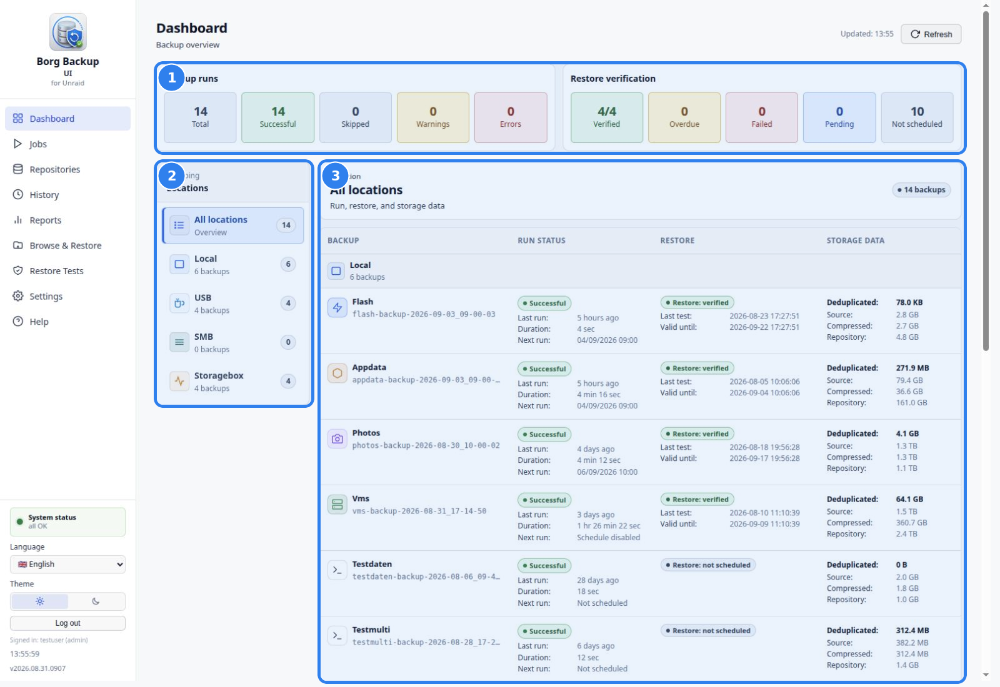
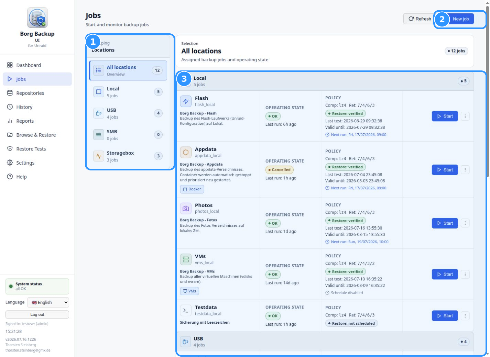
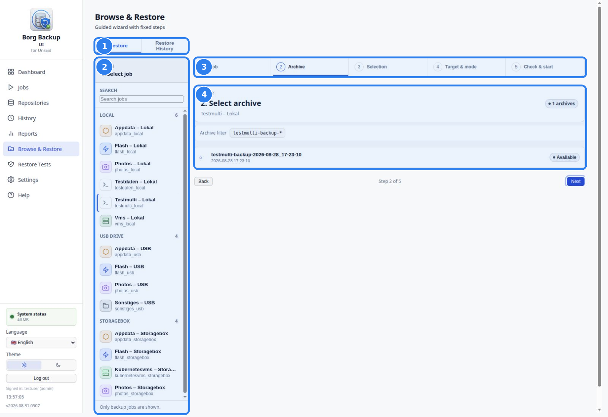
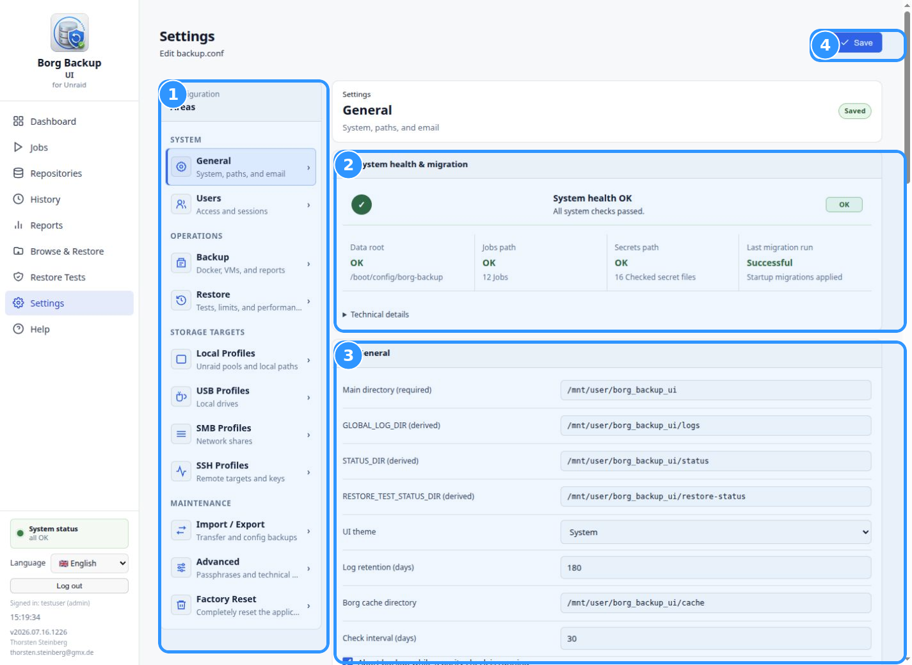

# Borg-Backup-UI User Manual

Documentation review: 2026-10-11. Behavior baseline: stable `2026.10.11.1525`, Borg `1.4.5`.
Language: English  
Audience: Beginners, advanced users, and administrators of an Unraid system

Choose an entry point for your task. The numbered chapters remain available as a menu reference. Updated help rendering ships with the documentation test candidate and does not change backup behavior. Screenshots were refreshed on 2026-10-11 using the current application and synthetic data. The isolated plugin demo uses real Borg; Grafana shows separately generated example metrics. These captures do not replace testing on actual Unraid hardware.

[Capture inventory and demo boundaries](../assets/README.md).

> **Note:** This manual describes the application itself. It does not replace the general BorgBackup documentation or the Unraid system documentation. If a function is not visible in the interface, it may not be available for the currently signed-in role or current configuration.

## Find your path

| Entry point | Start here |
| --- | --- |
| Tutorial | [Installation](#13-installation-and-initial-setup), then [first backup and verified restore](#tutorial-first-backup-and-verified-restore) |
| Tasks | [Back up, check, restore and notify](#11-typical-tasks); during an outage use [disaster recovery](#16-disaster-recovery) |
| Reference | [Jobs](#3-jobs), [Repositories](#4-repositories), [Restore](#7-browse--restore), [Settings](#9-settings), [actions and settings reference](#17-actions-and-settings-reference) |
| Concepts | [Terms](#11-key-terms), [lifecycle, sizes and evidence](#18-concepts-and-lifecycle) |

## Tutorial: First backup and verified restore

**Outcome:** Back up a known test file and compare the restored content. You
need an initialized Unraid system and the **admin** role; subsequent manual runs
and restores also allow **operator**. Allow about 20 minutes plus installation
and transfer time. Use new test directories only. This single-host exercise is
a functional check, not an independent disaster backup.

1. Complete [initial setup](#13-installation-and-initial-setup). In the Unraid
   terminal or file manager, create three new directories inside an existing
   share `/mnt/user/demo`: `source`, `repositories` and `restore`. Choose other
   unused names if those directories already contain data. Create
   `source/probe.txt` containing `Borg Backup UI restore check`. Back up only the
   test source, never the entire share containing the repository and restore
   destination.
2. Open **Settings > Local Profiles**. Create storage target `Demo-Local` with
   base path `/mnt/user/demo/repositories`. Save it and check reachability and
   write access. If the check fails, resolve mount, path and free-space issues
   before creating a job.
3. Open **Repositories > Add Repository**. Select `Demo-Local`, **Create New
   Repository**, display name `Demo-Repository` and relative repository directory
   `demo-repo`. Choose `repokey-blake2`, set a new passphrase and keep it separately.
   Verify the full destination shown. After creation, refresh repository
   information and export its Borg key from management. Keep the export outside
   this server. See [keys and recovery](#16-disaster-recovery).
4. Open **Jobs > New Job**. Set **Job name** to `Demo-Backup` and **Archive prefix**
   to `demo-backup`. Keep the generated **Job ID**. Leave Docker/VM control off
   for this text-file exercise.
5. In **Sources & Target**, select only `/mnt/user/demo/source`, `Demo-Local`,
   `Demo-Repository` and compression `lz4`. Leave **Exclusions** empty. Docker and
   VM steps are skipped. Under **Retention**, choose **Keep all** for this small
   test, enter a description and leave scheduling disabled initially. Select no
   **Pre/Post scripts**. Review source and destination in **Flow Preview**, then
   save.
6. Start `Demo-Backup` manually under **Jobs** and confirm the dialog. Wait for
   completion. In **History**, verify the result, archive name and plausible
   original size. Under **Repositories > Archives**, open the new archive and
   find `probe.txt`. Success alone does not prove that the right data was selected.
7. Open **Browse & Restore**. Select `Demo-Backup` and that exact archive. Navigate
   to the stored path and select only `probe.txt`. Choose
   `/mnt/user/demo/restore` and **Do Not Overwrite**. Check the final file path in
   the summary. You may run **Dry run (no changes)** first, but it produces no
   comparison file. Then turn it off and perform the actual restore.
8. Check completion and **Restore History**. Open the restored file. Compare it
   in the Unraid terminal using `cmp`; if the destination differs, use the exact
   path shown in the summary:

   ```bash
   cmp /mnt/user/demo/source/probe.txt /mnt/user/demo/restore/probe.txt
   ```

   No output and exit code `0` mean equal contents. A missing file, a difference,
   or a skipped existing destination is not a passed test. Check archive,
   selection, destination, conflict strategy and log. Application data also
   requires a startup test and application-specific checks in an isolated instance.
9. Only after a successful comparison, enable the backup schedule. For example,
   use 03:00 daily in the Unraid server timezone. Schedule Restore Tests separately,
   such as Sunday 06:00 with eight days of evidence validity. The
   [test limits](#83-test-levels) still apply. Configure
   [notifications](#115-configure-notifications), save the settings and send a
   test message.
10. For real data, choose suitable retention and at least one independent copy.
    Protect configuration, keys and credentials following the
    [recovery guide](#16-disaster-recovery). Keep the test data until you have
    confirmed the comparison.

## Table of Contents

1. [Basics](#1-basics)
2. [Dashboard](#2-dashboard)
3. [Jobs](#3-jobs)
4. [Repositories](#4-repositories)
5. [History](#5-history)
6. [Reports](#6-reports)
7. [Browse & Restore](#7-browse--restore)
8. [Restore Tests](#8-restore-tests)
9. [Settings](#9-settings)
10. [Help](#10-help)
11. [Typical Tasks](#11-typical-tasks)
12. [Status, Warnings, and Best Practices](#12-status-warnings-and-best-practices)
13. [Troubleshooting](#13-troubleshooting)
14. [FAQ](#14-faq)
15. [Recommended Operating Practices](#15-recommended-operating-practices)
16. [Disaster Recovery](#16-disaster-recovery)
17. [Actions and Settings Reference](#17-actions-and-settings-reference)
18. [Concepts and Lifecycle](#18-concepts-and-lifecycle)

## 1. Basics

Borg-Backup-UI is a web interface for BorgBackup on Unraid. The application manages backup jobs, storage targets, schedules, restore functions, restore tests, reports, notifications, and system diagnostics.

### 1.1 Key Terms

- **Job:** A backup definition with folders or files to back up, target, job-specific Borg options, retention, and optional schedule.
- **Repository:** The BorgBackup target where archives are stored.
- **Archive:** A single BorgBackup snapshot inside a repository.
- **Location:** A target group such as `Local`, `USB`, `SMB`, or `Storagebox`.
- **Profile:** A reusable target configuration, for example a USB, SMB, or SSH profile.
- **Restore:** Recovery of files or directories from an archive.
- **Restore test:** Automated verification that a restore is technically possible.
- **System status:** Combined status of configuration, migration, jobs, secrets, runtime recovery, and maintenance notes.

### 1.2 Sign-in, Language, and Role

After signing in, the left sidebar shows the main menu, system status, language selection, log-out action, signed-in user, and installed version.

On first use, the interface follows a supported German or English browser language; other or unknown languages default to English. Afterwards, the language can be switched between German and English at the bottom left and remains stored for that browser. This affects the web interface, not the technical log files. Logs, machine-readable values, and technical error codes may still contain English terms.

The application supports the `admin`, `operator`, and `viewer` roles:

- **admin:** Full access to users, settings, storage targets, repositories, and jobs.
- **operator:** May run operational actions such as backups, restores, and maintenance, but cannot manage administrative settings.
- **viewer:** Read-only access; write actions are disabled or rejected.

> **Warning:** Keep passwords, Borg passphrases, SSH keys, and export passwords secure. Borg-Backup-UI masks secrets in diagnostic output, but support bundles should still be reviewed before sharing.

### 1.3 Installation and Initial Setup

General Unraid steps are covered by the official [Community Apps](https://docs.unraid.net/unraid-os/manual/applications/) and [plugins](https://docs.unraid.net/unraid-os/using-unraid-to/customize-your-experience/plugins/) guides.

Borg Backup UI is installed through **Unraid Community Apps**. It requires **Unraid 6.12.5 or newer** and **Python 3.10 or newer**. Install the separate **Python 3 for Unraid** plugin from Community Apps first. BorgBackup itself is bundled with Borg Backup UI; no separate Borg or pip installation is required.

1. Open **Apps** in Unraid.
2. Install **Python 3 for Unraid** if it is not already present.
3. Search for **Borg Backup UI** and install the plugin.
4. Open **Settings > Borg Backup UI**, start the service, and open the web interface.
5. Create the first administrator account with a password of at least twelve characters.
6. Select and confirm a concrete main directory for logs, status, and restore data.
7. Start with non-critical test data, run the first backup manually, and verify a restore into a separate test target.

> **Warning:** A written backup is not yet proof that recovery works. Do not rely on the setup until a manual restore and a restore test have succeeded.

The main directory may live below an Unraid share, pool, array disk, Unassigned Devices mount, or remote mount. During startup Borg Backup UI waits for the actual backing mount before migrations, the scheduler, or status workers write to it. If no main directory is configured yet or its mount is unavailable, only the functions needed for setup and diagnostics remain active; the application does not create misleading runtime directories on the root filesystem.

Service start, stop, and autostart are managed by the plugin. Do not add a separate launch command to `/boot/config/go`.

## 2. Dashboard



**Figure 1 – Dashboard with example data:** (1) Current metrics, (2) location filter, (3) historical trends, (4) location overview with links to Jobs.

Four compact cards show **Latest backup runs**, **Restore coverage**, **Active runs** and **Server resources**. The location filter in the header applies to the first three metrics, attention items, historical statistics and location totals. The first card counts the last saved outcome per job. Restore coverage compares valid evidence with all jobs; the ratio within known test plans appears separately. Missing status data never counts as success.

Running jobs appear only in **Active runs**, using the existing link; no duplicate job-name row appears above attention items.

**Needs attention** shows a compact status strip. When problems exist, **View** expands full failure messages, warnings, skipped or cancelled runs, overdue backups and restore evidence. **View job** opens the matching job and its status. Jobs without test plans are listed in the **Restore coverage** card with a link to Restore Tests.

Status charts use consistent solid colors: green for success, orange for warnings, red for errors, gray for skipped, blue-violet for cancelled, and light gray for unknown outcomes. Needs attention uses a neutral card surface with a warning triangle; specific failures remain identifiable by their labels. Server resources retain their blue styling.

Info icons beside chart titles expand explanations of calculations and data sources and support keyboard access. The normal overview including the location table stays compact on large desktop screens; expanded details, running tests or smaller screens can require scrolling.

**Trends** evaluates saved backup runs over 7, 30 or 90 calendar days including today in the server timezone. Success rate is successful runs / (successful runs + warnings + failures). Skipped, cancelled and unknown runs are counted separately. This historical rate differs from the share of jobs whose current outcome is successful.

**Repository storage** uses actual sizes from saved reports, counting each shared repository once. The last sample is carried forward until the next measurement. Missing sizes are never replaced by deduplicated archive sizes; incomplete series remain gaps. Assignment follows the current job configuration because older reports contain no repository ID. After changing a repository assignment, older values therefore have limited comparability. The chart shows the latest sample time. Deleted jobs are excluded from this overview.

During automatic refresh, charts remain visible while new data loads. Trends and the location table update in place. Locations without assigned jobs are omitted from the dashboard filter and table. If the selected location becomes empty, the view returns to all locations.

The **Locations** table summarizes job counts, latest successes, jobs needing attention and restore coverage. **Open jobs** in a location row shows only the jobs at that location, for example USB. Individual job details and actions belong on the Jobs page.

**Server resources** in the fourth summary card remain global. CPU and RAM are stacked compactly; expandable history below the cards uses the full width. Active protected restore tests also use the full width, even with history collapsed. Charts stack on narrow screens.

### 2.6 Unraid Dashboard Widget

The plugin adds a read-only widget to the normal Unraid Dashboard. It shows backup counters, running jobs, the latest and next backups, restore proof, and the number of reachable repositories.

The widget reads a precomputed status file on the flash drive. Refreshing it does not start Borg or a repository check and should not wake array disks only to render the display. The cache is updated after backup and restore-test events. **Data updated** is the snapshot time; **Last fetched** is the last successful widget fetch. The refresh button only reads the existing cache again. An older snapshot between events is normal and does not itself indicate a connection failure. Relative ages and Today/Tomorrow labels update in the browser; clock times use the browser timezone. An elapsed cached schedule is marked **Scheduled … (past)** until an event refreshes the schedule. Older caches without absolute timestamps show a hint instead of stale relative times until the next event.

Skipped runs have their own **Skipped** counter. A separate overdue condition still produces a warning. Failed fetches or invalid caches show visible feedback while retaining the last available display. **Initial** or **Unknown** is not current backup evidence; check the Dashboard, History, and System Health in Borg Backup UI.

> **Note:** This native Unraid widget is different from the optional **Homepage** integration under **Settings > General**. Homepage uses its own restricted token.

### 2.7 Server Resources

The fourth summary card shows CPU utilization and available RAM for the **entire Unraid host**, including VMs, containers and Borg. 100% CPU means all logical CPU cores combined; I/O wait is not counted as CPU work. Available RAM uses Linux `MemAvailable`, including reclaimable cache, rather than only completely unused memory.

Active runs count backups, restores and restore tests tracked by resource locks, once per run. Browsing requests do not count as runs, but their load is included in host measurements. A protected restore test additionally shows its shared cgroup consumption: CPU, RAM including file cache and child processes, and the actual enforced RAM limit. Waiting tests and tests with protection disabled never inherit another test's measurements. Missing measurements show a dash instead of zero.

Expanded resource history uses the full width below the server metrics: CPU and RAM appear side by side, stacking on narrow screens. Active tests also appear across the full width below the server metrics, with job name, CPU, RAM, memory limit and host reserve. This area stays visible with history collapsed and disappears when no active runs or test metrics are reported. Server resources remain independent of the location filter.

The RAM bar shows the available share of total RAM; the CPU mini trend remains visible while history is collapsed.

The card refreshes every **2 seconds** during active runs and every **10 seconds** otherwise. Requests pause when leaving the dashboard or hiding the browser tab. Shared server sampling continues after the first dashboard visit: once per second during active runs, every ten seconds otherwise. **Show history** opens the last ten minutes; the transferred trend is thinned to approximately five seconds. There is no persistent storage or complete per-run analysis; restarting the UI service clears history.

The expanded charts show the current value and labeled percentage or GiB scales. Point or tap inside a chart to inspect a sample with its timestamp. Focus a chart with Tab; arrow keys navigate samples and Home/End select the first/last point. Times use the browser time zone. Missing measurements are explicitly identified instead of replaced with zero.

The display does not introduce new limits. Memory enforcement currently protects restore tests only. The configured host reserve is a monitored cancellation threshold, not preallocated RAM. Backups and Browse & Restore can also consume RAM; in particular, large archive browser indexes are currently outside this protection.

## 3. Jobs



**Figure 2 - Jobs:** (1) Filter by storage target, (2) entry point to the job wizard, (3) job cards with state, policy, and start action.

The **Jobs** page manages backup jobs. Jobs can be viewed, started, edited, scheduled, and deleted here.

### 3.1 Purpose of the Page

Jobs define which data is backed up and where it is stored. A job contains:

- Display name, permanent job ID and archive prefix
- Location and repository
- Folders or files to back up
- Docker and VM control
- Borg options such as compression and retention
- Schedule
- Description and icon

### 3.2 Areas and Functions

- **Location selector:** Filters jobs by storage target above the compact cards.
- **Job list:** Shows name, operating state, dates and actions. Description, policy and storage facts are available in expandable details.
- **Start:** Starts a job manually.
- **More actions:** Opens actions such as edit, schedule, logs, or delete depending on the job.
- **New job:** Opens the job wizard.
- **Refresh:** Reloads job list and status.
- **Live log:** During a running job, output can be followed in the browser.
- **Cancel:** Requests a controlled cancellation of the running job.

**Next run** shows the scheduled time. The last run time and duration remain separate values.

Jobs appear as separate compact cards with spacing. The **Single jobs/Job groups** tabs attach directly to the workspace. The **All locations** total and each individual location count use the same subtly outlined badge. A labelled location bar below them shares the surrounding panel, without pills or a dropdown. A dedicated date column shows schedules, the latest restore test and evidence validity. The arrow next to a job opens one detail area with **Workflow** and **Data & settings**. The latter combines storage facts, policy, archive prefix, description, Borg/repository checks and restore evidence. Both views reserve the height of the larger content, so switching does not shift the list. Open details and the selected view survive refreshes.

Subtle markers below the job name identify configured **VMs**, **Docker**, **Pre script** and **Post script** options. Script markers reflect current assignments, not historical run results; their tooltip names the script and the post-script execution condition.

Status and restore evidence use distinct symbols and subtle background fills with normal-weight text and no outline. Last test and validity dates have separate labels and vertically aligned values.

**Start**, **Log** and **Cancel** have matching icons and retain their positions and labels below the centered **Actions** heading. Unavailable actions remain disabled. **Log** opens the live log during a run (marked with a live dot) and the saved log afterwards; it is disabled when no log is available. During Docker/VM recovery, **Cancel** stays disabled, with the explanation in a tooltip instead of an extra text row. Requested cancellation appears in the status badge.

Collapsed cards identify failures, warnings, skipped or cancelled runs by status only. The full message appears exactly once under **Workflow**, labelled **Last saved outcome**, including during a new run. Dashboard problem links open this view directly. Long live-log lines scroll horizontally. Missing status files never imply success.

### 3.3 Start a Job Manually

1. Open **Jobs**.
2. Find the desired job by location group or search.
3. Click **Start**.
4. Confirm the start dialog.
5. Watch the live log.
6. Afterwards, check **History** and optionally **Repositories**.

> **Warning:** If the job is configured to stop Docker containers or VMs, only the targets configured in the job are controlled. Review this selection before production runs.

### 3.4 Cancel a Running Job

1. Click **Cancel job** on the running job.
2. Confirm the controlled cancellation.
3. Watch the status and live log until runtime recovery is complete.

An active Borg step is interrupted with SIGINT. If cancellation is requested while Docker containers or VMs are being stopped, the application first completes the stop operation already in progress. It then automatically restarts the containers or VMs that were running before the backup. Cancellation is no longer available during this recovery. If a container or VM cannot be restarted, the run ends as an error and **System Health & Migration** shows the pending runtime recovery item.

> **Note:** A controlled cancellation is stored as **Cancelled**. The application does not automatically run `borg check`, remove Borg locks, or repair a repository after cancellation. Review the log when Borg reports anything unusual and use repository maintenance deliberately.

The live-log connection indicator describes the browser connection to the log stream, not the backup process result itself. After a short transport error the interface attempts to reconnect. Judge the run by its final status and stored log.

### 3.5 Job Wizard

The job wizard guides creation or editing of a job through fixed steps.

#### Step 1: Basics


This step sets job name, archive prefix, icon, icon color, and initial runtime options. The automatically assigned **Job ID** is permanent.

Important fields:

- **Job name:** Visible name in the UI, reports, and notifications.
- **Archive prefix:** Beginning of future archive names; letters, digits, dots, underscores and hyphens are accepted.
- **Job ID:** Permanent UUID linking the job, schedule and history independently of its display name.
- **Icon / icon color:** Representation in Dashboard, Jobs, Restore, and Reports.
- **Stop Docker before backup:** Enables Docker control.
- **Shut down VMs before backup:** Enables VM control.

The **Job name** is a display name. The **Job ID** is an independent, immutable UUID. The **Archive prefix** defines `<current-prefix>-*`. Renaming a job preserves its identity. Changing the prefix affects new archives only; previous prefixes remain visible in the archive-pattern history and information popover. Existing archives are neither renamed nor moved. Browse & Restore can show current and previous patterns together; prune uses only the current prefix. Changing repositories leaves older archives in the previous repository.

#### Step 2: Sources & Target


The compact view shows **Backup sources** on the left and the **Backup target** on the right. The left side provides separate folder and database profile tabs with selected-item counts and scrollable lists. Exclusions are configured in the next step. The right side selects storage type, the exact storage target, an existing repository, and job compression. The repository list only shows repositories belonging to the selected storage target. Repository paths are no longer entered freely in a job.

Typical folders to back up:

- `/boot/`
- `/mnt/user/appdata/`
- `/mnt/user/domains/`
- `/mnt/user/photos/`

> **Note:** The selected folders or files must exist on the Unraid system and must be readable by the backup process. Technically, they are stored as the job's source paths.

A complete and valid source can be accepted with **Enter** even while autocomplete shows child-directory suggestions. Share roots such as `/mnt/user/appdata` are allowed when they exist. If the selected source itself is a symlink, or a parent path passes through a symlink, Borg Backup UI resolves it to the real target only at run time and remaps related exclusions. The readable path selected by the user remains stored in the job; the resolution is recorded in the run log.

When editing a job, a different existing repository can be selected. The change affects future backups only. Existing archives are not moved and are no longer reachable through this job in **Browse & Restore**; the wizard requires explicit confirmation.

#### Step 3: Exclusions


The dedicated **Exclusions** step always shows excluded paths, marker filenames and the exclusion file. All ten wizard steps keep the same window size; Docker and VMs are skipped when their controls are disabled. Small screens or long lists can still require scrolling.

Exclusions are concrete files or directories below a selected backup folder. They are omitted from the Borg archive. With many entries, only the path lists scroll inside their section.

The advanced rules supplement the excluded paths without modifying source files or existing archives.

- **Marker files:** One case-sensitive filename per line. If you enter `.nobackup` and create that file inside `/mnt/user/data/cache`, Borg skips the whole folder, its subfolders and the marker. File contents do not matter. Up to 32 distinct names are allowed; paths are not.
- **Exclusion file:** Upload one UTF-8 text file without a BOM, up to 64 KiB. Borg patterns remain unchanged, for example `fm:*.tmp`; blank lines and comment lines starting with `#` are ignored. The job stores its own copy. Changes to the original file take effect only after uploading it again and saving. Downloading, replacing and removing the copy are supported.

A running backup uses a private temporary copy of the uploaded file. Editing the job during a run does not change that run's filter. A missing or corrupt managed file blocks the run before backup starts and is reported in system health. After changes, use a test job to inspect the actual archive contents.

New job exports include the managed exclusion file. Jobs using extended rules use export format `bbui-job-bundle-v4`, so older versions cannot silently ignore these settings. Previous UUID job bundles in v3 format remain importable. For manual configuration backups, include the entire `config/jobs` directory, including `exclusions`. Uploaded file contents are not included in support bundles.

#### Docker and VM Steps

If Docker or VM control is enabled, the wizard shows dedicated selection steps.

Options:

- **All running containers**, **selected containers only**, or **all except selected containers**
- **Order** of the containers for stopping and restarting, see "Job Start and Stop Order"
- **All running VMs** or **selected VMs only**

When `/mnt/user/appdata` is backed up, the application recommends stopping all Docker containers. When `/mnt/user/domains` is backed up, it recommends shutting down all VMs. If only selected services are stopped, the warning must be acknowledged deliberately.

When Docker or VM control is disabled, the related selection step is skipped. For protected appdata or domains sources, the required risk acknowledgement appears no later than the final review so an intentional backup without stopping services remains possible.

> **Warning:** Appdata and VM backups can produce warnings or inconsistent data if files change during the backup. For full appdata or domains backups, stop all affected services where possible.

A planned VM shutdown is reported as informational. A failed shutdown or restart, or an explicitly permitted force-off, produces a warning or error. Only containers and VMs stopped by the job that were actually running before that run are started again.

Once archive creation (`borg create`) finishes, containers and VMs stopped by the job are restarted immediately, including when Borg reports warnings. Retention (`prune`), space reclamation (`compact`), and any due repository check (`check`) run afterwards and do not extend service downtime. If archive creation fails or is cancelled, cleanup still restarts the stopped workloads. If a restart fails, recovery is still attempted for the other workload type; the run ends as an error and maintenance does not start.

Each job has a compact card with its name, operating status, dates and actions. **All locations** groups only destinations with jobs; the location selector sits above the cards. If the selected destination loses its last job, the view returns to **All locations**. Selecting one location avoids a duplicate section heading.

The overall result appears directly below **Operating status**.

The expandable **Workflow** view shows each configured step exactly once, in execution order: optional Pre script, database backups, Docker/VM shutdown, `borg create`, Docker/VM recovery, `borg prune`, `borg compact`, `borg check` and Post script. With “Keep all archives”, prune is absent. A configured check that is not due remains visible with its reason. Each row contains its status symbol, result and measured duration; long results wrap.

A circled check, circled cross, warning triangle, stop symbol, minus, empty circle and rotating ring distinguish success, failure, warning, cancellation, skipped, pending and running steps without relying on color alone. Reduced-motion preferences disable ring animation. Progress updates preserve the running animation without restarting it. Unexecuted steps never receive invented durations or success symbols. Recovery after errors or cancellation is tracked too.

The arrow next to the job opens **Workflow** with a compact row per step with a small status symbol, result and duration. Successful steps show available results without repeated success text or exit code 0; failures and warnings keep their status and exit code. Service counts identify the action as stopped or started. Kept/deleted archives and script names come from reported results. Raw script output and paths are not copied here. The keyboard-accessible disclosure stays open during polling.

For `borg create`, **Files processed** includes unchanged files, not just new or modified files. **Original data** is the archive's uncompressed amount; **New data (deduplicated)** is the additional deduplicated and compressed data reported by Borg. Neither value is the total repository size or a measurement of filesystem usage. For `borg compact`, **Approx. … freed** shows Borg's estimate of reclaimed repository space. Missing values remain unknown; zero appears only when explicitly reported. Older reports are not filled with estimated metrics.

Operating status labels the **current action**, **step elapsed time** and **total elapsed time** separately. As soon as the respective Borg command starts, the progress bar shows available live file/data counters underneath. The time of the last Borg update is not displayed. `borg create` shows a processing rate over a rolling window of up to 30 seconds. It measures original bytes before compression and deduplication, not network throughput. Speed and remaining time disappear after 30 seconds without a new byte measurement. Prune, compact and check percentages describe only the current operation; the bar remains indeterminate until the first progress event. Detailed service, script and database results remain available under **Workflow**. A longer pause since the last update alone does not indicate failure.

Source-size measurement starts automatically with every backup and adds approximate source size, percentage and remaining **archive creation** time to the live metrics. No job setting needs to be enabled. After preparation (including database dumps), an additional GNU `du` scan runs alongside `borg create` on its actual local source paths. Mounted USB, SMB and SSH filesystems can be measured; this does not add direct SSH source backups. The metadata scan can add disk and network load. Borg starts in parallel without waiting for the result.

The scan measures logical sizes, including sparse files. Overlapping source roots are combined and `du` counts hardlinks once. Explicit excluded directories are honored. Marker exclusions or imported pattern files disable the scan because `du` cannot reliably reproduce their Borg semantics; the view explains why. Failed or incomplete scans do not provide a total. Cancellation, completion of archive creation or a five-minute limit stops the scan; uninterruptible filesystem I/O can delay process cleanup, without making the application wait indefinitely. Results appear with the next Borg progress event. Scan failures do not change the backup result.

Percentage and remaining time are estimates for `borg create` only, excluding prune, compact, check and other job steps. They remain unknown while measuring. A rate needs at least two seconds of samples; measured zero progress shows zero speed and unknown remaining time. Changing sources and processing rates can affect estimates. When processed bytes exceed the estimated source size, percentage and remaining time disappear. Progress stays below 100% until Borg returns and never substitutes for the success status.

After completion, steps, results and durations remain in the existing run report. Total duration also includes preparation, service recovery and scripts. The status column shows the **last successful backup**, its date/time, relative age; duration is available under **Workflow**, even when details are collapsed. Later failed, warning, cancelled or skipped runs do not replace this success summary. New reports carry it forward so it survives normal history retention. If no prior success report exists, no date is guessed. Older reports show only their recorded Borg steps; additional steps are not invented retrospectively.

Borg commands in the backup runner (`create`, `prune`, `compact`, `check` and version/info diagnostics) are logged immediately before startup as `BORG_EXEC [operation] id=…: borg …`. `BORG_EXIT [operation]` uses the same ID and records the actual process exit code; negative codes represent signals. The job can still classify cancellation as 130. Startup failures use `exit_code=not_started`; diagnostic timeouts use `exit_code=unknown status=timeout`. Skipped commands produce no invocation record.

The log line comes from the actual argument vector. Spaces and special characters are shell-quoted for display, and control characters use visible hex escapes; execution still uses no shell. Credentials, sensitive options and known secret values are masked with `***`. Values of `--rsh` and `--remote-path` are conservatively hidden because they can contain nested commands. Environment variables are not printed. This is diagnostic evidence, not a complete replay script. Source/repository paths and archive names generally remain visible.

Manually started repository maintenance uses the same format in the service log and persisted execution details. The invocation and exit are retained within the existing limit of 20 lines of up to 2,000 characters each. Existing support exports include the records from included logs and maintenance results with additional masking; existing log-tail limits still apply.

Starting a job does not open the live log automatically. Click **Log** during the run; an already opened log stays visible after completion. **Log** opens the saved log after completion when available. The live log has no duplicate progress display; changing progress values are neither saved nor downloaded. Checks keep one final summary plus warnings/errors. Final statistics and optional file activity remain intact. Empty INFO lines and internal cache progress are suppressed; prune archive decisions, warnings and errors remain visible.

#### VM Shutdown Failures and Optional Force-Off

In the wizard's **VMs** step, **Force off VMs after the shutdown timeout** is off by default. This permission is saved per job and shown in the final review; existing jobs remain off until you explicitly enable it and save the job. It applies only to VMs within that job's selected scope that were active before preparation.

- **Without force-off:** The job requests a normal shutdown and waits for **VM Shutdown Timeout (s)** under **Settings**. If a target remains active, archive creation is aborted. The log, history and failure notification identify VM preparation as the cause, with the affected VM names and timeout.
- **With force-off:** The job first requests the same normal shutdown and waits for the same timeout. Remaining active target VMs are then powered off forcibly (`virsh destroy`). This does not delete their definitions or disks. Backup starts only after all targets have been confirmed inactive. A failed force-off or an unreadable VM state still aborts the backup. Paused guests must be resumed or shut down manually before starting the job.

> **Warning:** Force-off is equivalent to cutting power. Unsaved data can be lost and guest filesystems, databases or applications can be damaged. The backup may preserve that unclean state. Enable this only if you accept that risk for the affected VMs. Increasing the shutdown timeout may be preferable for guests that need more time.

Recovery is recorded before shutdown begins. If some VMs stop and another fails, the job tries to restart those already stopped. It also watches pending shutdowns for up to 30 additional seconds and restarts guests that stop during that window. A guest still shutting down, an unknown state or a failed restart remains visible under **System Health & Migration**; check the affected VM and start it manually if needed before resolving the entry. VMs already off before the job are not started. Force-off is logged as a warning. A recovery error does not replace the original preparation failure.

For imported VMs, check the guest integration as well: the QEMU Guest Agent may be missing, inactive or incorrectly connected, and the guest may ignore an ACPI power-button event. Missing a Guest Agent alone does not prevent every normal shutdown; libvirt also supports ACPI. Check the guest's power settings and Guest Agent, test a normal shutdown in Unraid and review the job log before enabling force-off. See the [libvirt shutdown documentation](https://www.libvirt.org/manpages/virsh.html#shutdown).

#### Job Start and Stop Order

In the Docker step of the job wizard, the **Order** list shows all containers in the selected scope. Drag an entry to the desired position or move it with the arrows:

- After archive creation, Borg Backup UI starts the containers stopped by the job from top to bottom. The next start follows once Docker has confirmed the previous one. The pauses between the label priority groups do not apply to the listed containers.
- Before the backup, the containers are stopped one by one in reverse order. Put databases at the top: they start first and stop last.
- Containers that are not in the saved order, such as containers added later, stop first and start after the listed containers according to their label priority.

As long as you move nothing, the list shows the default order (`backup.start.priority` label, then name) and the job saves no order of its own. The containers are then stopped together and started by priority group as before. **Restore default order** returns to this behavior. Stopping one by one can take considerably longer than stopping together, while starting without group pauses is considerably shorter. For the listed containers, the custom order replaces the label priority groups, including the pauses between them. The flow preview and the run log show the order in use.

> **Note:** In neither mode does Borg Backup UI wait for Docker health checks or application readiness. A database started first therefore does not necessarily accept connections yet when the next application starts. Applications should retry failed connections themselves.

#### Docker Container Restart Priority

The priority controls only the order in which containers stopped by Borg Backup UI are started again after archive creation. It does not control the stop order or Unraid's normal autostart order. If a job defines its own order, that order applies to the listed containers.

Configure the label on each affected container in Unraid:

1. Open the Unraid **Docker** tab.
2. Edit the container.
3. Enable **Advanced View**.
4. Under **Extra Parameters**, add for example:

   ```text
   --label backup.start.priority=1
   ```

5. Preserve any existing extra parameters and add the label alongside them.
6. Apply the container configuration.

Supported values:

- `1`: critical infrastructure, such as databases or caches
- `2`: standard applications that depend on priority-1 services
- `3`: remaining containers

A missing, empty, invalid, or unsupported value falls back to priority `3`. Lower-numbered groups start first; Borg Backup UI waits between populated groups according to its runtime configuration. The label belongs to the container and therefore applies whenever any job restarts that container after a backup.

Example: assign PostgreSQL or MariaDB priority `1` and its dependent application priority `2`. Perform the first verification in a maintenance window and check the live log for **Phase 1**, **Phase 2**, and **Phase 3**. The priority value is sufficient for troubleshooting; do not publish a complete container configuration containing secrets.

> **Note:** Unraid's normal autostart order applies when the Docker service starts. `backup.start.priority` is used only by Borg Backup UI during post-backup recovery.

#### Retention, Compression, and Description


The wizard stores per-job Borg options such as compression and retention. Encryption and the passphrase belong to the repository.

Choose exactly one retention strategy:

| Strategy | Effect |
| --- | --- |
| **Tiered** | Combine hourly, daily, weekly, monthly and yearly rules. Optionally also keep every archive in a recent time window. |
| **Last X archives** | Keep the newest X matching archives regardless of day. Other time rules are disabled in this mode. |
| **Keep all** | Disable prune for this job, including repository maintenance. Compact and due repository checks remain active. |

Retention values count time periods containing backups, not archives within a period. **Daily: 7** selects at most one matching recovery point for each of the last seven days with backups. Days without backups do not count. Other active rules select additional points; these values are not a fixed total archive count.

If backups are created at 08:00 and 08:30 on the same day, the daily rule normally selects the newer 08:30 archive. An hourly rule or time window may still preserve the earlier archive. **Daily: 20** does not mean 20 archives from the same day. An archive remains if at least one active rule protects it.

**Keep all archives from the last …:** With **7 days**, every matching archive from the past 7 × 24 hours remains, including multiple backups on the same day. The window is calculated backwards from the time prune runs. Other count rules may preserve additional older archives. For this option a month means 31 days and a year means 365 days.

**Protection against deleting every archive:** `0` disables a rule. In “Tiered”, at least one count rule must be greater than `0`. A time window alone is rejected because it could permit deletion of every archive after a long backup gap. Example: **7-day window + 1 daily recovery point**. No extra rule is silently added. “Last X” requires at least `1`. “Keep all” explicitly skips prune. The same validation applies when saving and importing jobs, and to automatic and manual prune.

**Large deletions can still be permitted:** With “last 3 archives” and 100 matching archives, 97 older archives may be deleted. A value of `1` keeps only the newest recovery point. The wizard evaluates the rules; it does not calculate an actual deletion list from the repository.

After a backup has been created successfully, the saved retention policy is applied. Prune is restricted to the current archive prefix. Archives with previous prefixes remain in addition and do not count towards X. Prune removes unprotected archives; compact then reclaims space that is already unused. The run log records the archive filter and the actual Borg retention arguments. With “Keep all”, it records that prune is skipped.

The **info button** opens a separate dialog for each mode and for the time window, showing current rules, an explanation, an example and the deletion effect. It does not increase the wizard page height. Close or Escape returns without losing input.

#### Optional File Activity in the Live Log

The per-job **File activity in the live log** option is located under **Basics** in the wizard and adds `--list --filter=AME` to `borg create`. During a manual or scheduled run, the live log then shows entries that Borg classifies as added (`A`), modified (`M`), or errored (`E`). Unchanged entries are intentionally omitted. The option is disabled by default and applies only to the selected job.

These status values are based on Borg's files cache and its change detection. They are neither a report of the bytes actually transferred nor a complete listing of archive contents. For example, a path can appear as modified while Borg deduplicates existing data chunks and stores only metadata or a small number of new chunks.

When this option is enabled, the live viewer loads the complete run log in sections, starting at the current end. It follows new lines through completion until you scroll back or use section navigation. **↑ Previous section** and **↓ Next section** move backward or forward through the log; scrolling loads adjacent sections automatically. **Go to beginning** and **Jump to end** provide direct navigation. **Jump to end** resumes following. Every emitted line is retained in the log file. **Clear** only clears the view. Browser search and text selection cover only the loaded section. **Download complete log** includes every entry present when the download starts. Jobs without file activity keep the existing live viewer.

With file activity enabled, the active log is initially stored in RAM under `/run/borg-backup-ui/activity-logs`. After the backup process exits, including cleanup and service recovery, the complete log is copied to the configured log directory and the RAM is released. The current log therefore does not modify a file inside the backed-up log directory and is not included in that backup. This also applies to failed and cooperatively cancelled runs. Restarting the WebUI process does not interrupt final log persistence. History and reports reference the final location. Required RAM is approximately the log size. A server restart or power loss before persistence loses the volatile log. If saving fails, the log remains in RAM and the live viewer asks you to download it before restarting the server.

> **Privacy note:** When this option is enabled, file and directory names appear in both the live log and the stored run log. Because support bundles can contain recent run logs, those names can also be included there. Support bundles mask secrets but are not anonymous; always review a bundle before sharing it.

#### Schedule


The schedule can be set directly in the wizard. Turn on **Enable schedule** to show the frequency, time, and cron controls and the next-run preview. While disabled, the wizard shows a hint that the job only runs manually. Toggling the schedule off and on preserves the entered values. The UI supports simple frequencies and a cron expression.

Cron format:

```text
minute hour day month weekday
```

Example:

```text
0 3 * * *
```

This expression starts the job daily at 03:00.

#### Step 9: Pre/Post scripts

Administrators manage reusable Bash scripts under **Settings > Scripts**, with a name, description and timeout (1–86400 seconds). **Validate and save** checks syntax without executing the script. Syntax errors include a line number; valid syntax does not guarantee runtime success.

The script selector shows the number of assigned jobs. The **Used by** list is collapsed by default and initially shows only the job count. Expand it to see jobs with location, Pre/Post assignment and Post execution condition, including disabled jobs. **Delete** remains disabled while assignments exist. The Bash editor provides local syntax highlighting and line numbers. On a syntax error it jumps to and marks the reported line; diagnostics beyond the end of the file mark the last line. Colored text does not replace syntax validation.

**Duplicate** copies the current editor content, description and timeout into a new unsaved draft without job assignments. **Import (.sh)** also opens a new draft without overwriting saved scripts. Files must be UTF-8 text up to 64 KiB with `#!/bin/bash`, `#!/usr/bin/bash` or `#!/usr/bin/env bash` on the first line, without additional options. UTF-8 BOM and Windows line endings are normalized. The extension alone is insufficient: the server verifies the Bash declaration and runs `bash -n` without executing the script. Only **Validate and save** creates the draft in the inventory. **Export (.sh)** validates the current editor content and downloads only script text, excluding description, timeout and assignments. If a supported Bash shebang is missing, `#!/bin/bash` is prepended. Export does not save editor changes.

Optionally select a Pre and Post script in the wizard. These are general hooks around the entire job, independent of Docker/VM controls. After local initialization and successful lock acquisition, Pre runs before backup preparation, network mounts and repository access. Post runs after backup, early Docker/VM recovery, maintenance, final repository statistics and share cleanup according to job settings. Only final status, notifications and lock release follow Post.

- Any nonzero Pre exit or timeout prevents the backup from starting.
- Post **On success** includes Borg warnings (exit 1). **Also on failure, skip or cancellation** enables cleanup after an unsuccessful run, including failed Pre. A conflict during initial lock acquisition does not start a job and runs neither hook.
- Post failure marks the overall job failed. History separately shows script outcomes and the `borg create` exit code; an already created archive is retained.
- Pre is cancellable. Post is final cleanup and cannot be interrupted through **Cancel**; its timeout still applies. Child processes are terminated on completion, timeout or cancellation.
- Jobs store central references. Edits apply to all assigned jobs at their next start; active runs retain both definitions read at startup. Assigned scripts cannot be deleted.

Scripts run with the backup service privileges (normally root on Unraid), non-interactive stdin and a clean environment without inherited Borg credentials. Available variables are `BBUI_JOB_ID`, `BBUI_HOOK_PHASE` (`pre`/`post`) and, for Post, `BBUI_JOB_RESULT` (`success`, `warning`, `failed`, `cancelled`, `skipped`). Executed scripts get their own phase separators in the job log, with name, output and result (up to 64 KiB per script); do not print credentials. Wake scripts must wait until the server is ready. If multiple jobs share a server, wake/sleep scripts must account for that shared use.

For script failures, the log and History identify the affected phase and script exit code. A failed Pre explicitly reports that the backup was not started. Job exit code 2 identifies the failed overall run and is separate from the script exit code. The log footer distinguishes success, warning, failure and cancellation.

Definitions are stored in `<data directory>/config/job-scripts.json`; back up that file with the data directory. Job exports contain references, not script contents. When transferring to another system, create scripts there and update assignments in the wizard. The [six test scripts and test matrix](../../examples/job-hooks/README.md) cover success, runtime errors and syntax errors.

#### Flow Preview


The final step shows a technical preview of the planned flow. It summarizes repository, folders or files to back up, Docker/VM selection, and planned actions.

Forms and multi-step wizards with unsaved input do not close when the backdrop is clicked. **Cancel** and the close button remain available; when values have changed, Borg Backup UI asks explicitly before discarding them.

### 3.6 Scheduling and Cron

Schedules can be changed in the job wizard or through job actions. When saved, the application's cron entry is updated.

The schedule editor preserves custom expressions such as `15 3 * * 1,3,5` (Monday, Wednesday and Friday at 03:15). Expressions that cannot be represented by one preset stay **Custom**; switching modes refreshes the next-run preview immediately.

For individual jobs, a new or changed enabled schedule, or re-enabling a schedule, starts a new overdue-monitoring window after successful installation in the server's crontab. Earlier occurrences of the new schedule are not counted as missed. The first applicable occurrence still becomes overdue after the configured tolerance if no later job status exists. Saving unchanged settings or restarting the service does not reset this window or clear a genuine overdue condition.

Existing schedules retain their previous monitoring behavior until changed; their historical activation time cannot be reconstructed. A failed crontab update leaves the changed schedule saved but pending: the save reports an error and reminder diagnostics show **Schedule not applied**. No overdue reminders are sent for that pending schedule. The previous cron entry may still run. Correct the reported cause and save again, or reapply schedules by restarting the service. The successful retry establishes the new activation time. Imported new or changed schedules likewise become effective when successfully applied; imported activation timestamps are not reused.

Best practices:

- Test new jobs manually first.
- Enable the schedule afterwards.
- Leave enough time between scheduled jobs so large backups do not overlap.
- For external targets, verify that network and mounts are available at the scheduled time.

### 3.7 Typical Messages

- **Preview error / invalid data:** A wizard field is not plausible. Check the folders or files to back up, type ID, storage target, and repository selection.
- **No storage target or repository available:** Configure the storage target under **Settings** first. Then create or import the repository under **Repositories**.
- **Schedule disabled:** The job runs manually or through a job group.

### 3.8 Job Groups

Job groups are available starting with stable `2026.10.17.1802`. Direct script editing is available starting with stable `2026.10.18.1217` (#573).

A job group runs existing jobs in a fixed order. Jobs retain their sources, repositories, maintenance and Pre/Post scripts. **admin** can configure groups; **operator** and **admin** can start and stop them. **viewer** can inspect progress and logs.

1. Open **Jobs > Job groups > New group** and enter a name.
2. Open **Add jobs**. Search by name or archive prefix, or filter by location. Select one or more jobs and click **Add selection**. Selections are retained while filtering; new jobs are appended in selection order. Use the arrows or drag them into their execution order, from top to bottom.
3. Enable the **Group schedule** if needed. Choose daily, weekly, monthly or a custom cron expression; server time applies. Manual group starts remain available without a group schedule.
4. Keep **Stop group** on errors or explicitly select **Continue with next job**. Save the group.
5. Review the additional individual schedules and coordinate them with the group. Disabling an individual schedule disables neither the job nor its group starts.
6. Start the group manually. Check the active step and **Live log**. **Follow current job** switches the log view when the next job starts and shows the last available job log after the group finishes, even when a short job completes between refreshes. Clicking the current job's **Live log** keeps following enabled; selecting an older log turns it off. Existing log colors are retained.

**Edit job scripts directly:** The group overview and group settings show each job's current Pre/Post scripts. As **admin**, open **Edit scripts**, select existing scripts or **None**, and choose the Post condition. **Save to job** immediately updates the original job; the change also applies to individual starts and every other group using that job. Saving is independent of saving the group; discarding group changes does not undo a script assignment already saved to a job. Already running jobs retain their script snapshot. Jobs that have not started yet, including later steps of a running group, read the new settings when they start. The display describes current job settings, not the scripts used by a historical run. If another editor changes the same assignments, close and reopen the editor; concurrent changes are not silently overwritten.

Under **Individual jobs**, a linked line identifies the group and position, for example “Group: Local backup · Step 1 of 3”. Individual starts, job settings and schedules remain available. The group waits for the complete child process to exit, including maintenance, workload recovery, cleanup and the Post script. Only then does the next job start. History and reports remain per job, supplemented by group context and a separate group run history.

On the dashboard, a compact link with the group name and position (for example, “Local backup · 2/3”) identifies related jobs. Group starts and individual schedules use separate single-line entries; complete group details remain available as tooltips. Leaving modified group settings and deleting a group use the application confirmation dialogs. Unchanged settings can be closed without confirmation. In the group view, live and saved logs keep the same height; longer content scrolls inside the log viewport.

**Stopping and errors:** “Stop after current job” lets the running job finish and starts no further jobs. Cancelling a child job also stops its group. Warnings continue the sequence; failures or jobs skipped because of a lock stop it by default. With “Continue with next job”, failures remain visible in the overall result. A running group cannot be started twice or deleted. Group edits apply to the next group run; each job's current settings are read when that job starts.

**Starting and shutting down a backup machine:** Configure startup and waiting for availability in the first job's Pre script, and shutdown in the last job's Post script. If the group stops earlier, that final Post script does not run. Individual starts execute the same scripts. Groups do not reserve resources across their sequence: other jobs and groups may start independently, while the existing job/repository locks remain effective. Another job can acquire a released resource between two group members. Coordinate schedules and shutdown scripts yourself.

After loss of the coordinating service process, the group run is marked **Interrupted** and is not automatically replayed. A surviving child process is not automatically terminated by this. Check its state and log before starting a new group run.

**Backup and transfer:** Definitions are stored in `config/job-groups.json`, and run state in `group-runs` inside the data directory. Include them in configuration backups. Job exports include only groups whose complete membership is selected, using `bbui-job-bundle-v5`. Imports remap references to the imported jobs; incomplete groups are reported as skipped. Existing groups are retained in `skip` mode. Script definitions still need separate transfer. Reminders monitor the group schedule as one shared start, without prematurely flagging queued members as missing; additional individual schedules remain independent.

**Verification:** After a test run, check the sequence in group history, each job log and the backup machine's state. Edit the group if a job is missing. A referenced job can be deleted only after removal from its groups and any active group run. Deleting a group retains its jobs and saved runs. See section 3.5 for script details.

## 4. Repositories

The **Repositories** page displays registered Borg repositories as separate cards, including repositories without a linked backup job. The storage-target bar filters by the exact target. The left chevron opens the workspace inside a card; its tabs share the height of their largest content so the following cards do not jump when switching tabs. **Add repository** creates or imports a repository on a storage target already configured under **Settings**.

Local storage targets are created under **Settings > Local Profiles**. A
concrete directory below `/mnt`, such as `/mnt/backup` or `/mnt/disks/USB-A`,
is allowed. Broad roots, system paths, and malformed input containing empty,
`.` or `..` segments are rejected before saving.

### 4.1 Purpose of the Page

The page separates storage targets, Borg repositories, and backup jobs. A storage target describes the physical or remote location. A repository contains Borg archives. A job selects an existing repository and defines sources, schedule, compression, and retention.

### 4.2 Areas and Functions

All repository tabs share a compact height based on the overview and the window size. Switching tabs or loading data keeps the card height unchanged. Archive pages fit this area; longer contents scroll inside the selected tab. On wide screens Management places key recovery, removal and deletion in columns separated by vertical dividers, with action buttons aligned along the bottom. The repository ID stays on one line; truncated IDs are available in full on hover. On narrow screens the management sections, archive list and file browser are stacked. Returning to Repositories automatically refreshes job links and the availability of management actions. Deleting a job does not require an additional Refresh click; any other blockers still apply.

- **Repository cards:** Arrange facts in **Repository**, **Storage target**, **Linked jobs**, and **Archive data** columns. Names and group headings match the Jobs page typography. The transport appears below the storage target; "Jobs: Appdata, Flash" lists all linked jobs. Archive count and used space appear together with the cached statistics timestamp. Dividers separate storage targets. Consistent linked-job icons are reused; mixed or unassigned repositories use their repository type. A missing Borg key export is visible on the collapsed card.
- **Storage-target bar:** Shows all targets with subtly outlined repository counts. Multiple local targets remain separately selectable.
- **Overview:** Shows compact Borg statistics and the file count of the newest archive, not a sum across backup versions. Unavailable values appear as "—". The four maintenance results use two columns on larger screens. Repository, storage target, job, encryption and path details follow below. Explicitly expanding a card scrolls it into view when necessary; background refreshes do not move the viewport.
- **Archives:** Loads the newest up to 100 archives directly from Borg and fits entries per page to the window height and measured row heights. Resizing keeps the previous first entry on the visible page. The total count remains visible; a limited list states how many archives were loaded. The range and paging buttons appear directly above and below the left archive list, for example "1–5 of 14 loaded archives". The list shows archive name and creation time. Archive names stay on one line; very long names use an ellipsis. The full name is available on hover and after opening the archive. The technical archive ID remains internal for safe identification. The archive list and file browser retain their size when navigating large, small, or empty folders. Long contents scroll inside the panes; Previous and Next remain in the same position.
- **Maintenance:** Provides Check, Verify Data, Prune, and Compact with fixed **Start** buttons. Results include timestamp, duration, check scope, and recorded deleted archive names for Prune. Compact shows the reclaimed space reported by Borg, including `0 B`; historical results without that amount say "reclaimed space not recorded". New runs retain up to 20 masked output lines as expandable execution details, including successful runs. Missing details for historical runs are explicitly identified. Further starts are disabled while maintenance runs. Existing confirmation dialogs remain in place. On wide screens the four actions use two columns with aligned Start buttons. Long expanded execution details scroll within their result area while the buttons retain their position. Narrow screens stack the actions vertically.
- **Management:** Shows current job links, Borg key export/import, and separates non-destructive removal from the UI from permanent repository deletion.
- **Add repository:** Opens a wizard for selecting an existing storage target and creating or importing a repository.

Cards do not show a generic reachability status. A temporarily powered-off or unmounted target, for example controlled by pre/post scripts, is not itself an error. Active maintenance, recorded failed or warning outcomes, and missing key exports remain visible. Cached statistics labeled "As of" do not prove current reachability. Loading the overview does not mount drives or trigger repository access.

Automatic Borg-statistics refresh is disabled by default so repositories and disks are not contacted unexpectedly. It can be enabled deliberately under **Settings > Repositories**, where its interval is configurable; the default refresh interval is 24 hours and a failed access attempt is retried after one hour by default. Results are cached in `repositories.json`. Opening the Repositories page displays that cache and does not wait for every local and remote repository to refresh. **Refresh statistics** fetches sizes, archive count, repository ID, encryption and the newest archive's file count (`borg info --json --last 1` and `borg list --json`). It does not start maintenance. "Statistics fetched" identifies that fetch and remains visible when automatic refresh is off. The last Check, Prune and Compact timestamps remain unchanged. Existing statistics without a file count gain it on the next manual or scheduled refresh.

The repository header uses the **display name** assigned during creation or import. **Repository directory** is the final directory name, **repository path** is the complete local or remote target path, and **path in storage target** is the relative path below the selected storage target.

Signed-in administrators see a trash icon beside each archive. The confirmation dialog shows the repository, path, archive name and creation time in a summary. Enter exactly `DELETE` as an additional confirmation to enable the delete button. **Permanently delete archive** removes exactly that archive; jobs, run logs and history entries are retained. Deletion is rejected if the selection has changed or the repository is busy. It is also blocked while a restore test is running. The archive list is refreshed afterwards. Disk space is reclaimed by **Compact** under **Maintenance**. An API token alone does not authorize archive deletion.

### 4.3 Create or Import a Repository

1. Open **Repositories** and select **Add repository**.
2. Select an existing storage target. New Local, USB, SMB, and SSH storage targets are configured and tested exclusively under **Settings**.
3. The wizard validates the selected storage target again before accessing the repository.
4. Select **Create new repository** or **Import existing repository**.
5. Enter the display name. For imports, enter the relative repository path manually or use **Browse** to open and select existing directories inside the chosen storage target. Repositories that are already managed are identified and cannot be imported again.
6. For creation, select encryption and passphrase. Keyfile keys are stored persistently in the protected plugin directory.
7. For import, encryption is detected through `borg info`. For a keyfile repository, provide a Borg key export previously created with `borg key export` when required; an exact matching key already present on the system is adopted automatically.
8. Review the summary and save.

> **Warning:** Import does not initialize or modify the repository. Creation explicitly runs `borg init`.

> **Note:** Stable `2026.08.31.0907` uses bundled BorgBackup `1.4.5`. After importing a repository, verify it with **Refresh statistics**, **Check**, and a restore test. Import does not automatically update or convert the Borg repository.

> **Warning:** With `keyfile` and `keyfile-blake2`, recovery requires both the passphrase and the local key file. Use the encrypted jobs/secrets export for system migration and keep an additional independent `borg key export` backup.

### 4.4 Typical Actions

Back up or restore a repository Borg key:

1. Open **Repositories** and select the encrypted repository.
2. Open the **Management** tab.
3. **Export key** downloads a Borg key export. Keep this file separate from the repository and passphrase.
4. **Import key** accepts a Borg key export. Borg Backup UI checks the repository ID before import so a key for another repository cannot be imported.

> **Note:** A Borg key export does not replace the passphrase. Encrypted repositories still require both the Borg key and passphrase.

Check and maintain a repository:

1. Open **Repositories**.
2. Select the repository in the sidebar grouped by storage target.
3. Review Borg statistics and the latest state under **Overview**.
4. Open **Maintenance** and start Check, Verify Data, Prune, or Compact as required.
5. Review the status after completion. For failures, expand the secret-masked technical details in the status card.

Check an SMB target:

1. First check the SMB profile in **Settings > SMB Profiles**.
2. Open **Repositories**.
3. Select the repository. The application temporarily mounts a managed SMB target when access is needed and unmounts it afterwards if it mounted it.
4. Then refresh repository information under **Overview**.

Remove a repository from the application or delete it permanently:

1. Remove every linked backup job or assign those jobs to another repository first.
2. Open the repository's **Management** tab and verify that no job link or running operation remains.
3. **Remove from Borg Backup UI** only deletes the repository inventory entry. Repository data and the passphrase file remain intact.
4. **Permanently delete repository** revalidates repository ID, path, and archive count and requires the exact display name plus the safety word `DELETE`.
5. Only after `borg delete` succeeds does the application remove the inventory entry and a passphrase file used exclusively by that repository.

### 4.5 Notes

> **Note:** Prune uses a linked job's retention policy and limits the action to its archive pattern `<current-prefix>-*`. If several jobs use the same repository, a manual prune requires an explicit job as the retention source. The confirmation shows the job, archive filter, and periodic restore points; archives belonging to other jobs remain untouched. Prune remains disabled without a matching job link.

> **Note:** Prune lists deleted archives in its result. Compact only shows a numeric reclaimed-space value when Borg reports it.

> **Warning:** Borg Check can take a long time depending on repository size and target. Start it deliberately and not too frequently.

> **Warning:** Permanent repository deletion irreversibly removes every archive. It is blocked while jobs are linked or a backup, restore, restore test, or maintenance operation is running.

## 5. History


The **History** page shows past backup runs and restore test reports in chronological form.

### 5.1 Purpose of the Page

History is the first detail page after a backup run. It shows when a run happened, how long it took, how much data was processed, and whether the run was successful.

### 5.2 Areas and Functions

- **Location bar:** Filters the chronological table from above the content. Only locations with configured jobs appear, including before their first run. Subtly outlined counts show History entries. If the selected location loses its final job, the view returns to **All locations**, where retained entries remain accessible.
- **Job filter:** Filters by a configured job; locations distinguish jobs with the same name.
- **Status filter:** Filters by success, warning, error, or skipped runs.
- **Table:** Keeps date/time, job, location, duration, original size, deduplicated size and status. Status indicators use the same symbols as Jobs, subtle fills and regular text without outlines. **Skipped** stays yellow; **Error** uses a circle with an X. Existing details and log access are retained.
- **Detail area:** Can be expanded per run and shows archive, repository data, check status, log file, and error messages.
- **Open:** Opens the linked log file if available.

### 5.3 Typical Actions

1. Open **History**.
2. Filter by location or status if needed.
3. Expand a run.
4. Check archive name, exit code, check status, and log file.
5. Open the log file for warnings or errors.

### 5.4 Status Values

- **Successful:** The run completed without a relevant error.
- **Warning:** The run completed, but Borg or the application reported notable details.
- **Error:** The run failed.
- **Skipped:** The run was intentionally not executed, for example because of locks, missing prerequisites, or configuration.

### 5.5 Notes

> **Tip:** For failures, start with the expanded History entry and then read the log file. It usually contains the concrete Borg or access message.

## 6. Reports


The **Reports** page summarizes backup and repository data across multiple runs.

### 6.1 Purpose of the Page

Reports help analyze trends:

- runtimes
- data volumes
- repository size
- deduplication
- recurring errors
- monthly and job comparisons

### 6.2 Areas and Functions

- **Compact job selection:** The selected job icon, name and actual location appear at the top. **Switch job** opens a dialog with location filters, counts and jobs including archive prefixes. Empty locations are omitted.
- **Dialog search:** Filters jobs by name, archive prefix or identifier. Changing location clears the search without changing the active job. Selecting a job applies the change; Escape or Cancel closes without changes. The last selection is stored per page in this browser when browser storage is available. Removed jobs fall back to a valid selection.
- **Metrics:** Show aggregated values for the selected period.
- **Trend tables and charts:** Show development over time.
- **Monthly status history:** Keeps all months in a bounded scroll region with a fixed table heading. Use Tab and the arrow/Page keys to scroll with the keyboard. Switching jobs returns to the latest month. On smaller screens, the page still scrolls normally.
- **Borg repository information:** Can be loaded if available.
- **Refresh/Load:** Reloads data or fetches Borg information.

### 6.3 Typical Actions

1. Open **Reports**.
2. Open **Switch job**, filter by location if needed, then select the job. The first report-capable job loads initially; a saved, still-valid selection takes precedence.
3. Review runtimes, sizes, and trends.
4. Load Borg repository information if repository details are needed.
5. Compare suspicious values with **History** and logs.

### 6.4 Notes

> **Note:** Reports are based on available status and run data. If older runs do not contain complete metrics, some columns may be empty or incomplete.

## 7. Browse & Restore



**Figure 3 - Browse & Restore:** (1) Switch between Restore and History, (2) job selection by location, (3) progress through the five wizard steps, (4) content of the current step.

**Browse & Restore** guides recovery of data from Borg archives.

### 7.1 Purpose of the Page

The page allows users to:

- select a backup job
- select a Borg archive
- browse archive contents
- select individual files or directories
- define target directory and conflict strategy
- start a dry run or real restore
- reopen the status view for an active restore
- inspect completed restore runs

### 7.2 Views

The page has two tabs:

- **Restore:** The guided restore wizard.
- **Restore History:** Completed restore runs with details and delete action.

### 7.3 Restore Wizard

The compact selection bar shows the configured icon, job name and actual location. **Switch job** opens the searchable dialog with location filters; only locations with backup jobs are offered. The last valid selection is stored for this page in this browser when browser storage is available. Changing location filters the offered jobs; selecting a job changes the restore source. Switching jobs asks for confirmation before resetting an existing archive, file and destination selection. Selection is locked during an active restore operation.

The wizard below contains four steps. The workspace fills the available window height; long content scrolls within it. Back, Next or Review, and the final review confirmation and start action remain visible in the bottom action bar. The compact source summary applies at every window size. The job dialog fits within the window; long job lists scroll inside it. The separate Restore History remains available and retains normal page scrolling.

#### Step 1: Select Archive

Select an archive from the repository assigned to the job. **Show archives** offers three options:

- **Archives of this job** (default): Uses the job's current and stored historical prefixes, for example `testdata-backup-*`. The information popover shows historical patterns.
- **All archives in repository**: Shows archives regardless of their name or creating application.
- **Custom filter**: Enter a Borg name pattern and select **Apply** or press **Enter**. `*` matches any number of characters, `?` matches one character. For example, `documents-*` matches `documents-2026-09-22`; `202*` matches names starting with `202`. The pattern is used as entered, without adding a hyphen or wildcard.

The filter applies only to this restore selection. Backup names and retention rules stay unchanged. Changing the filter clears the selected archive, files and precheck. Selecting another job or reopening the page resets the filter to **Archives of this job**. External archives still require a job assigned to their repository and valid repository credentials.

If no archives are visible, check repository access, passphrase, storage status, and the displayed archive pattern. After a job repository change, older archives remain in the previous repository and do not appear here; the change neither moves nor copies them.

#### Step 2: Selection

Use the **Folder tree** on the left: the arrow expands or collapses a branch; clicking a folder name shows its contents on the right. When first opening an archive, the view automatically follows folders with only one subfolder until it reaches files or several subfolders. This avoids clicking through every level of paths such as `mnt/user/demo/source/Documents`. Further branches load only when opened, and expanded folders stay open while you select entries.

You can also use the breadcrumbs or enter a known archive path and select **Open**. The name filter on the right applies only to the open folder; it does not search the entire archive.

Use the checkboxes to select up to 256 files or folders from the same archive. The selection list stays visible while you browse other folders. Remove individual entries using the adjacent button. A selected folder includes all its contents; selecting both a folder and one of its children restores that child only once. Changing jobs or archives clears the selection.

Multiple selections keep the structure below their common parent. For example, selecting `Backup/Test1` and `Backup/Test2` restores `Target/Test1` and `Target/Test2`. Selecting `Backup/Test1` and `Other/Test1` preserves both parent folders below the target. A single selected directory keeps the previous behavior: if the target already has the same name, its contents are restored directly there.

#### Step 3: Target & Mode

Review the read-only **Archive path**, then set the target directory and conflict behavior. The repository and archive are shown separately below the archive path so the origin of the selection remains clear.

Conflict strategies:

- **Do not overwrite:** An already existing selected target is skipped entirely, including an existing selected folder. Other selected entries can still be restored.
- **Replace:** Conflicting files are replaced. Unrelated files inside existing directories are kept.
- **Rename:** Each selected entry receives a timestamp suffix, even if the original destination does not exist. Existing entries are kept.

With **Dry run (no changes)** enabled, starting the operation checks the selected data using Borg without writing restored files. Disable it for an actual restore. Simulation is identified in the live result and history.

The final precheck shows each source and destination and marks entries that will be skipped. Extraction is staged on the target filesystem before publication, so sufficient free space for all selected data is required. An extraction failure leaves existing target files untouched. A later failure while moving files to their destinations can leave a partial restore; the log records which selections completed.

The target path is checked against allowed restore target roots.

By default, `/mnt/user` is allowed. Administrators can allow additional target roots in **Settings > Restore > Browse & Restore**.

Blocked examples:

- `/`
- `/mnt`
- `/mnt/disks`
- `/mnt/remotes`
- `/boot`
- `/etc`
- `/usr`
- `/var`

Allowed examples when deliberately configured:

- `/mnt/user`
- `/mnt/cache` (including subfolders such as `/mnt/cache/appdata`)
- `/mnt/data`
- `/mnt/disk1`
- `/mnt/disks/<name>`
- `/mnt/remotes/<name>`

> **Warning:** Never restore directly into system paths. A wrong restore target path can overwrite existing data or make a system unusable.

#### Step 4: Review & Start

Below the three summary cards in **Step 4**, the **Restore plan** lists the archive source, planned action and destination path for every entry. Skipped destinations and simulations are explicitly identified; timestamp renaming is noted alongside the destination.

The final step shows summary and system check. Depending on the selection, the technical precheck output can be expanded. Validation errors state the concrete reason, such as a missing or unwritable target, a target outside the allowed restore roots, or a missing archive selection. **Cancel** closes the start dialog without restoring; after explicit confirmation, the restore starts.

Before starting, Borg Backup UI checks the repository lock. A backup, another restore, a restore test, or maintenance running on the same repository blocks the new restore instead of risking concurrent read or write operations.

### 7.4 Active Restore Runs

If a restore is still running or the browser session was interrupted, the page shows an active restore banner. **Open status** reopens its status view.

The compact view shows the archive, selection, destinations, conflict strategy and ownership setting. While running, it displays the phase and elapsed time, without an estimated percentage or a scrolling list of individual files. A connection failure explicitly marks the displayed information as the last known status.

Extraction first writes into the displayed hidden `.bbui-restore-stage-…` folder inside the destination. After extraction and path validation, entries are moved to their final paths. Existing destination files remain untouched during extraction.

Successful completion shows the number of restored files and folders; links and other entries are counted separately. Counts exclude unchanged destination files and synthetic parent folders needed only to build the destination path. Skipped selections are listed separately. Simulations write no files and do not display restored counts. Failures have no complete final count; completed selections and technical error details remain available.


*Current demo: one file and one folder selected, 14 files restored in total. All 14 files were then compared byte-for-byte with their originals outside the plugin. This is a real restore; an L2 dry run does not write these files.*

### 7.5 Restore History


Restore History shows completed restore runs with:

- restore ID
- job
- archive
- target directory
- start and end time
- duration
- status
- detail view
- delete action for history entries

The detail view can be expanded and collapsed. It shows structured data and the retained restore log.

### 7.6 Typical Error Messages

- **Target path must be inside an allowed restore target root:** The target is not below an allowed root.
- **Archive not visible:** Check repository and passphrase.
- **Precheck failed:** Expand details and read the technical message.
- **Restore aborted:** Check Restore History for a recorded server restart or process error.

## 8. Restore Tests

A cancelled restore test is an incomplete attempt, not failed verification evidence. Jobs and saved status details show the **latest test attempt as cancelled** with its date; the preceding completed test retains its outcome and original validity deadline. Cancellation neither renews evidence nor hides a preceding real failure. Without a usable preceding report, verification remains open. Existing cancellation reports are evaluated using retained report history in the same way; reports are preserved.


Restore Tests automatically verify that a restore is technically possible. They are important evidence that backups are not only written but also readable.

### 8.1 Purpose of the Page

The page manages:

- restore test policies per job
- test levels
- execution schedules and evidence validity
- manual test starts
- due scheduled tests
- verification reports

### 8.2 Planning and Job Cards

The location bar above the cards filters by **All locations** or an occupied location and shows job counts. Empty locations are hidden. Job cards use their configured icons and colors. The chevron on the left or **Evidence & history** opens reports directly inside the job card, including reports from former locations. There is no separate reports tab.

Separate compact cards show **Job**, **Test planning**, **Last test** and **Actions** in aligned columns. Location headings with dividers, shared location icons and job counts group the cards. All location navigation counts have subtle outlines. Status indicators use icons and muted fills without bold text or borders. Empty locations are hidden; location is not repeated below each job name. Schedule, test level and next execution are combined under Test planning. Guidance can be expanded below the cards.

Choose **⋮ > Edit plan** for a job to configure its policy, test level and evidence validity. The floating menu matches the Jobs page without increasing the card height; Escape or a click outside closes it. **Evidence & history** opens the latest report directly inside the job card. The last attempt shows its result independently of evidence validity; an expired successful test remains **Successful**.

- **Scheduled:** Choose a daily, weekly or monthly time. Monthly plans use days 1–28. Times use the Unraid server's local timezone.
- **Manual / Off:** Disable automatic execution. **Test now** remains available for enabled backup jobs.
- **Evidence valid (days):** How long a successful scheduled test remains current. This is separate from the execution schedule.
- **Next test:** The next calendar start; a manual test does not shift it.
- **Test planning:** The next automatic execution is shown only for an installed cron trigger. **Inactive** or **No schedule** indicates missing setup; save the plan again to retry. **Evidence due** remains visible independently of the next execution.

Saving creates or updates the cron entry. Startup reapplies the saved schedules without duplicating entries or replacing unrelated cron jobs. If cron installation fails, the saved policy is retained and the error is displayed.

**Existing installations:** Existing global restore-test cron times, job intervals, levels and reports are preserved. These are marked **Interval active**. Jobs that previously had a scheduled policy but no automatic trigger show **No schedule**. Choose a time to enable automatic execution; the update does not choose one for you. After switching a job to a fixed schedule, the old interval no longer delays its tests.

**Repository conflicts:** A backup and a restore test cannot run against the same repository simultaneously, including when different jobs refer to that repository. The later operation is skipped with a reason in its log and history/report. The previous test evidence is retained when a test is skipped. The lock lasts through cleanup and is released on completion or failure. Existing SMB mount protection also applies. Other repositories are not blocked by the repository lock.

For calendar schedules, overdue status and reminders follow evidence validity. The next cron start does not postpone this deadline. A skipped test does not renew evidence; a successful test does. Existing notification channels and reminder intervals still apply. No overdue reminder is sent before the first test report exists.

Missed or skipped calendar runs are not automatically retried. Use **Test now** or wait for the next scheduled time; no before/after safety windows are required.

### 8.3 Test Levels

**Reports are stored per job; archive selection is repository-wide.** The runner
uses `borg list --short --last 1` to select the newest archive without filtering
by the job's archive prefix. In a shared repository, the tested archive may
belong to another job. Always check **the archive actually tested** in the report.
Use explicit archive selection in **Browse & Restore** to test a particular backup.

| Level | Actual method | Scope and writes | Cost and limits |
| --- | --- | --- | --- |
| L1 | List archives, select newest, attempt `borg info --json` | Metadata only; no restored user files. Logs/status and Borg management data may be written | Lower cost than L2; neither `borg check` nor full data verification. An info-step failure ends the test as failed. |
| L2 | L1, file listing and `borg extract --dry-run` | Reads metadata and chunks; Borg checks hash/HMAC, decrypts and decompresses. Writes no restored user files. Full archive below the size threshold; bounded regular-file selection above it | Potentially substantial I/O/network traffic. Does not test destination filesystem, write permissions, restore free space or application startup. |
| L3 | L2, then read selected regular files through `borg extract --stdout` and calculate SHA-256 | Streams content through a pipe and records hashes. No independent expected-hash comparison and no restored destination files | Additional reads; default sample 5 files. No guarantee for all files or full application recovery. The dry-run timeout also applies per file (0 = unlimited). |

Borg's internal data-integrity checks are separate from the additional SHA-256
value in the report. Computing a hash without an independently stored expected
value does not prove a content comparison. The technical report label
`sha256 sample compare` is misleading in this baseline: L2 performs no such
comparison and L3 only calculates hashes.

A timeout (exit 124), memory interruption or failed metadata step ends the test
as failed. An interrupted full dry-run reports no confirmed file coverage.
For grouped checks, only fully completed groups count. Even "100%" does not
mean an application was tested.

**Memory protection:** Under **Settings > Restore > Restore Tests**, the default
RAM limit is 2048 MiB for the test worker and its Borg children together. A small
separate supervisor runs outside that budget. Archive listings are processed
line by line; only a counter and a bounded random sample remain in memory.
Full L2 still checks the entire archive; bounded L2 retains the same file limits,
and L3 retains its selection rules. This does not remove Borg's own memory needs.

Limited tests run sequentially, including across different repositories. Further
starts wait with a message in their run log. Before starting, available RAM must
cover both the budget and the host reserve (default 1024 MiB). The test is stopped
if available host RAM falls below that reserve during execution. This periodically
checked reserve is not a guaranteed reservation against other services. The kernel
limit covers the test, including accounted caches; group swap is disabled when
the kernel exposes that interface.

A writable cgroup v2 memory controller with `cgroup.kill` is required. Without it,
the test does not run unprotected; the report explains the failure. This also
applies to existing installations after an update. Both values require at least
256 MiB. Only **RAM limit = 0** explicitly disables protection; the queue and
host reserve then do not apply either. Increase the budget only with sufficient
available host RAM. A memory-limit failure is not evidence of archive corruption
and never counts as successful verification.

Protection uses the Linux kernel interface directly and does not require systemd.
A successful worker log alone is not yet a confirmed overall result: the supervisor
then checks the memory counters. A small idle keeper keeps the group populated
until then so Unraid's automatic cleanup cannot remove it early. Only this helper
is exempt from OOM killing; worker and Borg remain limited and eligible for killing.
The plugin therefore requires permission to set the helper's OOM score to -1000.
Missing permission or premature keeper exit fails the protected test. Cleanup ends
the helper; it also exits when its pipe to the supervisor closes. Missing final
counters fail verification. A group already
removed at cleanup is not an additional failure. The final report and summary are
the authoritative result.


The [Borg 1.4.5 extract reference](https://borgbackup.readthedocs.io/en/1.4.5/usage/extract.html)
explains dry-run and standard output. It is optional for routine operation.

### 8.4 Start Tests

Use **Test now** next to a job to start it manually with its configured test level. Watch the live log and review **Test reports** afterwards. Fixed schedules run automatically through cron. If an existing global interval schedule is active, **Run due interval tests** remains available for its due jobs. Repeated manual starts of the same job open the existing run; repository conflicts are recorded as skipped.

Running tests are marked directly beside the job with **Running** and a red **Cancel** button. After confirmation, the test stops its processes and releases its resources. The button shows **Cancelling…** until cleanup finishes, then **Test now** becomes available again. The log and report explicitly identify the cancellation; it is not successful restore evidence. Status refreshes when opening the page and every ten seconds. Independently started parallel tests continue. Cancelling a global interval run also stops the remaining batch, as explained in the confirmation. The button remains disabled for starting runs or runs started before this update without cancellation control.

### 8.5 Reports

If a repository path is unreachable or the filesystem reports an access error (for example, after removing a USB drive without unmounting), the attempt ends as **Unavailable**. The report records the failed reachability step and, where available, the OS error number; subsequent checks remain untested. Check the drive connection, mount and access permissions before retrying. This creates no new restoration evidence.


Reports are retained per run, including failures before a retry. Details identify
the corresponding log file. An existing installation's previous report is saved
before its first replacement; reports overwritten before this change cannot be
reconstructed. The current `<job-id>.test` remains authoritative for the dashboard
and evidence validity; history lives alongside it under `runs/<job-id>/`. The new
report history is not automatically pruned. Deleting the current evidence does not
remove that history. Text logs live in the configured log directory as
`Borg-Restore-Test--<timestamp>-<PID>.log`. Lifecycle events go to the application
log `/var/log/borg_backup_ui.log`, not automatically to Unraid syslog.

Expanded job cards show reports in a panel with a stable height. The report selector identifies each attempt by date, result and test level; the full report scrolls within the panel below it. Automatic refresh preserves the selected report, expanded technical details and scroll position. Reports for removed jobs remain accessible through read-only cards at their last recorded location, without planning or start actions.

A successful run is presented as **Restoration evidence**, identifying the actual archive, repository, timestamp, duration and documented scope. The **Coverage** row combines the percentage with its file-count basis (checked files out of archive files). Levels are cumulative: **L1**, **L1 + L2** and **L1 + L2 + L3**. Each level displays its recorded result; excluded levels and missing legacy report details are explicitly identified. L3 identifies sample files read and SHA-256 hashes recorded without claiming an independent expected-hash comparison. A single **Technical evidence** section combines checks and log diagnostics. **Show check data** below each check reveals its file lists, hashes and detail values. The repeated execution block with report ID, start and end is omitted.

**Successful**, **Failed**, **Cancelled**, **Skipped** and **Unavailable** describe the attempt. Evidence validity is shown separately; expiry does not change a historically successful test into a failed test. Cancellation creates no new evidence. When the server confirms that previous evidence remains valid and its report is available, **Open valid evidence** opens that report directly. An intervening real failure or expired evidence is not hidden.

Evidence establishes only the documented archive and test scope, not full application recovery or VM startup. Existing reports are not rewritten for the new presentation.

For restore tests at level 2 or above, the configured archive size selects the dry-run mode: below the threshold, the full archive is checked; at or above it, a file sample is checked in groups. The default threshold is 500 GB; 0 disables switching. The former special rule for the `photos` and `vms` types is removed.

The sample targets 5% of regular files by default, capped by the configured file limits (1,000 by default). Directories do not count as files or towards coverage. For example, 10,000 files give a 500-file sample; with 100,000 files, the 1,000-file cap gives 1% coverage. The report shows achieved file coverage. The additional level 3 check continues to use its separate sample size.

### 8.6 Best Practices

- Schedule restore tests regularly for important jobs.
- Use a suitable level and interval for large data volumes.
- Investigate failed tests promptly, especially for offsite or USB targets.
- Use notifications for overdue or failed restore tests.

## 9. Settings

To change a **Local**, **USB**, **SMB** or **SSH** storage profile, select it,
choose **Edit**, then click **Save profile**. Confirmation or a save error appears
beside the form. Inputs are locked while saving. “Unsaved” indicates pending
changes; reverting fields to their saved values clears those changes. A failed
save preserves the draft. Pending settings changes are resolved before switching
areas, so they are not attributed to the next profile.



**Figure 4 - Settings:** (1) Section navigation, (2) system health and migration, (3) settings for the selected section, (4) central save action.

The **Settings** page manages the application configuration. It is grouped into System, Operations, Storage Targets, and Maintenance.

> **Warning:** Settings changes can affect backup targets, secrets, notifications, restore safety, and schedules. Save only changes whose impact you understand.

### 9.1 General

The **General** section contains basic paths and general runtime parameters.

Typical contents:

- `GLOBAL_DATA_DIR` and derived runtime directories
- default paths for logs, status, and restore status
- general system parameters
- weekly report
- Homepage widget for external dashboards

### Notifications


Borg Backup UI manages notification channels under **Settings > Notifications**. There are three separate delivery paths:

- Unraid notifications
- email/SMTP
- Apprise notification profiles

Apprise profiles can be created, edited, duplicated, enabled/disabled, tested, and removed. The plugin bundles Apprise `1.13.1` with 141 available providers (previously 137). New providers are Pinglet, Trigv, Pingram, Signalgrid, and Lauther. Provider URL forms come from Apprise metadata; saved URLs remain write-only secrets. The [provider inventory](../apprise-providers.md) lists the complete set available in this package. Optional providers requiring additional packages, such as MQTT and XMPP, remain outside the existing package scope.

**NotificationAPI profiles:** Apprise no longer supports `napi://` and `notificationapi://`. Affected profiles show a warning in Settings > Notifications and fail validation/delivery with reconfiguration guidance. Their settings and secret files are preserved. Edit the profile and configure Pingram with its new credentials, or choose another provider; changing only the URL scheme is not sufficient. Other profiles, Unraid notifications and native email continue independently. No configuration migration or automatic credential conversion runs. Malformed URLs are rejected without interrupting the application.

Direct email notifications use the saved global recipient; when it is empty, the weekly-report recipient is used as the fallback. Save changed SMTP and email fields before sending a test message. Port `465` uses implicit TLS, while TLS on port `587` is established with STARTTLS.

Real backup, restore-test and reminder events are delivered through Apprise in the background. The originating job writes a queue entry and does not wait for the external provider. The UI service processes the queue regularly, honors the profile timeout, attempts and backoff settings, and continues with pending entries after a restart. Sanitized delivery status is available through System Health and support bundles; queued message bodies and Apprise secret URLs are not exported in support bundles.

Configurable events can include:

- backup successful
- backup failed
- backup skipped
- backup warning
- backup overdue
- restore test successful
- restore test failed
- restore test overdue

Reminder settings apply across channels. The reminder interval prevents the same overdue condition from being reported repeatedly. The backup overdue tolerance defines when a scheduled backup run is considered overdue after its expected start time.

**Custom notification texts:** Under **Notification texts**, replace the title and message of the backup events successful, warning, failed, skipped and overdue. The texts apply to Unraid, email and Apprise. Empty fields keep the default text; **Use original default** restores the original English text. Placeholders such as `{job}`, `{status}`, `{time}`, `{duration}`, `{target}`, `{archive}`, `{error}` and `{hostname}` are filled in when the notification is sent, and `{default_message}` inserts the complete default message. The shared **Placeholders & examples** reference shows meanings and sample values for all events. Select an event; the title and message face equally sized preview boxes. **Use example** inserts a template containing placeholders rather than fixed sample data. Choose **Insert into** and click a placeholder to insert it at the cursor in the title or message. **Show all 13 placeholders** expands the reference; values and previews follow the selected event. Switching events preserves unsaved texts. Events without custom texts start with an editable example template in the interface language. Both preview fields render exactly those inputs, including `{job}` in the title. Only **Save** applies the templates to delivery. Changing the interface language translates only supplied, untouched examples; saved texts and edited drafts remain unchanged. Empty fields show `{default_title}` or `{default_message}` as input hints and use the original English text; this explicit choice survives saving and reloading. Unknown placeholders remain unchanged, and a text that renders empty falls back to the default text. Inserted values such as status and error messages are always English. Emails from backup runs still include the log excerpt, and restore-test notifications keep their default texts. The complete text appears with line breaks directly in Unraid's notification sidebar, including **Archived**, and is forwarded to configured Unraid agents such as Discord. Channel-specific formatting is automatic during delivery. Unread status follows Unraid browser-notification settings; an archive entry alone does not indicate a delivery failure. The texts are stored in `config/notification-templates.json` in the plugin data directory and are included in support bundles.

> **Note:** Test messages verify only the delivery channel. They do not replace a real backup or restore test.

### Prometheus and Grafana


Under **Settings > Integrations > Prometheus & Grafana**, enable the metrics
endpoint, which is disabled by default. A dedicated token allows only reading
metrics. Copy the Prometheus configuration and download the Grafana dashboard
there. Prometheus and Grafana run separately; no additional exporter is required.

Collection uses existing data with a 60-second memory cache and never invokes
Borg. Repository figures may be older; the last refresh attempt and its result
are exposed. Missing evidence does not mean success. History starts with
Prometheus collection. Disabling blocks the endpoint immediately; replacing or
revoking a token invalidates the previous token.

### Homepage Widget

The Homepage widget provides a compact, token-protected status summary for the **Homepage** project. The UI generates a YAML template containing health, successful backups, restore tests, and active runs. Treat the widget token like a password and do not expose it in screenshots or support bundles.

### 9.2 About

The **About** section shows the installed Borg Backup UI version, bundled BorgBackup version, project and license information, and notices for bundled third-party components. Include these version details in support requests. The Unraid forum thread is the primary public support channel; GitHub Issues are an additional place for reproducible bug reports.

### 9.3 Users


The **Users** section is visible when the application runs in user mode and the signed-in user has administrator rights.

Functions:

- view users
- change roles
- enable or disable users
- change or reset password
- sign out own sessions
- sign out all sessions
- permanently delete users

Roles:

- **admin:** Full access to settings and actions.
- **operator:** Operational actions without administrative configuration rights.
- **viewer:** Read access; write actions are restricted.

> **Tip:** Disable users first instead of immediately deleting them permanently. This makes offboarding easier to control.

If an administrator forgot the password, recovery is not handled on the login
page. Open **Unraid WebUI > Settings > Borg Backup UI** and use
**Admin Access Recovery** on the plugin control page instead. An Unraid
administrator can select an existing admin account there and reset its
password. All Borg Backup UI sessions are signed out; jobs, repositories,
secrets, settings, and logs remain unchanged.

### 9.4 Backup


The **Backup** section contains defaults and technical limits for backup runs.

Typical settings:

- default compression
- retention defaults
- Docker and VM wait times
- Borg timeouts
- report and runtime options

These values affect new jobs or global runtime limits. Job-specific settings in the job wizard may override them.

### 9.5 Restore


The **Restore** section contains two subsections:

- **Restore Tests**
- **Browse & Restore**

#### Restore Tests

The **Existing batch and interval tests** section contains global defaults for test level, interval and location filtering. Saved job settings take precedence. Configure fixed times, test level and evidence validity per job under **Restore Tests → Edit plan**. The remaining settings still control global runtime limits, sampling and verification parameters.

#### Browse & Restore

This area manages allowed restore target roots. By default, only `/mnt/user` is allowed. Additional root paths must be added deliberately.

To restore directly to the cache pool, add `/mnt/cache` using **Add target root** and save the settings. Alternatively, restrict access to a subfolder such as `/mnt/cache/appdata`. The destination selected for the restore must exist and be writable.

> **Warning:** Do not add overly broad paths such as `/`, `/mnt`, `/mnt/disks`, or `/mnt/remotes`. Use concrete targets such as `/mnt/disks/<name>` or `/mnt/remotes/<name>`.

### 9.6 Local Profiles

Local profiles define concrete storage targets below `/mnt`, for example `/mnt/backup`, `/mnt/cache/backups`, or a dedicated pool. The repository wizard offers only storage targets that have already been created and checked.

Functions:

- create a profile with a unique display name
- select or enter a concrete base path
- test availability and write access
- edit the profile
- delete an unused profile

Overly broad or dangerous targets such as `/`, `/mnt`, and system directories are rejected. A profile cannot be deleted while repositories or jobs still reference it.

> **Recommendation:** Use one profile per physical pool or mount and assign a clear name such as `Local Backup` or `USB-5TB`.

### 9.7 USB Profiles


USB profiles describe local disks or Unassigned Devices targets. They are used by the job wizard for USB jobs.

Functions:

- add profile
- edit profile
- delete profile if it is no longer used by jobs
- check status

Important fields:

- profile name
- storage path on the USB drive: the mount point or an existing subfolder, for example `/mnt/disks/USBHDD/borg-backup`

The profile status check and backup startup use the same validation. They check the backing mount and whether the storage folder exists and is readable, searchable and writable. The detected mount point is shown in the status result and backup log. A directory left behind on the system filesystem after unmounting is not accepted as an available drive.

Existing profile and repository paths remain unchanged; no reimport or file move is required.

> **Note:** A USB profile does not automatically mount a device. The drive must be mounted on Unraid when a backup runs. A successful check cannot prevent a drive from being disconnected later during a backup.

### 9.8 SMB Profiles


SMB profiles define network shares. Passwords are treated as secrets.

Important fields:

- profile name
- server
- share
- mount path
- username
- password
- SMB version: **Automatic (SMB 2/3)** by default; a fixed modern version can be selected when required
- optional security setting for specific server requirements
- optional mount parameters

The status check verifies TCP port 445, credentials, a temporary mount, the share, write access, and a clean unmount. Errors distinguish network, share name, authentication/permissions, and protocol/mount options. SMB1 is not supported and is never used as an automatic fallback.

> **Tip:** Start with automatic SMB 2/3 negotiation. Select a fixed version only when the server documentation explicitly requires it.

Typical actions:

1. Add profile.
2. Enter credentials.
3. Save.
4. Check status.
5. Open the repository under **Repositories** and refresh its information.

### 9.9 SSH Profiles


SSH profiles are used for Storagebox or other SSH targets.

Important fields:

- profile name
- host
- port
- user
- base path
- SSH key path
- target type

Functions:

- generate SSH key
- show public key
- deploy key
- test connection
- save profile

Generating an SSH key never overwrites existing key files. If a key already exists at the configured path, the interface shows a warning and continues to use the existing key.

> **Note:** For Hetzner Storage Box, a relative base path such as `./backup` is typical. Check the resolved repository path on the **Repositories** page.

The **Borg Server** target type is intended for restricted SSH accounts that start `borg serve` directly after login and do not provide a normal remote shell. For this type, the profile check therefore skips shell-based path, Borg-binary, and write tests. Actual repository access is verified while creating or importing the repository. Because directory listing through a shell is unavailable, the repository directory browser is disabled; enter the relative repository path manually.

The **Storagebox**, **Synology**, and **Generic SSH** target types continue to use normal shell mode. Select **Borg Server** only when the target account is actually restricted to `borg serve`.

### 9.10 Import / Export


The **Import / Export** section is used to back up and transfer application configuration.

Functions:

- export jobs
- export jobs with passphrases
- export profiles and secrets
- preview imports before applying them
- choose conflict strategy
- view config backups
- prepare rollback
- create support bundle

Import strategies can keep, replace, or rename existing entries depending on the import type.

> **Warning:** Store export passwords securely. Encrypted exports cannot be restored without the matching password.

New encrypted exports use a versioned, authenticated envelope. Wrong passwords and damaged, truncated, or manipulated files are checked before import data is written. The enclosed configuration format must also be supported; the filename and export date do not determine compatibility.

> **Import compatibility:** Job bundles v3/v4 require schema-5 jobs; secure job bundles secure-v3 and profile bundles v2 are accepted. Older inner formats are rejected. See [formats and limits](#163-export-formats-and-limits). Borg archives remain usable independently.

### 9.11 Advanced


The **Advanced** section contains technical data that regular users should only inspect when needed.

Subsections:

- **Notification reminders:** Diagnostics for backup and restore test overdue notifications.
- **Per-repository passphrases:** Overview of repository-specific passphrase assignments.

Reminder diagnostics show when a run was expected, when it becomes overdue, when it was last sent, and when the next reminder is allowed. For restore tests, **Next test** (cron time) and **Overdue after** (evidence deadline) are shown separately. Without a saved schedule, the next-test field reads **No schedule**. This view does not send notifications; it is diagnostic only.

### 9.12 Factory Reset

**Factory Reset** is the final entry in the **Maintenance** group. It removes the application configuration and configured operational data, then restarts Borg Backup UI at the administrator first-setup page.

Before resetting, the application checks for running backups, restores, restore tests, and repository maintenance. Managed Borg repositories inside a directory scheduled for deletion block the operation. External Borg repositories and the plugin installation are not deleted.

Approval requires every risk acknowledgment, the server name, the current administrator password, and the confirmation text `FACTORY RESET`.

> **Warning:** Users, jobs, schedules, storage targets, repository assignments, secrets, Borg keyfiles, logs, status, and history data are permanently removed. Back up `/boot/config/borg-backup` first.

### 9.13 System Status and Migration


The system status is visible at the bottom left of the sidebar. Clicking it opens the related diagnostics area inside Settings.

The area shows, among other things:

- system checks
- job checks
- migration status
- executed migrations
- runtime recovery
- setup and maintenance notes
- secret file checks

For completed migrations, **Applied** is the immutable time at which the
migration actually changed data. **Last checked** instead indicates when the
migration state was verified during the latest plugin startup. A newer check
time therefore does not mean that the migration ran again. **Audit details**
provide a readable view of recorded actions, changed keys, affected files, and
available migration backups.

**Clean up migration backups** lists separately which copies will be deleted,
kept or skipped for safety. Active migrations retain their five newest eligible
copies. UUID snapshots from `job_ids_v1` and `job_settings_v1` are identified
using their matching migration journal. A missing or mismatched journal, or an
incomplete run, keeps the snapshot protected. Viewing the list does not modify
snapshots or rerun a migration. Deletion requires an explicitly confirmed cleanup.

For older installations, the historical application time may be unavailable
when earlier versions did not store it separately and no successful audit
event can prove it. The application reports that limitation instead of showing
the current startup time as the application time.

Required data migrations run during plugin startup before normal operation. They are idempotent, write a structured audit entry, and protect affected configuration data with a migration snapshot. If a required migration fails, later migrations and write operations are blocked; sign-in, System Health, migration details, and support-bundle creation remain available for diagnosis.

> **Warning:** Before a plugin update, keep an independent backup of at least `/boot/config/borg-backup`. An automatically created migration snapshot protects affected data, but it is neither a complete system backup nor an automatic plugin downgrade. Unraid normally installs only the current plugin version. Repair or manual restoration must therefore be performed transparently with the installed or a corrected version.

Runtime recovery indicates that Docker containers or VMs were stopped during a backup and must be checked after a crash, abort, or restart.

> **Warning:** Mark runtime recovery notes as resolved only after the affected containers or VMs have actually been checked or started manually.

## 10. Help


The **Help** page offers **Quick help** and **User manual** offline, follows the selected language and opens bundled companion documents in the same reader. Use either view to return to its entry point.

Switching views or opening a document without a chapter link shows the page header and view tabs. Chapter links still navigate directly to their section.

On desktop screens, the document and table of contents scroll independently. The main navigation, heading, view tabs and search field stay in place. Focus the document with Tab to scroll it using the keyboard.

### 10.1 Purpose of the Page

The help page provides quick orientation directly in the UI. It is shorter than this manual and is useful for:

- looking up terms
- checking common workflows
- reading typical error cases
- refreshing UI concepts

### 10.2 Functions

- **Refresh:** Reloads the help document.
- **Table of contents:** Jumps to sections.
- **Search:** Filters the table of contents and chapters for terms such as `restore`, `SMB`, or `passphrase`.
- **Callouts:** Highlight recommendations, warnings, and security-relevant information.
- **Language-dependent content:** Help follows the selected UI language.

## 11. Typical Tasks

### 11.1 Create a New Backup Job

**Outcome:** Repeatable backups. **Role:** admin. The repository must already
exist and be reachable. Consider user impact before stopping services and the
required recovery points before changing retention.

1. Open **Jobs > New Job**. Set job name and archive prefix, check the generated
   Job ID and choose an icon and required workload control.
2. Select sources, storage and repository, followed by exclusions.
3. Configure Docker and VMs only if their control is enabled.
4. Choose retention, description and optional schedule. Select only reviewed,
   previously saved definitions under **Pre/Post scripts**.
5. Review **Flow Preview**, save and start one manual run.
6. Check history, archive contents and a restore using the
   [tutorial](#tutorial-first-backup-and-verified-restore).

**Result:** Job and archive are visible; only a content comparison verifies the
test file. For an empty archive, inspect sources and exclusions. See
[Job Wizard](#35-job-wizard) and [retention](#retention-compression-and-description).

### 11.2 Check a Repository

**Outcome:** Check structure or payload data. **Role:** operator or admin. Target,
keys and passphrase must be available. Allow time and I/O and wait for other
repository operations.

1. Select storage and repository under **Repositories**.
2. Refresh information and open **Maintenance**.
3. Select **Check**, or **Verify Data** for payload verification, and confirm.
4. Wait for completion; read status, timestamp and details.
5. For errors, first check profile, mount, credentials and the specific Borg
   message. Do not start Prune or Compact as a supposed repair.

**Success:** The selected check completed without errors. This does not prove
application startup. See the [maintenance table](#172-maintenance-and-deletion).

### 11.3 Restore Files

**Outcome:** Write a file, directory or multiple selections to a safe destination.
**Role:** operator or admin. Requires repository access, sufficient free space and
an existing approved destination. Back up existing destination data before
**Replace**; preferably begin with an empty test destination.

1. Open **Browse & Restore**, select job and exact archive.
2. Deliberately use **All archives in the repository** for foreign archive names.
3. Select up to 256 files/directories and review the selection list.
4. Choose destination and conflict strategy. Check each final destination in the
   precheck and allow space for staging the complete selection.
5. Optionally perform **Dry run (no changes)** first. Turn it off to write actual
   files, then confirm the restore.
6. Review completion and **Restore History**. Distinguish written, skipped and
   failed entries.
7. Compare contents, required permissions/metadata and application behavior in an
   isolated environment.

**Failures:** **Do Not Overwrite** skips an existing selected directory as a whole.
A later move failure can leave a partial restore. Use a new destination for
diagnosis. See [Restore Wizard](#73-restore-wizard).

### 11.4 Schedule a Restore Test

**Outcome:** Regular technical checks with a separate evidence expiry.
**Role:** admin to schedule, operator to start manually. First review
[archive selection and test limits](#83-test-levels).

1. Open **Restore Tests > Planning & Policy**, select the job and **Edit plan**.
2. Enable scheduled execution and select calendar frequency/time or cron, plus
   L1, L2 or L3.
3. Set **Evidence validity** independently, for example eight days for a weekly
   test. The Unraid server timezone applies; daylight saving can change actual
   elapsed intervals.
4. Save. Check **Next test** and plan status. Saved policy with failed cron
   installation is not active automation.
5. Use **Test now** and review report, archive name, steps and coverage. Also
   compare an actual restore.

Missed slots or tests skipped for repository conflicts are not caught up. Run
manually if needed. Skipping does not renew validity. Legacy interval tests
remain separate under **Settings > Restore**; their interval does not replace a
calendar schedule. No restore-overdue reminder is sent without a previous report.
See [planning](#82-planning-and-job-cards).

### 11.5 Configure Notifications

**Outcome:** Receive relevant results and overdue warnings. **Role:** admin.
Have credentials for the chosen channel; do not expose them in logs or screenshots.

1. Open **Settings > Notifications**.
2. Configure Unraid, email/SMTP or an Apprise profile.
3. Select events, reminder interval and backup tolerance. Optionally adjust
   titles and messages under **Notification texts**. Save.
4. Send a test message and confirm arrival at its destination.
5. Check **Settings > Advanced > Notification Reminder**, then verify the result
   and delivery for the next real run.

**Failures:** A test message checks only the channel. Event selection, recipient,
tolerance and retry queue affect actual notifications. See
[notifications](#notifications) and [troubleshooting](#134-email-ntfy-or-apprise-is-not-sent).

### 11.6 Configure and verify Pre/Post scripts

**Goal:** Add controlled preparation and cleanup to a job. **Role:** admin to
configure, operator to run. Start with a test job. Scripts run with the backup
service's privileges; a faulty script can change data or affect services. Use
log messages only while learning.

1. Open **Settings > Scripts**, select **New script**, name it `Demo Pre`, and
   set the timeout to `30` seconds.
2. Enter this harmless example and select **Validate and save**:

   ```bash
   #!/bin/bash
   set -euo pipefail
   printf '%s\n' 'Demo Pre: preparation checked'
   ```

3. Create `Demo Post` with the message `Demo Post: cleanup completed`. Syntax
   validation has not executed either script.
4. Edit the test job. In **Pre/Post scripts**, select both saved scripts.
   **On success** is the usual Post condition; choose **Also on failure, skip or
   cancellation** only when the script handles those states correctly. Review
   **Flow Preview** and save.
5. Start the job manually. The log must show Pre before preparation and Post
   after maintenance and cleanup. Open **History** and inspect the separate
   script outcomes, exit codes and backup result.
6. Review assignments under **Settings > Scripts > Used by**. Editing a central
   script affects all listed jobs at their next start. Back up script text,
   timeout and assignments separately from the job export.

**Verify:** Both example messages and exit code `0` appear; the archive still
contains the expected files. A failed Pre prevents the backup from starting.
A failed Post can coexist with an already written archive. For a timeout, first
inspect the operation rather than blindly increasing the limit. See
[execution and failure rules](#step-9-prepost-scripts) and
[extended test scripts](../../examples/job-hooks/README.md).


*Current application, 2026-10-11: central Bash editor, syntax validation, timeout,
import/export and job assignments. Synthetic demonstration data only.*


*Step 9 assigns saved scripts; the Post condition belongs to the job.*

### 11.7 Monitor backup health in Grafana

**Goal:** Use the included overview dashboard in Grafana. **Role:** admin for
plugin settings and appropriate Prometheus/Grafana permissions. Both services
must be available separately; the plugin does not install them.

1. Open **Settings > Integrations > Prometheus & Grafana**. Enable metrics and
   securely store the new restricted read-only token. Do not include it in
   screenshots, links or support bundles.
2. Add the displayed scrape configuration to Prometheus. Use a plugin address
   reachable from that environment. A container's `localhost` refers to the
   container, not your Unraid host.
3. Check the Prometheus target: **UP**. Download the dashboard JSON from the
   integration and import it into Grafana, selecting your Prometheus data source.
   Export local customizations before replacing a dashboard with the same UID.
4. Select one server and optionally filter by location, repository and job.
   Check **Connection**, **Dashboard data** and **Snapshot age** first.
5. Read latest backup results, overdue status and restore evidence separately.
   **Latest runs successful** counts jobs whose latest result succeeded, not
   every execution in the selected time range.


*Actual Grafana 12.1.1 capture using the shipped dashboard template, 2026-10-11.
Names, sizes and states are synthetic examples; the dashboard language is
English. This is not evidence about a real server's backups.*

| Example display | Meaning and next step |
| --- | --- |
| Connection online, Dashboard data available | Exporter reachable and data readable; this does not establish backup success. |
| Latest backup successful but overdue | The last success is too old. Review the schedule, mount and job log in the plugin. |
| Restore evidence expired/failed | Evidence expired or a check failed. Inspect the report and actual archive tested, then perform a real restore. |
| No data / No result | Missing data remains unknown. Check target, token, filters and collection start; do not interpret it as a healthy zero. |
| Stored in repositories | Cached unique compressed chunks; neither total filesystem usage nor just data belonging to the selected job. |

**Verify:** The target is UP, the snapshot is current, and a known demo job has
plausible values. History begins when Prometheus starts collecting; short runs
can fall between scrapes. Use the plugin's **History** for the complete run
history. Configuration examples and metric limits are in the
[Prometheus/Grafana guide](../../integrations/prometheus.md).


## 12. Status, Warnings, and Best Practices

### 12.1 Backup Operation

- Test new jobs manually before enabling schedules.
- Check Dashboard, History, and Restore Tests regularly.
- Do not schedule large jobs too close together.
- Verify USB and network targets before production schedules.
- Keep Borg passphrases and export passwords secure.

### 12.2 Restore Safety

- Restore to a separate target directory first.
- Use **Do not overwrite** if you are unsure.
- Allow additional restore target roots only deliberately.
- Check Restore History after every restore.

### 12.3 Docker and VMs

- For a full appdata backup, stop all Docker containers where possible.
- For a full domains backup, shut down all VMs where possible.
- Use selective control only if it is clear which services write data.
- Treat runtime recovery notes seriously and resolve them only after checking.

### 12.4 Failure Analysis

Recommended order:

1. **Dashboard** for overview.
2. **History** for the concrete run.
3. Open the log file from History.
4. **Repositories** for repository information and maintenance status.
5. **Settings > System status and migration** for configuration problems.
6. Create a support bundle if the error needs to be shared.

> **Tip:** A successful backup is truly reliable only after restore tests and at least one manual restore into a test target have also succeeded.

## 13. Troubleshooting

### 13.1 Backup Succeeds but Contains No Data

An existing but empty source directory is technically valid. Do not rely on the exit code alone:

1. Open the job and compare the source path character by character with the Unraid path. Linux paths are case-sensitive.
2. Verify that the path contains readable files.
3. Review exclusion paths. An overly broad exclusion can remove all content.
4. Run the job again and check file count and original size in History or Reports.

If a configured source path is missing, Borg-Backup-UI stops the run. This prevents an apparently successful but incomplete archive.

For sources below `/mnt/disks/<Name>` or `/mnt/remotes/<Name>`, the application checks the actual Unassigned Devices mount. If it is not mounted, the **entire run is skipped**; a leftover empty mount directory is not sufficient. This also applies to selected subfolders and jobs with additional sources. No database exports, Docker/VM stops, archives, or retention actions are performed. The job's target location stays unchanged, for example **Local**.

The check runs after a successful Pre script, allowing that script to mount the source. A Post script set to **Always** also runs when the backup is skipped; if it fails, the run is an error. Readable sources may be mounted read-only. A selected path missing on a mounted device, a missing ordinary local source, or a mount/access inspection failure remains an error. The check cannot protect against unplugging a device during backup.

Under **Settings > System health & migration**, an unmounted source appears as an availability warning instead of a failed job configuration. That check does not run scripts or mount anything. Historical errors remain unchanged; a new run receives the appropriate current status.

### 13.2 Repository Lock or SSH Disconnect

A lock normally means that another Borg process is using the repository or that a previous connection did not close cleanly. Borg-Backup-UI waits for a limited time. Before removing any lock manually, verify:

- Is a backup, restore, restore test, or check still running?
- Is an SSH connection still active?
- Is another computer accessing the repository?

`Connection reset by peer` or `Broken pipe` means that the SSH connection was interrupted. Check WAN connectivity, the target server, and SSH keepalive, then restart the action. Borg does not resume an interrupted full check from its previous progress position.

### 13.3 Storage Target Is Unavailable

- **USB:** Use the profile status check to confirm that the drive is mounted and the configured storage folder is accessible and writable. The storage path may be a subfolder on the drive.
- **SMB:** Test port 445, share, user, password, and SMB 2/3 compatibility in the profile check.
- **SSH/Storagebox:** Check host, port, public key, and base path.
- **Local:** Verify that the pool or disk is online and writable.

Depending on the protection rule, an unavailable managed target results in **Skipped** or **Failed**. The run log contains the exact reason.

### 13.4 Email, ntfy, or Apprise Is Not Sent

1. Send a test notification.
2. Verify that the specific event is enabled for the channel.
3. Check recipient, server, topic, provider URL, and authentication.
4. Open **Settings > Advanced > Notification Reminders** to see whether a reminder was already sent and when the next one is allowed.
5. Review the application log for SMTP or Apprise errors. `WRONG_VERSION_NUMBER` usually indicates an invalid port and TLS-mode combination.

### 13.5 Migration or System Check Failed

A failed required migration places the application in restricted maintenance mode. Open **Settings > System Status & Migration**, read the reason and affected file, and use the referenced migration backup. Normal write operations remain blocked until the problem is resolved.

> **Warning:** Do not edit JSON files without a backup. Use a support bundle and the structured migration log when requesting support.

### 13.6 Directory Permissions Changed After Plugin Installation (#484)

Older plugin packages could change shared system-directory permissions during
installation or updates. In the confirmed test, `/`, `/etc`, `/usr`, `/usr/local`,
`/usr/local/emhttp` and `/usr/local/emhttp/plugins` changed from `755` to `775`.
This can prevent SSH public-key login.

Corrected packages preserve the existing permissions of these directories.
Installing the fix does not automatically repair permissions already changed
by an older package.

**Recovery:** On the tested **Unraid 7.4.0 Beta 2** system, a normal reboot restored
the original permissions. Borg Backup UI remained installed and was running after
startup. Uninstalling the plugin or manually changing permissions was unnecessary.

1. Capture permissions with the command below and save the output.
2. Reboot Unraid normally through its web interface.
3. Capture permissions again and compare them with the state before the affected
   installation. Also check SSH public-key login if applicable.

```bash
stat -c '%a %U:%G %n' \
  / /boot /boot/config /boot/config/plugins \
  /etc /etc/rc.d \
  /usr /usr/local /usr/local/emhttp /usr/local/emhttp/plugins \
  /mnt /var
```

In the tested baseline, the listed `/boot` directories had mode `700`, `/etc/rc.d`
had `777`, and the other listed directories had `755`; all were owned by
`root:root`. These are observed reference values for that system, not blanket
requirements for other versions or intentionally customized permissions. Do not
set every directory to `755` or use recursive `chmod`. If permissions differ after
reboot, record the Unraid version and both captures for investigation. Reboot
recovery is confirmed here for Unraid 7.4.0 Beta 2.

### 13.7 Unencrypted Backup Fails After Reboot (#498)

Older versions stored Borg's repository security state under `/root/.config/borg/security`. This directory disappears after an Unraid reboot. In this case, `Attempting to access a previously unknown unencrypted repository` does not mean the archives are missing. Until the fix is installed, use **Repositories > Refresh statistics** before the next backup.

The fix persists this state in `borg-security` below the configured plugin configuration root, normally `/boot/config/borg-backup/borg-security`. Backup, maintenance, Browse & Restore and restore tests share this path. The cache and separately stored Borg keys retain their existing locations.

On the first start, `borg_security_v1` adopts existing records, including manifest and nonce state. It saves a snapshot under `config/migration-backups`, preserves the original files and records its actions in `config/migrations.log.jsonl`. Different contents for the same record stop the migration without overwriting either copy. Check **System Status & Migration** and the reported path; do not delete security records to bypass the conflict.

If the old state is already missing, the next access to an explicitly unencrypted managed repository can initialize it. This cannot reconstruct lost historical security information. Encrypted repository records are persisted too; existing Borg security checks remain active. The backup log shows the selected path next to `Borg security:`.

## 14. FAQ

### Do I Need BorgBackup Experience?

No. The wizards guide you through common workflows. You should still understand repository, archive, retention, and restore; this manual explains them in context.

### Does a Backup Job Create Its Repository Automatically?

No. Storage targets are managed under **Settings**, repositories are created or imported under **Repositories**, and a job then selects an existing repository. This separation prevents accidental duplicate or incorrectly encrypted repositories.

### Where Is Encryption Configured?

When the repository is created. A job defines sources, compression, retention, and schedule but does not change encryption for an existing repository.

### Can Multiple Jobs Write to the Same Repository?

The application maintains an explicit repository assignment. Do not schedule overlapping access. Separate repositories per backup purpose are usually easier to operate when data sets or retention policies differ.

### Why Are Only Previously Running Containers or VMs Restarted?

This prevents Borg-Backup-UI from starting services that an administrator intentionally left stopped. Runtime recovery records the targets that were actually stopped and supports verification after an abort or restart.

### Is a Successful Backup Enough?

No. Also verify repository health, notifications, restore tests, and a real restore to a separate test target at regular intervals.

### Is a Support Bundle Anonymous?

No. It is **sanitized**, not fully anonymous. Secrets are masked, but technical paths, names, and infrastructure references may still identify the environment. Review the bundle before sharing it.

### What Is Removed When the Plugin Is Uninstalled?

Uninstallation stops the service and removes the plugin-owned program payload under `/boot/config/plugins/borg-backup-ui` together with remaining legacy startup and runtime entries. User data outside that plugin directory remains intact, including jobs, histories, configured data paths, and Borg repositories. Uninstallation still does not replace a verified configuration and repository backup.

## 15. Recommended Operating Practices

### 15.1 Backup Strategy

Use the 3-2-1-0-0 principle:

- three data copies including the original
- two different media or storage locations
- one offsite copy
- zero unnoticed backup failures
- zero untested backups through regular restore tests

A typical Unraid setup combines the original data on the array with a local or USB repository and an SSH/Storagebox repository.

### 15.2 Repository Layout and Secrets

- Use clear display names.
- Separate important data sets into understandable repositories.
- Back up passphrases and keyfiles outside the Unraid server.
- Export configuration and secrets in encrypted form and test the import preview.
- Delete repositories only through the protected Administration workflow and only after reviewing every job assignment.

### 15.3 Scheduling and Performance

- Leave sufficient time between large jobs.
- Avoid parallel maintenance actions on the same repository.
- Run full data checks less frequently than normal checks.
- Select compression based on hardware and data; stronger compression consumes more CPU time.
- Avoid checking offsite targets during known WAN maintenance windows.

### 15.4 Restore Readiness

- Schedule L3 tests for critical jobs at suitable intervals.
- Perform a manual restore to a test directory after major changes.
- Document where passphrases, keyfiles, and export passwords are securely stored.
- After updates, verify migration, jobs, repository assignments, and at least one representative backup run.

## 16. Disaster Recovery

### 16.1 Prepare before failure

**Outcome:** Access an existing archive after losing the Unraid host. You need
administrative control of the replacement host and storage. A job export alone
is not a complete recovery plan.

| Required item | Storage and purpose |
| --- | --- |
| Independent Borg repository copy | Contains archives and chunks. Plugin configuration exports contain no backup data. |
| Repository address and Borg repository ID | Prevent target confusion; record host, port, base path and relative path. |
| Borg passphrase and Borg key export | With `repokey`/`repokey-blake2`, the active key is in the repository; export an additional copy. With `keyfile`/`keyfile-blake2`, the external keyfile is essential. A passphrase cannot replace a missing key. |
| SSH keys, SMB credentials and export passwords | Keep outside the sole backup host; independently verify the remote SSH host identity. |
| `/boot/config/borg-backup` | Configuration, jobs, inventories, users, secrets, Borg keyfiles, schedules, migration state and central scripts. Make a protected, consistent copy with the service stopped. |
| Configured main directory (`GLOBAL_DATA_DIR`) | Logs, status, reports and restore data. This is separate from flash configuration; check scope and size before copying. |
| Unraid configuration and application knowledge | Separately protect pools, shares, container/VM definitions, networking and application recovery procedures. |

Keep at least one copy outside the server and passwords in an independent
password store. Regularly test export decryption, check manifests for failed
key exports and perform a test restore. A support bundle is no substitute.

### 16.2 Recover on a replacement host

1. Stop automatic backups, prune and schedules. Preserve damaged configuration
   and the repository; preferably work with an independent repository copy.
   Never use **Create New Repository** on the existing target.
2. Prepare Unraid, pools, shares and Python requirements. Install a Borg Backup UI
   version compatible with the export; compare **About** with the documented
   baseline. Create an administrator account and an available main directory.
   Without the Unraid configuration, this is not automatic whole-server recovery.
3. Either restore a verified complete plugin configuration with the service
   stopped, or use configuration exports. Preserve both new and old configuration
   before replacing anything. Do not copy old migration state as a supposed code
   downgrade. Recheck paths, mounts, users and networking on a changed host.
4. For exports, restore storage profiles and their secrets first, then job and
   repository definitions with passphrases and existing keyfiles. Review the
   import preview and deliberately choose conflict strategies. Immediately check
   imported schedules before jobs can run. The format table explains which parts
   require separate backups.
5. When reconstructing definitions manually, use **Import Existing Repository**
   under **Repositories**. Supply the original passphrase and the matching Borg
   key for keyfile encryption. Check the repository ID. Import an individual key
   or matching repository-key backup through repository management.
6. Restore central script definitions separately. `.sh` imports create new
   definitions: recheck content, timeout and job assignments. Hooks must not
   perform unknown production actions before the test run.
7. Check **System Health & Migration**. Failed required migrations block normal
   operation. Resolve the specific cause, then restart with the installed or
   corrected version. Preserve details and the audit log. A migration snapshot
   is not an automatic plugin rollback.
8. List archives. If job prefixes no longer match, choose **All archives in the
   repository**. Browse & Restore requires a job associated with that repository;
   a new helper job with scheduling disabled provides the association. Restore a
   small selection into a separate approved destination first. Compare content
   and required metadata; test applications in isolation before replacing
   production data.
9. Verify required services, results and notifications. Only then re-enable
   schedules and retention. A green connection test alone is not completed recovery.

For a forgotten admin password, use **Admin Access Recovery** on the Unraid
plugin page. For a damaged user store, follow the separate
[user-store recovery guide](../../auth-user-store-recovery.md); never delete a
valid user store as a routine password reset.

### 16.3 Export formats and limits

These details apply to `2026.10.09.1435`. Encrypted exports use the outer
`bbui-authenticated-export` version `2`. Import also validates the inner format.
A legacy OpenSSL encryption envelope may be readable without making an
unsupported inner format compatible. Always use the import preview; never edit
a format identifier by hand.

| Export / inner format | Includes | Excludes / import boundary |
| --- | --- | --- |
| Jobs: `bbui-job-bundle-v3`, `bbui-job-bundle-v4` or `bbui-job-bundle-v5` | Schema-5 job metadata, linked repositories/storage, schedules, profile configuration; managed exclusion files when used | No passphrase-file or Borg-keyfile contents, central script definitions or archives. v4 is generated for extended exclusions/retention; v5 additionally includes complete job groups; all three formats with valid schema 5 are accepted. v1/v2 and older job schemas are rejected. |
| Jobs with passphrases: `bbui-job-bundle-secure-v3` | Inner v3/v4 bundle, associated existing passphrase files and local Borg keyfiles | No general settings/profile-secret package, central scripts, archives or automatically exported repokey keys. Older secure formats are rejected. |
| Profiles and secrets: `bbui-profile-secrets-v2` | SMB/storage profiles and their associated SMB/SSH secret files | No jobs, archives or complete application configuration. v1 is rejected. |
| Secrets: `bbui-secrets-backup-v1` | Allowed secret files and files under `secrets/borg-keys` | No job/profile definitions or archives; only accepted filenames are imported. |
| Repository keys: `bbui-repository-keys-v1` | Borg key exports, manifest and repository IDs | No archive data; check failed entries in the manifest. Imports match repository IDs, not merely display names. |
| Individual script: `.sh` | Bash source | No permanent script ID, description, timeout or job assignment; review and assign after importing. |
| Config backup / migration snapshot | Local configuration files named in that backup's manifest | No complete system backup or installed-code downgrade; different from a portable job export. |

**Central scripts:** Job bundles contain hook references only. A complete backup
also requires `/boot/config/borg-backup/config/job-scripts.json` or individual
script exports with documented assignments. Successful job import does not prove
that every referenced hook exists on the target.

## 17. Actions and Settings Reference

### 17.1 Permissions and effects

Minimum roles follow API authorization. A hidden button grants no additional
permission. **admin** includes **operator** privileges, which include **viewer**
read access.

| Action | Minimum role | Notes |
| --- | --- | --- |
| Read dashboard, jobs, archives, history, reports and restore status | viewer | Secrets remain protected; administrative configuration is not fully readable. |
| Start/cancel backup, precheck/start restore, start restore test | operator | Can write user data within an approved restore destination. |
| Test storage, perform SMB mount action, refresh repository info; check, verify data, prune, compact | operator | The maintenance endpoint includes destructive prune; operator is not merely a start-only role. |
| Change jobs, schedules, restore-test policy, profiles and repository associations | admin | Can change future execution and deletion policies. |
| Delete individual archives or whole repositories, import/export Borg keys | admin | Confirmation steps and additional prerequisites still apply. |
| Users, scripts, exports, system settings, reset and support bundle | admin | Exports and support bundles may contain confidential information. |

Prometheus and Homepage tokens are separate read-only tokens restricted to their
respective endpoints; they do not replace a user role. Disabling or revoking an
integration blocks access. The [Prometheus guide](../../integrations/prometheus.md)
and [Homepage guide](../../integrations/homepage-widget.md) are bundled offline
technical references.

### 17.2 Maintenance and deletion

Before destructive actions, have a verified independent backup and decide which
recovery points may be removed. Wait for other repository users. Check is not repair.

| Action | Prerequisites and purpose | Data effect | Verification |
| --- | --- | --- | --- |
| Check | Reachable repository; check repository and archive structure | No `--repair`; no intended archive deletion | Review completion, timestamp and error details in Maintenance |
| Verify Data | Check with `--verify-data`; allow time, I/O and network capacity | Also reads payload data to check integrity; does not restore an application | Wait for full completion without data errors |
| Prune | Job supplying retention; explicitly select one when several share the repository | Deletes unprotected archives matching the current job prefix. Previous prefixes are outside this filter | Check rules, actual filter and deleted-archive list; do not assume the wizard previews actual deletions |
| Compact | After pruning/deletion or when unused segments exist | Reclaims unreferenced storage; does not select additional archives for deletion | Review completion and reported reclaimed space; zero can be correct |
| Delete archive | admin; deliberate archive selection and confirmation | Removes that recovery point independently of job retention | Refresh archive list; physical space may require Compact |
| Delete repository | admin; no assigned jobs and multi-step confirmation | Removes the entire Borg repository and its archives | Verify target and management status; distinguish this from removing the UI entry |

The official [Borg 1.4.5 check](https://borgbackup.readthedocs.io/en/1.4.5/usage/check.html)
and [retention reference](https://borgbackup.readthedocs.io/en/1.4.5/usage/prune.html)
provide additional detail. Do not use automatic lock removal, repair or recursive
permission changes as routine troubleshooting.

### 17.3 Important defaults and limits

Defaults are initial-install values, not a statement about your saved
configuration. Check the visible values. Global runtime limits also affect
existing jobs; compression and retention are explicitly stored per job.

| Setting | Default / boundary | Scope and effect |
| --- | --- | --- |
| Main directory | Empty on first installation; must be configured | Logs, status and restore data; backing mount must be available. Changing it does not move a repository. |
| Compression / retention | New jobs: `lz4`; daily 7, weekly 4, monthly 6, yearly 3 | Per job; global changes do not replace saved job values. Counts 0–1,000,000; last-N at least 1. |
| Borg runtime limit | 0 hours = unlimited | Backup Borg processes; positive value sends TERM at deadline, then KILL after 30 seconds if needed. Not an L3 file timeout. |
| Borg checkpoint / check | 1800 seconds / 30 days | Checkpoint during archive creation; due maintenance check after backup. Does not replace a restore. |
| Repository information refresh | Off; 24-hour interval, retry after 1 hour | Reads repository information and may wake disks. Refreshing Dashboard alone is not a fresh Borg check. |
| Docker stop / waits | 60-second timeout; 5 seconds after stop/start | Job workloads; allow adequate application shutdown time. |
| VM shutdown / warning / startup wait | 120 seconds / 5 minutes / 60 seconds | VM control; inspect logs and Runtime Recovery, with no consistency guarantee after failed shutdown. |
| Parity protection | On | Can skip a run during an active parity check. |
| Allowed restore roots | `/mnt/user` | Administrators deliberately extend them; destination must exist and be writable. |
| Restore-test size threshold | 500 GB; 0 disables size-based switching | L2/L3 full dry-run or bounded file selection. |
| Sample / file limits / L3 | 5%; both file limits 1000; L3 5 files | Regular-file selection, not guaranteed application coverage. |
| Test Borg timeout / dry-run / chunk size | Config template: 240 seconds / 0 unlimited / 100 files | Individual calls have additional limits; runner fallbacks for missing values are 180 seconds and 200 files. No single timeout covers all phases. |
| Calendar and evidence | Per job; validity at least 1 day | Calendar uses server timezone; validity is independent of next execution. Legacy interval default 30 days. |
| Hook timeout | Default 300; allowed 1–86400 seconds | Per script; failed Pre prevents backup, failed Post may leave an archive with an overall failed job. |
| Reminder / backup tolerance | 24 / 6 hours | Repeat-notification interval / delay after expected backup start. Verify delivery separately. |
| Log retention / session | 30 days / 30 minutes | Old run logs are cleaned up; sessions expire. Save logs first if longer retention is needed. |

## 18. Concepts and Lifecycle

### 18.1 Archives and sizes

A Borg archive is a logical recovery point. It does not require manually
assembling a full/incremental backup chain. Archives in one repository can share
data chunks. **Original size** is the logical data amount, **compressed size**
its compressed representation, and **deduplicated size** the new or unique
storage amount attributed to that report. These are not measurements of network
traffic. Repository size includes shared chunks and management overhead;
growth is the difference between measurements. Prune may not reclaim space until
Compact runs. Missing or old measurements do not prove no data has been added.

### 18.2 Job lifecycle

1. Load the job, validate its definition and acquire resource locks. A run that
   never starts or is skipped because of a lock conflict executes neither hook.
2. Snapshot Pre/Post definitions for this run. Execute **Pre**, then mount SMB and
   prepare the backup: exclusion copy, parity/USB/source checks and log cleanup.
   A Pre failure or timeout prevents workload shutdown and archive creation.
3. Stop selected running Docker containers, then shut down selected running VMs.
   Do not start previously stopped workloads merely for the backup.
4. Create the archive with Borg. Failure or cancellation enters cleanup and
   workload recovery. A warning may still leave an archive; inspect details.
5. After successful archive creation, restart Docker and then VMs before
   retention, Compact and any due Check maintenance.
6. Attempt required workload recovery on failure paths too. Remove the temporary
   exclusion file, clean up SMB mounts created by the run, then execute **Post**
   according to its condition. “On success” also includes warnings without a
   failure/skip; “Also on failure, skip or cancellation” applies only to started
   jobs. Further user cancellation is unavailable during recovery/Post; the
   script timeout still applies.
7. Persist final result, history and status, send notifications and release locks.
   Post or cleanup failures can fail the overall job after `borg create` has
   already written an archive. Acknowledge workload-recovery warnings under
   **System Health & Migration** only after actually verifying those workloads.

Backing up a database while it is writing is not automatically application
consistent. Use suitable service shutdown or verified application dumps. Hook
syntax validation proves only valid Bash syntax. The bundled
[hook examples](../../examples/job-hooks/README.md) are targeted tests that do not
modify production data.

### 18.3 Troubleshooting by symptom

| Symptom | Low-risk diagnosis | Cause and next action | Verification |
| --- | --- | --- | --- |
| Success, but file missing | Read archive contents, source, exclusions and markers | Correct source/filter and run a new manual backup | Find the file in the new archive and restore it separately |
| Restore skips destination | Read precheck and conflict mode | Do Not Overwrite encountered an existing target; choose a new empty destination | Compare a file actually written by the restore |
| Restore partly completed | Preserve log listing completed entries | Check move errors, permissions and space; avoid blindly replacing data | Restore missing selections into a new destination |
| Repository locked | Check active local and remote Borg processes | Wait for the other run; after a crash establish owner and cause first | Retry after normal release, without routine lock removal |
| Green test, wrong job's archive | Compare tested archive name with job prefix | Repository-wide selection; manually select intended archive | Perform a real restore of that archive and compare contents |
| Test timeout or contradictory report | Read exit code and individual steps | Apply section 8.3 limits; check load, reachability and runtime | Repeat without timeout and verify an actual restore |
| No reminder | Check event, recipient, tolerance and last delivery | Save settings and test the channel; no restore overdue reminder without a previous report | Verify test message and next eligible event |
| Migration blocked / workloads remain off | Read health, migration and Runtime Recovery | Fix specific cause and check workloads; do not delete status files as a repair | Successful restart and verified workload state |

## 19. Database backups in Docker (#591)

### 19.1 Profiles and prerequisites

The guide above the form shows the sequence. **Save connection & load databases**
persists connection settings and discovers available names. Then select databases
and dump storage and click **Save profile**. Feedback appears directly above the
save actions. New profiles are marked as not saved yet. Only an acknowledged save
clears the pending-change state; test actions use the saved profile.

Under **Settings > Database backups**, create a profile for a running local
MariaDB, MySQL or PostgreSQL container (see section 19.5 for scope). Enter the database user (typically `root` for
MariaDB/MySQL or `postgres` for PostgreSQL) and password. Use **Save connection and load
databases**, select databases with the checkboxes, then save the profile. A root
Docker execution user alone does not bypass database authentication. Discovery
uses the configured account and never automatically adds new databases to jobs. Names currently accept letters, digits, underscores, dots
and hyphens; database names must start with a letter, digit or underscore.
System schemas are not ordinary backup sources. Missing/disabled profiles block
jobs that reference them. Profile deletion is blocked while any job references it.

The plugin ships `database-dump-mariadb.sh`, `database-dump-mysql.sh` and `database-dump-postgresql.sh` in
its runtime. **Borg Backup UI maintains these scripts; direct edits may be
replaced by the next plugin update.** The scripts contain the same notice in
English and German. Profiles and existing custom scripts are preserved during
updates. For custom behavior, maintain a separate imported Pre script. A custom
copy does not receive updates or automatic dump inclusion. Do not configure the
same export as both a Pre script and an integrated profile.

The container must provide `sh`, `env`, `setsid`, `stat`, `id`, `readlink`, standard shell
utilities, `/proc`, writable `/dev/shm`, and its database clients. MariaDB requires
`mariadb` and `mariadb-dump`; MySQL requires `mysql` and `mysqldump`; PostgreSQL requires `psql`, `pg_dump`, `pg_restore`
and, for global objects, `pg_dumpall`. Tools are not installed automatically.
Server/client major versions must match (major.minor for MariaDB/MySQL). Validated
images for this implementation are `mariadb:11.4`, `mysql:8.0-debian` and `postgres:16`; other images
must meet these prerequisites and require their own restore test.

Credentials are saved privately under `secrets/`, for example as
`database-mariadb-backup-v001.json`. The filename contains a safe profile-name
slug and version number. Alongside the password, the file records profile ID/name,
database engine, container, database user and creation time. The profile shows
its current filename; passwords are never populated in the UI. Leave the password
blank to retain it.

Changing the password, profile name, container, engine or database user creates a
new immutable file. Identical slugs share a version sequence without replacing
existing files. Previous versions remain for active snapshots and recovery.
Include them in the separate encrypted **Secrets backup**; ordinary configuration
exports contain references only.

Startup migration `database_secret_names_v1` copies currently referenced UUID
secrets into the readable format and updates profile references. Original
`.database-<id>.json` files remain available for historical configuration exports
and run snapshots. Unassociated old secrets are not guessed or renamed. The
migration snapshots the original profiles under `config/migration-backups/`, logs
actions without passwords and is visible under **System health & migration**.
Failures block normal operation through the central migration runner until a
successful restart.

Manual dump imports require credentials for the destination server; the original
backup password is not mandatory. Secrets do not replace database account/grant
backups.

No container file or bind mount needs to be configured for new profiles. The
plugin transfers credentials over Docker stdin into an owned temporary file in
`/dev/shm`, never process arguments or logs. It removes that file after confirmed
completion/cancellation, or during interrupted-operation reconciliation. Existing
profiles using a container file continue to work; enter a password to switch to
managed Secrets. Existing external files are preserved and are not exported.

**Settings > Scripts** separates three areas:

- **Own scripts**: saved, editable Pre/Post scripts.
- **Templates**: four practical Bash examples (source check, free-space check, Wake-on-LAN and webhook) with syntax highlighting and line numbers.
  **Create own script** creates an unsaved draft. Adjust its constants, check
  prerequisites, then set `CONFIGURED="yes"`, save and assign it to a job.
  The original template is unchanged; updates do not overwrite your own copy.
- **Managed by Borg Backup UI**: only the three managed database helpers, read-only with
  syntax highlighting, documentation and an update notice. Database profiles
  control their configuration and execution. Internal Python modules, startup
  service, restore test and notification adapter are outside this view.

Select templates and managed scripts from a dropdown. **Description** and
**Source code** tabs share the full available width and retain the chosen view.
In the job wizard, **Sources & destination** separates folders and database
profiles into tabs with selected-item counts. Long lists scroll within their
panel; counts refer to selected folders or profiles. Switching tabs preserves
both selections and the backup destination.

The **Docker container** field offers a dropdown of discovered containers.

Use a dump directory on a real mounted local pool/disk. Existing ownership and
permissions remain unchanged, including `nobody:users` and `0777`. The plugin
needs read/traversal access and, for exports, write access. New run directories
use `0755`; dump files and manifests use `0644`. Credentials and internal control
records remain separately protected with private permissions.

All path components are opened without following symlinks. Held directory handles
keep exports and archiving on the original run directory even if its name or a
parent path is replaced. Cleanup rejects replaced run directories, links and
unknown files. Supported filesystem types are Btrfs, XFS, ext-family and ZFS.
Use the actual pool path, not `/mnt/user`; boot storage, RAM and network
filesystems are not supported. Select the actual mount point separately. The
free-space reserve is a guard, not a dump-size estimate; allow room for complete
exports.

Enter an absolute backup folder, for example
`/mnt/cache/borg-database-dumps/TheTwist/`. A trailing `/` is accepted and
normalized when saving. Invalid input is explained at the relevant field;
entered values are preserved.

The first test dump or backup creates missing subfolders inside the specified,
mounted pool. Saving a profile and listing local runs do not create folders.
A folder that has not been created yet is shown as an informational initial state,
not a failed backup. The overview covers all saved profiles. Missing disks,
access problems and unsupported storage still produce errors naming the profile
and path. Existing profiles and dumps need no migration.

### 19.2 Run and verify

**Create test dump** immediately shows preparation, followed by the current
database, phase, elapsed time and exported/compressed byte counts. Measurements
update during export. No percentage or ETA is estimated without a known total.
Completion states what was created and where it was stored.

The job card shows **Database backups** as a separate step before Docker/VM
shutdown. During export, the active step and elapsed time remain visible. Its
outcome and duration remain in the run details afterwards. Assigned Pre/Post
scripts appear as separate steps.

1. Save the connection and load databases. Select the required names and save.
   **Check connection** repeats discovery without changing the selection; it does
   not prove dump privileges, storage readiness or restoration. Empty selections
   can be saved as drafts but cannot be used in a job.
2. Use **Create test dump**. The operation runs asynchronously and supports cancel.
   Its output is local only. Review its directory, size and outcome, then perform
   a restore test before enabling scheduled jobs.
3. In job wizard step 2 select the profile(s). File sources are optional for a
   database-only job. Every selected database is required; failure stops the job.
4. Select a repository and the existing job schedule/retention as usual. The
   profile's staging directory must not overlap ordinary source directories.
   The job automatically adds only its current completed exports and manifest.

Order: resource locks, existing Pre hook, existing mounts/prerequisites,
**database backup**, existing Docker/VM stop policies, Borg create, workload
recovery, required-artifact readback, repository maintenance, Post hook and final
report. The shared Docker resource lock also protects test operations. An
external Docker administrator can still stop a container; that fails the export.

MariaDB exports use a transaction and include routines, events, triggers and SQL
for database creation. Non-InnoDB base tables are rejected; avoid concurrent
schema changes. Server accounts/global grants are excluded. PostgreSQL exports
use custom format. All new local exports are gzip-compressed while streaming
(level 6): `.sql.gz` for MariaDB, `.dump.gz` for PostgreSQL, and `globals.sql.gz`.
No second full uncompressed dump is written. Streaming uses bounded memory;
compression takes CPU time and its ratio depends on content. Borg still applies
job compression; precompressed data can reduce deduplication between runs. Optional global
roles/tablespaces are exported separately, without password hashes. Databases
and globals do not share a cluster-wide atomic snapshot.

A database dump and ordinary application files are not automatically a consistent
pair. If needed, put the writing application into maintenance mode using your
existing Pre/Post hooks, keeping the database running. Stopping the application
only after the dump does not establish a common recovery point. Arrange recovery
in Post with the appropriate error/cancellation policy.

Completed artifacts include a manifest with tool versions, container identity,
selected scope, compressed/uncompressed sizes and SHA-256 hashes of compressed
files. New run folders contain a safe profile-name slug, server-local start time
with timezone offset and no UUID, for example
`bbui-mariadb-apps-2026-10-24_11-35-10+0200/`. The manifest preserves the
original profile name and ID. The overview displays profile, date and both sizes.
Existing uncompressed dumps and UUID-only directories remain readable and
removable without changes, including profile/time/UUID directories. An existing
dump directory for the same profile slug and timestamp causes an error without
overwriting data. New database-job archives use `<prefix>-YYYY-MM-DD_HH-MM-SS`
without a random suffix; Borg rejects an existing archive name. Existing archives
with UUID suffixes remain selectable and restorable. Paths inside Borg use the same folder name, recorded
as `archive_directory` in the manifest.
Older test archives use the original staging path without its leading slash. The job reads each required artifact back
from the new archive and checks its bytes. Excluded/missing/corrupt output fails
verification; completed local files remain. The manifest inside the archive
records export-time status; the local result and job workflow record subsequent
archive verification. **Archived and verified is not a database restore test.**

### 19.3 Local retention and interrupted operations

Internal metadata in `database-operations` and `database-tests` is checked hourly,
starting one minute after normal service startup. Confirmed terminal records are
removed once their valid completion timestamp is older than 30 days. Running,
unresolved, malformed, unsafe or unidentifiable entries remain. The same rule
cleans journal-linked leftovers in `database-discovery`; normal discovery already
removes its temporary directory immediately. Older temporary directories without
an identifying journal remain for manual investigation. Busy Docker operations
defer the pass. Dumps, Secrets, configuration and Borg archives are untouched.
This does not migrate internal state to SQLite.


**Local backup runs** shows retained database dumps across saved profiles, from
backup jobs and test dumps. The profile selector above does not filter this list.
Borg archives and ordinary file backups are not listed here. Removing local files
requires confirmation in the application dialog showing the exact directory;
cancelling leaves the run unchanged.

Default: keep local exports. Borg Prune does not remove them. The optional policy
removes this run's managed files only after Borg create exits without warnings
and all required artifacts pass readback verification. Later maintenance/Post
results remain separate. Failed/warning exports are retained. Use **Local backup
runs > Remove local files** for an explicitly confirmed cleanup; unfamiliar files
or unsafe paths block cleanup. Remove retained runs before changing their profile's
staging path or deleting that profile, otherwise retain the old path for manual
administrative inspection.

Cancel requests terminate only the owned in-container client group. Merely
stopping `docker exec` is not treated as successful cancellation. If termination
cannot be confirmed, further conflicting operations fail closed. Use **Reconcile
interrupted exports** after Docker is available; this may terminate an owned
leftover export. A removed/stopped container cannot contain a running exporter.
Inspect the reported container if reconciliation remains unresolved. Never clear
journals/locks merely to bypass an active exporter. Orphaned partial files remain
visible for explicit cleanup.

The existing job configuration export includes referenced database profiles and
preserves their IDs. Import refuses differing profiles with the same ID instead
of overwriting local settings. Reprovision missing containers/credential files
and run connection checks after restoring configuration.

### 19.4 Restore into an isolated destination

Extract the chosen run's manifest and dumps through Browse & Restore into a
separate directory. Verify the manifest hashes. Use a fresh, isolated container
and matching client/server versions. Never test by overwriting production.

Check new `.gz` files first (`gzip -t database.sql.gz`), then decompress in the
isolated restore environment (`gzip -dk database.sql.gz`; likewise for `.dump.gz`
and `globals.sql.gz`). Allow space for this working copy. Existing uncompressed
dumps do not need this step.

MariaDB: provision required database accounts/grants, then import the SQL with
`mariadb --defaults-file=/protected/restore.cnf < database.sql`. It contains
CREATE/USE statements for the original database name, so use an isolated server.
Verify representative rows, views, triggers, stored routines and events. Keep
the event scheduler disabled during a test to avoid application side effects.

PostgreSQL: provision required extensions and roles. If global objects were
included, inspect their SQL, adapt tablespace paths, and apply it with `psql`.
An existing bootstrap role may need its duplicate CREATE removed in a separate
working copy. Passwords are omitted and must be reprovisioned. Restore using
`pg_restore --exit-on-error --create --dbname=postgres database.dump` with the
appropriate connection options. Check ownership, extensions, representative
rows and application behavior. Log a restore as tested only after these checks.

Logical exports do not provide WAL/binlog retention, physical server backups or
point-in-time recovery. New tables/databases outside the explicit selection are
not automatically included.

### 19.5 Supported online databases (#593)

Database backups support only **MariaDB, MySQL and PostgreSQL**. Exports do not
stop containers. Separately configured Appdata/Docker stop steps remain independent
and run after database exports.

| Engine | Online method | Supported scope |
| --- | --- | --- |
| MariaDB | `mariadb-dump --single-transaction` | Selected InnoDB databases, routines, triggers and events; back up accounts/grants separately. |
| MySQL | `mysqldump --single-transaction` | Selected InnoDB databases, routines, triggers and events; back up accounts/grants separately. |
| PostgreSQL | `pg_dump` custom format | Selected databases; optional global objects without role passwords. |

MariaDB/MySQL reject nontransactional tables. Avoid schema changes during export.
Online backup does not guarantee consistency across multiple databases or application
files. The limitations in section 19.4 still apply.

MySQL requires `mysql` and `mysqldump` with matching major/minor versions, plus
supervisor tools including `setsid` inside the container. Missing tools fail clearly;
the plugin does not install packages automatically. Restore remains manual: extract
artifacts from Borg, decompress them and import into a prepared destination using
`mariadb`, `mysql` or `pg_restore`/`psql` respectively.

MongoDB, Redis and SQLite are no longer offered. Profiles created with the previous
test candidate appear as a notice in Database backups. Stored profiles, Secrets and
dumps are preserved without automatic conversion and remain part of configuration
transfer. Remove their assignments from affected jobs; until then, those jobs fail
with "Profile unavailable" instead of skipping requested backups. Other profiles
continue to work. Existing Borg archives remain accessible through Browse & Restore;
local dumps remain at their original storage location.
